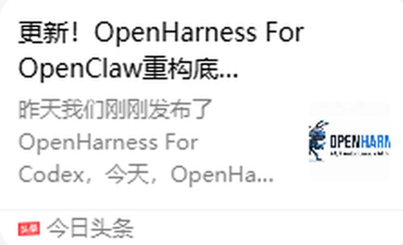
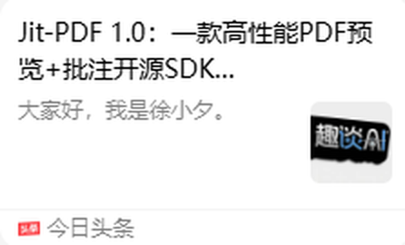

# Awesome AI · Game · Video 

> 我平时在 QQ 里给自己转发收藏的文章和视频，整理成一份清单：AI、编程开发、游戏、视频，外加 3D 与设计、量化、硬件、科普与生活。
>
> 收录 **387** 条，分享时间 **2026-03-06 ~ 2026-10-28**。每个分类下按分享日期从新到旧排列。

## 目录

- **🤖 AI**（119）：OpenClaw 与 Agent 框架（28）、Claude Code / Codex（27）、Skills 与插件（22）、AI 应用与资讯（18）、大模型与本地部署（13）、大模型与 API（11）
- **💻 编程开发**（37）：前端与 UI（16）、开发工具与开源项目（13）、数据库（5）、学习与杂谈（3）
- **🎮 游戏**（140）：AI 做游戏（43）、游戏美术与动画（30）、游戏推荐与折扣（29）、Godot 教程（23）、独立游戏开发经验（10）、Unity / 其他引擎（5）
- **🎬 视频**（34）：AI 视频生成（13）、AI 短剧 / 漫剧（11）、视频创作与工具（10）
- **🧊 3D 与设计**（31）：3D 建模 / 动捕（19）、UI 设计 / 插画（12）
- **📈 量化与投资**（8）：量化交易（7）、美股与投资（1）
- **🖥️ 硬件与系统**（10）：电脑与显卡（3）、Switch 与掌机（3）、Windows 与系统（2）、手机与数码（2）
- **🌱 科普与生活**（8）：游泳健身（3）、科普（3）、生活好物（2）

## 说明

- 来源是 QQ 聊天里从微信、B 站、知乎、小红书、今日头条等 App 转发过来的分享卡片，以及少量直接粘贴的文章链接。普通聊天、截图、文件、账号类信息都没有收录。
- QQ 分享卡片里看不到原始链接。所以带 🔍 的标题链接到对应平台的**按标题搜索**结果。带 🔗 的是聊天里贴出的原始链接。
- 摘要根据卡片上的标题和简介整理，没有逐条打开原文核实。标题由截图 OCR 识别，个别字可能有误。
- 配图优先用 QQ 里的卡片截图（缩略图已加载的情况）。缩略图没加载出来的，用自动生成的标题卡代替。

## 🤖 AI

### OpenClaw 与 Agent 框架

- 🔍 **[DeepSeek Harness 技术入门与架构原理（京东读书）](https://search.jd.com/Search?keyword=DeepSeek%20Harness%20%E6%8A%80%E6%9C%AF%E5%85%A5%E9%97%A8%E4%B8%8E%E6%9E%B6%E6%9E%84%E5%8E%9F%E7%90%86)**  
  `2026-09-14` · 京东读书  
  京东读书上的书：《DeepSeek Harness 技术入门与架构原理》，作者亦凯。  
  

- 🔗 **[DeepSeek Harness 一下子涌现出那么多插件，有没有大佬给一下推荐？](https://www.zhihu.com/question/2072103596481683649/answer/2072390857366545143)**  
  `2026-08-27` · 知乎  
  知乎问答（Kitt在进化的回答），推荐 DeepSeek Harness 的插件。  
  

- 🔗 **[腾讯开源的这个 Agent 记忆系统太强了，GitHub 已经 19.8k Star 了](https://zhuanlan.zhihu.com/p/2070864769142240693)**  
  `2026-08-27` · 知乎  
  刘聪NLP 的知乎文章，介绍腾讯开源的 Agent 记忆系统（19.8k Star）。  
  

- 🔍 **[大牛烧掉 2350 亿 Token：多智能体 3 大反常识、4 个避坑](https://so.toutiao.com/search?keyword=%E5%A4%A7%E7%89%9B%E7%83%A7%E6%8E%89%202350%20%E4%BA%BF%20Token%EF%BC%9A%E5%A4%9A%E6%99%BA%E8%83%BD%E4%BD%93%203%20%E5%A4%A7%E5%8F%8D%E5%B8%B8%E8%AF%86%E3%80%814%20)**  
  `2026-08-25` · 今日头条 · @基地说  
  多智能体实践的反常识经验和避坑建议。  
  

- 🔍 **[下一代 Agent 架构 —— Core 设计逻辑深度解析](https://search.bilibili.com/all?keyword=%E4%B8%8B%E4%B8%80%E4%BB%A3%20Agent%20%E6%9E%B6%E6%9E%84%20%E2%80%94%E2%80%94%20Core%20%E8%AE%BE%E8%AE%A1%E9%80%BB%E8%BE%91%E6%B7%B1%E5%BA%A6%E8%A7%A3%E6%9E%90)**  
  `2026-06-01` · 哔哩哔哩  
  B 站视频，深度解析下一代 Agent 架构的 Core 设计。  
  

- 🔍 **[2K Star，1MB 大小，终于有人把 Agent 监控做好了](https://so.toutiao.com/search?keyword=2K%20Star%EF%BC%8C1MB%20%E5%A4%A7%E5%B0%8F%EF%BC%8C%E7%BB%88%E4%BA%8E%E6%9C%89%E4%BA%BA%E6%8A%8A%20Agent%20%E7%9B%91%E6%8E%A7%E5%81%9A%E5%A5%BD%E4%BA%86)**  
  `2026-05-18` · 今日头条  
  介绍一个 1MB 大小、2K 星的 Agent 监控开源项目。  
  

- 🔍 **[3000 行代码的自进化 Agent，技能树越用越长](https://www.zhihu.com/search?type=content&q=3000%20%E8%A1%8C%E4%BB%A3%E7%A0%81%E7%9A%84%E8%87%AA%E8%BF%9B%E5%8C%96%20Agent%EF%BC%8C%E6%8A%80%E8%83%BD%E6%A0%91%E8%B6%8A%E7%94%A8%E8%B6%8A%E9%95%BF)**  
  `2026-05-13` · 知乎  
  介绍一个约 3000 行代码、能自我进化技能的 Agent。  
  

- 🔍 **[Agent 系统中的 Harness 设计未来会更偏向重型基础设施吗？](https://www.zhihu.com/search?type=content&q=Agent%20%E7%B3%BB%E7%BB%9F%E4%B8%AD%E7%9A%84%20Harness%20%E8%AE%BE%E8%AE%A1%E6%9C%AA%E6%9D%A5%E4%BC%9A%E6%9B%B4%E5%81%8F%E5%90%91%E9%87%8D%E5%9E%8B%E5%9F%BA%E7%A1%80%E8%AE%BE)**  
  `2026-04-16` · 知乎  
  知乎问题，讨论 Agent Harness 设计的发展方向。  
  

- 🔍 **[龙虾已死！装完 Hermes Agent 的真实感受](https://www.xiaohongshu.com/search_result?keyword=%E9%BE%99%E8%99%BE%E5%B7%B2%E6%AD%BB%EF%BC%81%E8%A3%85%E5%AE%8C%20Hermes%20Agent%20%E7%9A%84%E7%9C%9F%E5%AE%9E%E6%84%9F%E5%8F%97)**  
  `2026-04-08` · 小红书  
  开源 AI 智能体 Hermes Agent（上线不到两个月 GitHub 3 万星）的上手体验。  
  

- 🔍 **[更新！OpenHarness For OpenClaw 重构底层](https://so.toutiao.com/search?keyword=%E6%9B%B4%E6%96%B0%EF%BC%81OpenHarness%20For%20OpenClaw%20%E9%87%8D%E6%9E%84%E5%BA%95%E5%B1%82)**  
  `2026-04-03` · 今日头条  
  继 OpenHarness For Codex 之后，作者发布 OpenHarness For OpenClaw。  
  

- 🔍 **[multi-agent 系统 Harness Engineering 架构设计实践与思考](https://www.zhihu.com/search?type=content&q=multi-agent%20%E7%B3%BB%E7%BB%9F%20Harness%20Engineeri)**  
  `2026-03-22` · 知乎  
  多 Agent 系统里 Harness Engineering 架构的设计实践和思考。  
  

- 🔍 **[OpenClaw 进阶：5 只龙虾住在同一台服务器，我的多 Agent 实践](https://www.zhihu.com/search?type=content&q=OpenClaw%20%E8%BF%9B%E9%98%B6%EF%BC%9A5%20%E5%8F%AA%E9%BE%99%E8%99%BE%E4%BD%8F%E5%9C%A8%E5%90%8C%E4%B8%80%E5%8F%B0%E6%9C%8D%E5%8A%A1%E5%99%A8%EF%BC%8C%E6%88%91%E7%9A%84%E5%A4%9A%20Ag)**  
  `2026-03-22` · 知乎  
  在一台服务器上跑 5 个 OpenClaw 实例的多 Agent 实践。  
  

- 🔍 **[Agent S3 在 OSWorld 上首次超越人类水平](https://www.zhihu.com/search?type=content&q=Agent%20S3%20%E5%9C%A8%20OSWorld%20%E4%B8%8A%E9%A6%96%E6%AC%A1%E8%B6%85%E8%B6%8A%E4%BA%BA%E7%B1%BB%E6%B0%B4%E5%B9%B3)**  
  `2026-03-22` · 知乎  
  知乎文章：Agent S3 在 OSWorld 电脑操作基准上首次超过人类水平。  
  

- 🔍 **[AgentZero：15K★ 的开源 AI 智能体框架](https://www.zhihu.com/search?type=content&q=AgentZero%EF%BC%9A15K%E2%98%85%20%E7%9A%84%E5%BC%80%E6%BA%90%20AI%20%E6%99%BA%E8%83%BD%E4%BD%93%E6%A1%86%E6%9E%B6)**  
  `2026-03-19` · 知乎  
  介绍开源 AI 智能体框架 AgentZero（15K Star）。  
  

- 🔗 **[吊炸天的 OhMyOpenAgent](https://zhuanlan.zhihu.com/p/2017237304087959526)**  
  `2026-03-18` · 知乎  
  知乎作者“愿始”介绍 OhMyOpenAgent。  
  

- 🔗 **[别再一台服务器跑一个 OpenClaw 了，我教你一台跑 10 个（多智能体保姆级教程）](https://zhuanlan.zhihu.com/p/2017519479995793917)**  
  `2026-03-18` · 知乎  
  作者“猫哥AI量化”的教程：一台服务器跑 10 个 OpenClaw 实例。  
  

- 🔍 **[第 05 章：AI Agent 智能体 —— 让 AI 自主决策，循环解决问题](https://www.zhihu.com/search?type=content&q=%E7%AC%AC%2005%20%E7%AB%A0%EF%BC%9AAI%20Agent%20%E6%99%BA%E8%83%BD%E4%BD%93%20%E2%80%94%E2%80%94%20%E8%AE%A9%20AI%20%E8%87%AA%E4%B8%BB%E5%86%B3%E7%AD%96)**  
  `2026-03-17` · 知乎  
  系列教程第 5 章，讲 Agent 怎样自主决策、循环解决问题。  
  

- 🔍 **[Lightpanda：为 AI 而生的新一代浏览器](https://www.zhihu.com/search?type=content&q=Lightpanda%EF%BC%9A%E4%B8%BA%20AI%20%E8%80%8C%E7%94%9F%E7%9A%84%E6%96%B0%E4%B8%80%E4%BB%A3%E6%B5%8F%E8%A7%88%E5%99%A8)**  
  `2026-03-15` · 知乎  
  知乎文章，介绍为 AI 设计的浏览器 Lightpanda。  
  

- 🔍 **[AI 无头浏览器太快了吧！比 Chrome 快 11 倍](https://www.xiaohongshu.com/search_result?keyword=AI%20%E6%97%A0%E5%A4%B4%E6%B5%8F%E8%A7%88%E5%99%A8%E5%A4%AA%E5%BF%AB%E4%BA%86%E5%90%A7%EF%BC%81%E6%AF%94%20Chrome%20%E5%BF%AB%2011%20%E5%80%8D)**  
  `2026-03-15` · 小红书  
  介绍 Lightpanda，一款专为 AI 和自动化设计的无头浏览器。  
  

- 🔍 **[折腾了 3 周 AI Agent 浏览器自动化，我麻了](https://www.xiaohongshu.com/search_result?keyword=%E6%8A%98%E8%85%BE%E4%BA%86%203%20%E5%91%A8%20AI%20Agent%20%E6%B5%8F%E8%A7%88%E5%99%A8%E8%87%AA%E5%8A%A8%E5%8C%96%EF%BC%8C%E6%88%91%E9%BA%BB%E4%BA%86)**  
  `2026-03-15` · 小红书  
  作者折腾 3 周 AI Agent 浏览器自动化的踩坑经历和工具对比。  
  

- 🔗 **[Robotics Vibe Coding 2026（Tutorial）：新型 Robotics / 具身系统开发新范式](https://zhuanlan.zhihu.com/p/2013906538419462879)**  
  `2026-03-13` · 知乎  
  知乎作者 gurubar 的教程，讲用 vibe coding 方式开发机器人和具身智能系统。  
  

- 🔍 **[开发一个 OpenClaw 的难度大吗？](https://www.zhihu.com/search?type=content&q=%E5%BC%80%E5%8F%91%E4%B8%80%E4%B8%AA%20OpenClaw%20%E7%9A%84%E9%9A%BE%E5%BA%A6%E5%A4%A7%E5%90%97%EF%BC%9F)**  
  `2026-03-13` · 知乎  
  知乎问题，讨论自己开发一个 OpenClaw 类 Agent 有多难。  
  

- 🔍 **[OpenClaw 有哪些好用的 skill？](https://www.zhihu.com/search?type=content&q=OpenClaw%20%E6%9C%89%E5%93%AA%E4%BA%9B%E5%A5%BD%E7%94%A8%E7%9A%84%20skill%EF%BC%9F)**  
  `2026-03-13` · 知乎  
  知乎问题，收集好用的 OpenClaw skill。  
  

- 🔍 **[OpenClaw 没有 API token 可用？英伟达免费大模型…](https://so.toutiao.com/search?keyword=OpenClaw%20%E6%B2%A1%E6%9C%89%20API%20token%20%E5%8F%AF%E7%94%A8%EF%BC%9F%E8%8B%B1%E4%BC%9F%E8%BE%BE%E5%85%8D%E8%B4%B9%E5%A4%A7%E6%A8%A1)**  
  `2026-03-10` · 今日头条  
  介绍用英伟达提供的免费大模型 API 来零成本部署 OpenClaw（Telegram + 飞书双通道）。  
  

- 🔍 **[字节跳动开源了多代理框架 DeerFlow，该框架都有哪些亮点？](https://www.zhihu.com/search?type=content&q=%E5%AD%97%E8%8A%82%E8%B7%B3%E5%8A%A8%E5%BC%80%E6%BA%90%E4%BA%86%E5%A4%9A%E4%BB%A3%E7%90%86%E6%A1%86%E6%9E%B6%20DeerFlow%EF%BC%8C%E8%AF%A5%E6%A1%86%E6%9E%B6%E9%83%BD%E6%9C%89%E5%93%AA%E4%BA%9B%E4%BA%AE%E7%82%B9%EF%BC%9F)**  
  `2026-03-09` · 知乎  
  知乎问题，讨论字节开源的多 Agent 框架 DeerFlow 有哪些亮点。  
  

- 🔍 **[最近在 GitHub 摸鱼时，我被一个叫 OnlySpecs 的项目…](https://so.toutiao.com/search?keyword=%E6%9C%80%E8%BF%91%E5%9C%A8%20GitHub%20%E6%91%B8%E9%B1%BC%E6%97%B6%EF%BC%8C%E6%88%91%E8%A2%AB%E4%B8%80%E4%B8%AA%E5%8F%AB%20OnlySpecs%20%E7%9A%84)**  
  `2026-03-09` · 今日头条 · @AI那些事儿  
  微头条，介绍 GitHub 开源项目 OnlySpecs。  
  

- 🔍 **[龙虾控制 Codex 全自动开发测试](https://so.toutiao.com/search?keyword=%E9%BE%99%E8%99%BE%E6%8E%A7%E5%88%B6%20Codex%20%E5%85%A8%E8%87%AA%E5%8A%A8%E5%BC%80%E5%8F%91%E6%B5%8B%E8%AF%95)**  
  `2026-03-07` · 今日头条  
  作者实测用 OpenClaw（龙虾）驱动 Codex 自动开发和测试，环境为 Ubuntu 桌面 + Node.js 22+。  
  

- 🔍 **[（可能全网最全/长的）2万字 OpenClaw 保姆教程](https://www.zhihu.com/search?type=content&q=%EF%BC%88%E5%8F%AF%E8%83%BD%E5%85%A8%E7%BD%91%E6%9C%80%E5%85%A8/%E9%95%BF%E7%9A%84%EF%BC%892%E4%B8%87%E5%AD%97%20OpenClaw%20%E4%BF%9D%E5%A7%86%E6%95%99%E7%A8%8B)**  
  `2026-03-06` · 知乎  
  一篇约 2 万字的 OpenClaw 从安装到使用的保姆级教程。  
  

### Claude Code / Codex

- 🔍 **[不要再用对话管理 Codex 了，我开发了一个任务管理看板](https://so.toutiao.com/search?keyword=%E4%B8%8D%E8%A6%81%E5%86%8D%E7%94%A8%E5%AF%B9%E8%AF%9D%E7%AE%A1%E7%90%86%20Codex%20%E4%BA%86%EF%BC%8C%E6%88%91%E5%BC%80%E5%8F%91%E4%BA%86%E4%B8%80%E4%B8%AA%E4%BB%BB%E5%8A%A1%E7%AE%A1%E7%90%86%E7%9C%8B%E6%9D%BF)**  
  `2026-08-05` · 今日头条 · @AI工具分享站  
  作者开发的 Codex 任务管理看板。  
  

- 🔍 **[Codex 又整活了：sol-advisor](https://so.toutiao.com/search?keyword=Codex%20%E5%8F%88%E6%95%B4%E6%B4%BB%E4%BA%86%EF%BC%9Asol-advisor)**  
  `2026-08-03` · 今日头条 · @慧视A迹  
  微头条，介绍 Codex 的 sol-advisor 玩法。  
  

- 🔍 **[Codex 省额度教程：Sol 主控，Luna 干活](https://so.toutiao.com/search?keyword=Codex%20%E7%9C%81%E9%A2%9D%E5%BA%A6%E6%95%99%E7%A8%8B%EF%BC%9ASol%20%E4%B8%BB%E6%8E%A7%EF%BC%8CLuna%20%E5%B9%B2%E6%B4%BB)**  
  `2026-08-03` · 今日头条  
  Luna 降价 80% 后，用 Sol 主控、Luna 干活来节省 Codex 额度（面向 ChatGPT Plus 用户）。  
  

- 🔍 **[Codex 开启 Luna Subagent](https://www.xiaohongshu.com/search_result?keyword=Codex%20%E5%BC%80%E5%90%AF%20Luna%20Subagent)**  
  `2026-08-02` · 小红书  
  讲给 Codex 配低价 Luna 模型做 subagent，额度消耗低。  
  

- 🔍 **[指哪改哪！Codex 最新无限画布插件](https://www.xiaohongshu.com/search_result?keyword=%E6%8C%87%E5%93%AA%E6%94%B9%E5%93%AA%EF%BC%81Codex%20%E6%9C%80%E6%96%B0%E6%97%A0%E9%99%90%E7%94%BB%E5%B8%83%E6%8F%92%E4%BB%B6)**  
  `2026-07-25` · 小红书  
  介绍 Codex 的无限画布插件。  
  

- 🔍 **[Codex 并行度起飞：配置解锁并行上限和深度上限](https://www.xiaohongshu.com/search_result?keyword=Codex%20%E5%B9%B6%E8%A1%8C%E5%BA%A6%E8%B5%B7%E9%A3%9E%EF%BC%9A%E9%85%8D%E7%BD%AE%E8%A7%A3%E9%94%81%E5%B9%B6%E8%A1%8C%E4%B8%8A%E9%99%90%E5%92%8C%E6%B7%B1%E5%BA%A6%E4%B8%8A%E9%99%90)**  
  `2026-07-18` · 小红书  
  讲怎样配置 Codex 的并行和 subagent 上限。  
  

- 🔍 **[搞定了！任意模型接入 Claude Desktop](https://so.toutiao.com/search?keyword=%E6%90%9E%E5%AE%9A%E4%BA%86%EF%BC%81%E4%BB%BB%E6%84%8F%E6%A8%A1%E5%9E%8B%E6%8E%A5%E5%85%A5%20Claude%20Desktop)**  
  `2026-05-20` · 今日头条  
  讲怎样把 DeepSeek V4 等任意模型接入 Claude Desktop。  
  

- 🔍 **[Codex 需要手机号验证？一招教你破局！](https://so.toutiao.com/search?keyword=Codex%20%E9%9C%80%E8%A6%81%E6%89%8B%E6%9C%BA%E5%8F%B7%E9%AA%8C%E8%AF%81%EF%BC%9F%E4%B8%80%E6%8B%9B%E6%95%99%E4%BD%A0%E7%A0%B4%E5%B1%80%EF%BC%81)**  
  `2026-05-09` · 今日头条  
  讲 Codex 要求手机号验证的原因和应对办法。  
  

- 🔍 **[第八篇：你的终端里跑着一个 React 应用：Claude Code 的…](https://www.zhihu.com/search?type=content&q=%E7%AC%AC%E5%85%AB%E7%AF%87%EF%BC%9A%E4%BD%A0%E7%9A%84%E7%BB%88%E7%AB%AF%E9%87%8C%E8%B7%91%E7%9D%80%E4%B8%80%E4%B8%AA%20React%20%E5%BA%94%E7%94%A8%EF%BC%9AClaude%20Co)**  
  `2026-04-21` · 知乎  
  系列第 8 篇，讲 Claude Code 终端界面基于 React（Ink）的实现。  
  

- 🔍 **[Claude Code 的终端 UI 是怎么画出来的](https://so.toutiao.com/search?keyword=Claude%20Code%20%E7%9A%84%E7%BB%88%E7%AB%AF%20UI%20%E6%98%AF%E6%80%8E%E4%B9%88%E7%94%BB%E5%87%BA%E6%9D%A5%E7%9A%84)**  
  `2026-04-11` · 今日头条  
  分析 Claude Code 精致的终端界面是怎么实现的。  
  

- 🔍 **[别再纠结 AI 编程用什么框架了，这 3 个项目直接上手](https://so.toutiao.com/search?keyword=%E5%88%AB%E5%86%8D%E7%BA%A0%E7%BB%93%20AI%20%E7%BC%96%E7%A8%8B%E7%94%A8%E4%BB%80%E4%B9%88%E6%A1%86%E6%9E%B6%E4%BA%86%EF%BC%8C%E8%BF%99%203%20%E4%B8%AA%E9%A1%B9%E7%9B%AE%E7%9B%B4%E6%8E%A5%E4%B8%8A%E6%89%8B)**  
  `2026-04-10` · 今日头条  
  推荐 3 个 AI 编程开源项目，并和 Cursor、Windsurf 等对比。  
  

- 🔍 **[Claude Code 泄露源码阅读笔记（3）——读它的 prompt](https://search.bilibili.com/all?keyword=Claude%20Code%20%E6%B3%84%E9%9C%B2%E6%BA%90%E7%A0%81%E9%98%85%E8%AF%BB%E7%AC%94%E8%AE%B0%EF%BC%883%EF%BC%89%E2%80%94%E2%80%94%E8%AF%BB%E5%AE%83%E7%9A%84%20pro)**  
  `2026-04-08` · 哔哩哔哩  
  B 站视频，系列第 3 篇，读泄露的 Claude Code 里的 prompt 设计。  
  

- 🔍 **[Claude Code 记忆系统架构分析](https://so.toutiao.com/search?keyword=Claude%20Code%20%E8%AE%B0%E5%BF%86%E7%B3%BB%E7%BB%9F%E6%9E%B6%E6%9E%84%E5%88%86%E6%9E%90)**  
  `2026-04-07` · 今日头条  
  分析 Claude Code 基于文件的持久化记忆系统架构。  
  

- 🔍 **[冠军大神开源 vibecoding 工作流，已 11 万星标](https://www.xiaohongshu.com/search_result?keyword=%E5%86%A0%E5%86%9B%E5%A4%A7%E7%A5%9E%E5%BC%80%E6%BA%90%20vibecoding%20%E5%B7%A5%E4%BD%9C%E6%B5%81%EF%BC%8C%E5%B7%B2%2011%20%E4%B8%87%E6%98%9F%E6%A0%87)**  
  `2026-04-04` · 小红书  
  介绍一个 11 万星的开源 vibecoding / Claude Code 工作流。  
  

- 🔍 **[技术团队引入 AI 编程工具后，你们用什么方法保证代码质量？](https://www.zhihu.com/search?type=content&q=%E6%8A%80%E6%9C%AF%E5%9B%A2%E9%98%9F%E5%BC%95%E5%85%A5%20AI%20%E7%BC%96%E7%A8%8B%E5%B7%A5%E5%85%B7%E5%90%8E%EF%BC%8C%E4%BD%A0%E4%BB%AC%E7%94%A8%E4%BB%80%E4%B9%88%E6%96%B9%E6%B3%95%E4%BF%9D%E8%AF%81%E4%BB%A3%E7%A0%81%E8%B4%A8%E9%87%8F%EF%BC%9F)**  
  `2026-04-01` · 知乎  
  知乎问题，讨论团队用 AI 编程后怎样保证代码质量。  
  

- 🔍 **[Claude Code 大泄露：别光 Clone 了，当今最顶 Harness 开发](https://www.zhihu.com/search?type=content&q=Claude%20Code%20%E5%A4%A7%E6%B3%84%E9%9C%B2%EF%BC%9A%E5%88%AB%E5%85%89%20Clone%20%E4%BA%86%EF%BC%8C%E5%BD%93%E4%BB%8A%E6%9C%80%E9%A1%B6%20)**  
  `2026-04-01` · 知乎  
  借泄露的 Claude Code 源码，分析它的 Harness 设计。  
  

- 🔍 **[一套 Hooks 让它自己验收自己：Harness Engineering 实战](https://so.toutiao.com/search?keyword=%E4%B8%80%E5%A5%97%20Hooks%20%E8%AE%A9%E5%AE%83%E8%87%AA%E5%B7%B1%E9%AA%8C%E6%94%B6%E8%87%AA%E5%B7%B1%EF%BC%9AHarness%20Engine)**  
  `2026-04-01` · 今日头条  
  “驾驭工程实战”系列第二篇，讲用 Hooks 让 AI 编程助手自己验收产出。  
  

- 🔍 **[编程 Agent 核心就几十行代码，那剩下的几万行在干什么？](https://www.zhihu.com/search?type=content&q=%E7%BC%96%E7%A8%8B%20Agent%20%E6%A0%B8%E5%BF%83%E5%B0%B1%E5%87%A0%E5%8D%81%E8%A1%8C%E4%BB%A3%E7%A0%81%EF%BC%8C%E9%82%A3%E5%89%A9%E4%B8%8B%E7%9A%84%E5%87%A0%E4%B8%87%E8%A1%8C%E5%9C%A8%E5%B9%B2%E4%BB%80%E4%B9%88%EF%BC%9F)**  
  `2026-03-30` · 知乎  
  知乎讨论：编程 Agent 的核心循环很短，剩下的工程量都花在哪里。  
  

- 🔍 **[【万字预警】史上最详细 Codex Compact 源码解读](https://www.zhihu.com/search?type=content&q=%E3%80%90%E4%B8%87%E5%AD%97%E9%A2%84%E8%AD%A6%E3%80%91%E5%8F%B2%E4%B8%8A%E6%9C%80%E8%AF%A6%E7%BB%86%20Codex%20Compact%20%E6%BA%90%E7%A0%81%E8%A7%A3%E8%AF%BB)**  
  `2026-03-26` · 知乎  
  万字长文，解读 Codex 上下文压缩（Compact）的源码实现。  
  

- 🔍 **[everything-claude-code：Anthropic 黑客松冠军的配置集](https://so.toutiao.com/search?keyword=everything-claude-code%EF%BC%9AAnthropic)**  
  `2026-03-26` · 今日头条 · @编程进阶社  
  微头条，介绍 everything-claude-code 配置/资源合集。  
  

- 🔗 **[sorrycc's blog：Claude Code 相关文章](https://blog.sorrycc.com)**  
  `2026-03-26` · 今日头条  
  sorrycc 博客里关于 Claude Code 的文章（链接为分享时的博客地址）。  
  

- 🔍 **[learn-claude-code：从零写一个 Coding Agent](https://www.zhihu.com/search?type=content&q=learn-claude-code%EF%BC%9A%E4%BB%8E%E9%9B%B6%E5%86%99%E4%B8%80%E4%B8%AA%20Coding%20A)**  
  `2026-03-22` · 知乎  
  开源教程 learn-claude-code，从零实现一个类 Claude Code 的编程 Agent。  
  

- 🔍 **[如何学习 Claude Code 的构建](https://www.zhihu.com/search?type=content&q=%E5%A6%82%E4%BD%95%E5%AD%A6%E4%B9%A0%20Claude%20Code%20%E7%9A%84%E6%9E%84%E5%BB%BA)**  
  `2026-03-15` · 知乎  
  知乎文章，讲 Claude Code 的内部构建思路和学习路径。  
  

- 🔍 **[彻底杜绝代码幻觉](https://www.xiaohongshu.com/search_result?keyword=%E5%BD%BB%E5%BA%95%E6%9D%9C%E7%BB%9D%E4%BB%A3%E7%A0%81%E5%B9%BB%E8%A7%89)**  
  `2026-03-15` · 小红书  
  小红书笔记，讲怎样减少 AI 编程里的代码幻觉（OCR 标题不完整）。  
  

- 🔍 **[Kiro 里的 Claude 是直连的](https://www.xiaohongshu.com/search_result?keyword=Kiro%20%E9%87%8C%E7%9A%84%20Claude%20%E6%98%AF%E7%9B%B4%E8%BF%9E%E7%9A%84)**  
  `2026-03-12` · 小红书  
  笔记说 Kiro 里的 Claude 是直连的，多账号容易被封，并推荐一个能用本地环境的开源方案。  
  

- 🔍 **[ClawUI 开源神器：解决 Claude 多端会话混乱](https://so.toutiao.com/search?keyword=ClawUI%20%E5%BC%80%E6%BA%90%E7%A5%9E%E5%99%A8%EF%BC%9A%E8%A7%A3%E5%86%B3%20Claude%20%E5%A4%9A%E7%AB%AF%E4%BC%9A%E8%AF%9D%E6%B7%B7%E4%B9%B1)**  
  `2026-03-09` · 今日头条  
  开源工具 ClawUI，用来解决 Claude 在多个终端（tmux 窗口、多种渠道）下会话混乱的问题。  
  

- 🔍 **[oh-my-claudecode 全面解析：一个插件让 Claude Code 变身…](https://search.bilibili.com/all?keyword=oh-my-claudecode%20%E5%85%A8%E9%9D%A2%E8%A7%A3%E6%9E%90%EF%BC%9A%E4%B8%80%E4%B8%AA%E6%8F%92%E4%BB%B6%E8%AE%A9%20Clau)**  
  `2026-03-06` · 哔哩哔哩  
  介绍 oh-my-claudecode 插件，以及它怎样增强 Claude Code。  
  

### Skills 与插件

- 🔍 **[把这个 Skill 喂给 Astra，直接解锁 Three.js 能力](https://www.xiaohongshu.com/search_result?keyword=%E6%8A%8A%E8%BF%99%E4%B8%AA%20Skill%20%E5%96%82%E7%BB%99%20Astra%EF%BC%8C%E7%9B%B4%E6%8E%A5%E8%A7%A3%E9%94%81%20Three.js)**  
  `2026-09-11` · 小红书  
  一个让 GPT-6 Astra 掌握 Three.js 的 Skill。  
  

- 🔍 **[从夯到拉，锐评 8 个热门游戏制作 Skill](https://www.xiaohongshu.com/search_result?keyword=%E4%BB%8E%E5%A4%AF%E5%88%B0%E6%8B%89%EF%BC%8C%E9%94%90%E8%AF%84%208%20%E4%B8%AA%E7%83%AD%E9%97%A8%E6%B8%B8%E6%88%8F%E5%88%B6%E4%BD%9C%20Skill)**  
  `2026-08-13` · 小红书  
  点评 8 个让 Codex 做游戏的热门 Skill。  
  

- 🔍 **[一个 skill 搞定资产图](https://www.xiaohongshu.com/search_result?keyword=%E4%B8%80%E4%B8%AA%20skill%20%E6%90%9E%E5%AE%9A%E8%B5%84%E4%BA%A7%E5%9B%BE)**  
  `2026-07-31` · 小红书  
  一个用来保证 AI 影片图像资产风格和人物一致的 skill。  
  

- 🔍 **[这个 Skill 真的神了（网页效果）](https://so.toutiao.com/search?keyword=%E8%BF%99%E4%B8%AA%20Skill%20%E7%9C%9F%E7%9A%84%E7%A5%9E%E4%BA%86)**  
  `2026-07-18` · 今日头条 · @AI建站创意站  
  短视频推荐一个生成网页效果的 Skill。  
  

- 🔍 **[Codex 最值得抄的 7 套 Skill 配方](https://so.toutiao.com/search?keyword=Codex%20%E6%9C%80%E5%80%BC%E5%BE%97%E6%8A%84%E7%9A%84%207%20%E5%A5%97%20Skill%20%E9%85%8D%E6%96%B9)**  
  `2026-06-04` · 今日头条 · @编程充电站  
  微头条，推荐 7 套值得借鉴的 Codex Skill 配置。  
  

- 🔍 **[AI 驱动的大屏自动化生成实践](https://www.xiaohongshu.com/search_result?keyword=AI%20%E9%A9%B1%E5%8A%A8%E7%9A%84%E5%A4%A7%E5%B1%8F%E8%87%AA%E5%8A%A8%E5%8C%96%E7%94%9F%E6%88%90%E5%AE%9E%E8%B7%B5)**  
  `2026-05-31` · 小红书  
  一张需求描述，用 Skills 自动做出数据大屏。  
  

- 🔍 **[地表最强动画库放大招！GSAP Skills 让 AI 生成电影级动画](https://www.xiaohongshu.com/search_result?keyword=%E5%9C%B0%E8%A1%A8%E6%9C%80%E5%BC%BA%E5%8A%A8%E7%94%BB%E5%BA%93%E6%94%BE%E5%A4%A7%E6%8B%9B%EF%BC%81GSAP%20Skills%20%E8%AE%A9%20AI%20%E7%94%9F%E6%88%90%E7%94%B5%E5%BD%B1)**  
  `2026-05-31` · 小红书  
  GSAP Skills 让 AI 生成电影级的网页动画代码。  
  

- 🔍 **[Impeccable：前端界面设计非常好用的 skill](https://so.toutiao.com/search?keyword=Impeccable%EF%BC%9A%E5%89%8D%E7%AB%AF%E7%95%8C%E9%9D%A2%E8%AE%BE%E8%AE%A1%E9%9D%9E%E5%B8%B8%E5%A5%BD%E7%94%A8%E7%9A%84%20skill)**  
  `2026-05-29` · 今日头条  
  介绍 Claude Code 的前端界面设计 skill Impeccable。  
  

- 🔗 **[构建 Skills 的完整指南：官方指南精华 + 5 个模式详解](https://zhuanlan.zhihu.com/p/2015213930868397522)**  
  `2026-05-28` · 知乎  
  作者 Simon Wong 总结官方 Skills 构建指南，并详解 5 种模式。  
  

- 🔍 **[帮你拿捏前端动画的开源 skill 它来了](https://www.xiaohongshu.com/search_result?keyword=%E5%B8%AE%E4%BD%A0%E6%8B%BF%E6%8D%8F%E5%89%8D%E7%AB%AF%E5%8A%A8%E7%94%BB%E7%9A%84%E5%BC%80%E6%BA%90%20skill%20%E5%AE%83%E6%9D%A5%E4%BA%86)**  
  `2026-05-28` · 小红书  
  推荐一个前端动效设计用的开源 skill。  
  

- 🔍 **[你写的 Skill，正在拖慢模型？策略式 Gene 才是正确答案](https://so.toutiao.com/search?keyword=%E4%BD%A0%E5%86%99%E7%9A%84%20Skill%EF%BC%8C%E6%AD%A3%E5%9C%A8%E6%8B%96%E6%85%A2%E6%A8%A1%E5%9E%8B%EF%BC%9F%E7%AD%96%E7%95%A5%E5%BC%8F%20Gene%20%E6%89%8D%E6%98%AF%E6%AD%A3%E7%A1%AE%E7%AD%94%E6%A1%88)**  
  `2026-05-28` · 今日头条  
  解读论文（45 个科学代码场景、4590 次试验）：Skill 写法对模型表现的影响。  
  

- 🔍 **[Claude Code 安装 Superpowers 后代码通过率飙升](https://so.toutiao.com/search?keyword=Claude%20Code%20%E5%AE%89%E8%A3%85%20Superpowers%20%E5%90%8E%E4%BB%A3%E7%A0%81%E9%80%9A%E8%BF%87)**  
  `2026-05-19` · 今日头条  
  文章称装了 Superpowers 插件后，代码通过率从 58% 升到 91%。  
  

- 🔗 **[superpowers 目前 skills/ 目录下 14 个 skills 的逐个解读](https://zhuanlan.zhihu.com/p/2039313824822636897)**  
  `2026-05-18` · 知乎  
  作者“猫咪不吃鱼”逐个解读 Superpowers 里的 14 个 skills。  
  

- 🔍 **[2026 年 Claude Code 最值得安装的 Skills 和 MCP](https://so.toutiao.com/search?keyword=2026%20%E5%B9%B4%20Claude%20Code%20%E6%9C%80%E5%80%BC%E5%BE%97%E5%AE%89%E8%A3%85%E7%9A%84%20Skills)**  
  `2026-05-13` · 今日头条  
  汇总官方认证、社区高星、日常高频实用的 Claude Code Skills 和 MCP。  
  

- 🔍 **[Skills：前端设计双雄 —— TRAE SOLO 前端设计双雄](https://www.xiaohongshu.com/search_result?keyword=Skills%EF%BC%9A%E5%89%8D%E7%AB%AF%E8%AE%BE%E8%AE%A1%E5%8F%8C%E9%9B%84%20%E2%80%94%E2%80%94%20TRAE%20SOLO%20%E5%89%8D%E7%AB%AF%E8%AE%BE%E8%AE%A1%E5%8F%8C)**  
  `2026-04-26` · 小红书  
  介绍 frontend-design 和 ui-ux 两个前端设计 Skills（TRAE SOLO 下使用）。  
  

- 🔍 **[一个被严重低估的 Skills：Superpowers](https://search.bilibili.com/all?keyword=%E4%B8%80%E4%B8%AA%E8%A2%AB%E4%B8%A5%E9%87%8D%E4%BD%8E%E4%BC%B0%E7%9A%84%20Skills%EF%BC%9ASuperpowers)**  
  `2026-04-20` · 哔哩哔哩  
  B 站视频，介绍 Superpowers skills 合集。  
  

- 🔍 **[AutoSkill：让你的 skills 越用越聪明](https://www.zhihu.com/search?type=content&q=AutoSkill%EF%BC%9A%E8%AE%A9%E4%BD%A0%E7%9A%84%20skills%20%E8%B6%8A%E7%94%A8%E8%B6%8A%E8%81%AA%E6%98%8E)**  
  `2026-03-23` · 知乎  
  介绍 AutoSkill，让 Agent 的 skills 在使用中自我改进。  
  

- 🔍 **[全网独家：前端 Skills 效果评测](https://www.xiaohongshu.com/search_result?keyword=%E5%85%A8%E7%BD%91%E7%8B%AC%E5%AE%B6%EF%BC%9A%E5%89%8D%E7%AB%AF%20Skills%20%E6%95%88%E6%9E%9C%E8%AF%84%E6%B5%8B)**  
  `2026-03-18` · 小红书  
  作者把 GitHub 上星数最高的 5 个前端 AI Skills 拿来对比评测。  
  

- 🔍 **[用这个 Skill 提升产品 UI 设计：Impeccable](https://www.xiaohongshu.com/search_result?keyword=%E7%94%A8%E8%BF%99%E4%B8%AA%20Skill%20%E6%8F%90%E5%8D%87%E4%BA%A7%E5%93%81%20UI%20%E8%AE%BE%E8%AE%A1%EF%BC%9AImpeccable)**  
  `2026-03-18` · 小红书  
  Impeccable 是一个给 Cursor、Claude 等 AI 编程助手用的 UI 设计 Skill。  
  

- 🔗 **[你们有哪些好的 Claude Code skills 推荐？](https://www.zhihu.com/question/2016657901549266060/answer/2017238236225906423)**  
  `2026-03-17` · 知乎  
  知乎问答（一直很懒的小强的回答），推荐 Claude Code skills。  
  

- 🔍 **[Claude Code 必装插件，从此告别查限额强迫症](https://www.xiaohongshu.com/search_result?keyword=Claude%20Code%20%E5%BF%85%E8%A3%85%E6%8F%92%E4%BB%B6%EF%BC%8C%E4%BB%8E%E6%AD%A4%E5%91%8A%E5%88%AB%E6%9F%A5%E9%99%90%E9%A2%9D%E5%BC%BA%E8%BF%AB%E7%97%87)**  
  `2026-03-16` · 小红书  
  推荐 Claude HUD，一个 GitHub 4000+ 星的 Claude Code 状态栏插件，可以看到额度用量。  
  

- 🔗 **[如何自动重构代码：Claude Code 官方开源插件 code-simplifier](https://zhuanlan.zhihu.com/p/2014823009173648932)**  
  `2026-03-13` · 知乎  
  知乎作者 xnliu 介绍 Claude Code 官方开源的代码简化/重构插件 code-simplifier。  
  

### AI 应用与资讯

- 🔗 **[知乎文章：CarRacing 强化学习](https://zhuanlan.zhihu.com/p/2098786531209121942)**  
  `2026-10-28` · 知乎  
  分享了一篇讲 CarRacing 强化学习的知乎文章（标题按聊天截图记录，内容未核实）。  
  

- 🔍 **[三个男生运营着一个 AI 言情世界，250 万日活](https://so.toutiao.com/search?keyword=%E4%B8%89%E4%B8%AA%E7%94%B7%E7%94%9F%E8%BF%90%E8%90%A5%E7%9D%80%E4%B8%80%E4%B8%AA%20AI%20%E8%A8%80%E6%83%85%E4%B8%96%E7%95%8C%EF%BC%8C250%20%E4%B8%87%E6%97%A5%E6%B4%BB)**  
  `2026-09-09` · 今日头条  
  JanitorAI 的故事：三个人运营的 AI 角色平台，日活 250 万。  
  

- 🔍 **[腾讯 WorldClaw：AI 自动造世界](https://www.xiaohongshu.com/search_result?keyword=%E8%85%BE%E8%AE%AF%20WorldClaw%EF%BC%9AAI%20%E8%87%AA%E5%8A%A8%E9%80%A0%E4%B8%96%E7%95%8C)**  
  `2026-08-12` · 小红书  
  腾讯混元的 WorldClaw 项目：AI 自动构建世界。  
  

- 🔍 **[一句话部署本地语音智能体](https://so.toutiao.com/search?keyword=%E4%B8%80%E5%8F%A5%E8%AF%9D%E9%83%A8%E7%BD%B2%E6%9C%AC%E5%9C%B0%E8%AF%AD%E9%9F%B3%E6%99%BA%E8%83%BD%E4%BD%93)**  
  `2026-08-08` · 今日头条 · @量子位  
  量子位：一个开源两年的语音项目可以一句话部署本地语音智能体。  
  

- 🔍 **[更新了一下额度显示插件，现在支持 Kimi 了](https://www.xiaohongshu.com/search_result?keyword=%E6%9B%B4%E6%96%B0%E4%BA%86%E4%B8%80%E4%B8%8B%E9%A2%9D%E5%BA%A6%E6%98%BE%E7%A4%BA%E6%8F%92%E4%BB%B6%EF%BC%8C%E7%8E%B0%E5%9C%A8%E6%94%AF%E6%8C%81%20Kimi%20%E4%BA%86)**  
  `2026-08-07` · 小红书  
  AI 额度显示插件更新，新增 Kimi 支持。  
  

- 🔍 **[实时监控 28 款 AI 工具用量/额度、记录订阅信息](https://www.xiaohongshu.com/search_result?keyword=%E5%AE%9E%E6%97%B6%E7%9B%91%E6%8E%A7%2028%20%E6%AC%BE%20AI%20%E5%B7%A5%E5%85%B7%E7%94%A8%E9%87%8F/%E9%A2%9D%E5%BA%A6%E3%80%81%E8%AE%B0%E5%BD%95%E8%AE%A2%E9%98%85%E4%BF%A1%E6%81%AF)**  
  `2026-08-07` · 小红书  
  一个监控 28 款 AI 工具额度和订阅的工具。  
  

- 🔍 **[Kimi 的神级 PPT 排版，被大佬开源免费玩了](https://www.xiaohongshu.com/search_result?keyword=Kimi%20%E7%9A%84%E7%A5%9E%E7%BA%A7%20PPT%20%E6%8E%92%E7%89%88%EF%BC%8C%E8%A2%AB%E5%A4%A7%E4%BD%AC%E5%BC%80%E6%BA%90%E5%85%8D%E8%B4%B9%E7%8E%A9%E4%BA%86)**  
  `2026-08-06` · 小红书  
  开源复刻 Kimi PPT 排版能力的项目。  
  

- 🔍 **[逆向工程，这是一门扒人底裤的事，现在居然被人…](https://so.toutiao.com/search?keyword=%E9%80%86%E5%90%91%E5%B7%A5%E7%A8%8B%EF%BC%8C%E8%BF%99%E6%98%AF%E4%B8%80%E9%97%A8%E6%89%92%E4%BA%BA%E5%BA%95%E8%A3%A4%E7%9A%84%E4%BA%8B%EF%BC%8C%E7%8E%B0%E5%9C%A8%E5%B1%85%E7%84%B6%E8%A2%AB%E4%BA%BA%E2%80%A6)**  
  `2026-08-06` · 今日头条 · @敬合Al解构师  
  微头条，讲 AI 辅助逆向工程。  
  

- 🔍 **[现实版“猫咪宝可梦”！流浪猫秒变 SSR 卡](https://www.xiaohongshu.com/search_result?keyword=%E7%8E%B0%E5%AE%9E%E7%89%88%E2%80%9C%E7%8C%AB%E5%92%AA%E5%AE%9D%E5%8F%AF%E6%A2%A6%E2%80%9D%EF%BC%81%E6%B5%81%E6%B5%AA%E7%8C%AB%E7%A7%92%E5%8F%98%20SSR%20%E5%8D%A1)**  
  `2026-07-30` · 小红书  
  vibe coding 做的应用：把流浪猫照片变成收集卡。  
  

- 🔍 **[GPT Image 2 神级提示词！GitHub 开源](https://so.toutiao.com/search?keyword=GPT%20Image%202%20%E7%A5%9E%E7%BA%A7%E6%8F%90%E7%A4%BA%E8%AF%8D%EF%BC%81GitHub%20%E5%BC%80%E6%BA%90)**  
  `2026-07-30` · 今日头条 · @Al设计创意工坊  
  短视频：GitHub 开源的 GPT Image 2 提示词合集。  
  

- 🔗 **[知乎文章（标题未识别）](https://zhuanlan.zhihu.com/p/1922216938827932958)**  
  `2026-07-14` · 知乎  
  仅分享了链接，QQ 里没有标题，内容未核实。  
  

- 🔍 **[最近律师圈这套王炸组合火了](https://so.toutiao.com/search?keyword=%E6%9C%80%E8%BF%91%E5%BE%8B%E5%B8%88%E5%9C%88%E8%BF%99%E5%A5%97%E7%8E%8B%E7%82%B8%E7%BB%84%E5%90%88%E7%81%AB%E4%BA%86)**  
  `2026-07-14` · 今日头条 · @小可妈妈母婴  
  短视频介绍律师群体常用的 AI 工具组合。  
  

- 🔍 **[离职后，我花了 720 小时、数十亿 token，给桌面造了…](https://search.bilibili.com/all?keyword=%E7%A6%BB%E8%81%8C%E5%90%8E%EF%BC%8C%E6%88%91%E8%8A%B1%E4%BA%86%20720%20%E5%B0%8F%E6%97%B6%E3%80%81%E6%95%B0%E5%8D%81%E4%BA%BF%20token%EF%BC%8C%E7%BB%99%E6%A1%8C%E9%9D%A2%E9%80%A0%E4%BA%86%E2%80%A6)**  
  `2026-07-07` · 哔哩哔哩  
  作者离职后花 720 小时用 AI 打造的桌面应用。  
  

- 🔍 **[剑指 Midjourney 审美，直逼 Z-Image 速度：Krea-2 开源](https://so.toutiao.com/search?keyword=%E5%89%91%E6%8C%87%20Midjourney%20%E5%AE%A1%E7%BE%8E%EF%BC%8C%E7%9B%B4%E9%80%BC%20Z-Image%20%E9%80%9F%E5%BA%A6%EF%BC%9AK)**  
  `2026-07-07` · 今日头条  
  文生图模型 Krea-2 在 Hugging Face 开源。  
  

- 🔍 **[不冲会员的 AI 聚合站太香了](https://www.xiaohongshu.com/search_result?keyword=%E4%B8%8D%E5%86%B2%E4%BC%9A%E5%91%98%E7%9A%84%20AI%20%E8%81%9A%E5%90%88%E7%AB%99%E5%A4%AA%E9%A6%99%E4%BA%86)**  
  `2026-07-05` · 小红书  
  一个不需要会员就能 AI 出图、AI 视频的聚合站（来源未核实）。  
  

- 🔍 **[做 AI 视觉的人，不知道这个开源项目真的亏大了](https://so.toutiao.com/search?keyword=%E5%81%9A%20AI%20%E8%A7%86%E8%A7%89%E7%9A%84%E4%BA%BA%EF%BC%8C%E4%B8%8D%E7%9F%A5%E9%81%93%E8%BF%99%E4%B8%AA%E5%BC%80%E6%BA%90%E9%A1%B9%E7%9B%AE%E7%9C%9F%E7%9A%84%E4%BA%8F%E5%A4%A7%E4%BA%86)**  
  `2026-07-05` · 今日头条  
  推荐一个 AI 视觉开源项目，避免重复造轮子。  
  

- 🔍 **[OpenAI 官宣：免费送 6 个月 ChatGPT Pro](https://so.toutiao.com/search?keyword=OpenAI%20%E5%AE%98%E5%AE%A3%EF%BC%9A%E5%85%8D%E8%B4%B9%E9%80%81%206%20%E4%B8%AA%E6%9C%88%20ChatGPT%20Pro)**  
  `2026-06-14` · 今日头条  
  资讯：OpenAI 的 ChatGPT Pro 免费 6 个月活动。  
  

- 🔍 **[Codex + image2 是做 PPT 的最佳组合](https://so.toutiao.com/search?keyword=Codex%20%2B%20image2%20%E6%98%AF%E5%81%9A%20PPT%20%E7%9A%84%E6%9C%80%E4%BD%B3%E7%BB%84%E5%90%88)**  
  `2026-06-04` · 今日头条 · @PPTAI创意站  
  演示用 Codex 加图像模型自动做 PPT。  
  

### 大模型与本地部署

- 🔍 **[DeepSeek 552B，4090 能跑](https://so.toutiao.com/search?keyword=DeepSeek%20552B%EF%BC%8C4090%20%E8%83%BD%E8%B7%91)**  
  `2026-10-22` · 今日头条  
  单张 RTX 4090（24GB）运行 DeepSeek 552B 的实测。  
  

- 🔍 **[Jev 刚火两天，开源复现就来了：一个 9B，一个 0.5B](https://so.toutiao.com/search?keyword=Jev%20%E5%88%9A%E7%81%AB%E4%B8%A4%E5%A4%A9%EF%BC%8C%E5%BC%80%E6%BA%90%E5%A4%8D%E7%8E%B0%E5%B0%B1%E6%9D%A5%E4%BA%86%EF%BC%9A%E4%B8%80%E4%B8%AA%209B%EF%BC%8C%E4%B8%80%E4%B8%AA%200.5B)**  
  `2026-09-22` · 今日头条  
  Jev 爆火后的开源复现版本（9B 和 0.5B）。  
  

- 🔍 **[24G 显存就能部署大模型｜5090 感觉还要涨价](https://www.xiaohongshu.com/search_result?keyword=24G%20%E6%98%BE%E5%AD%98%E5%B0%B1%E8%83%BD%E9%83%A8%E7%BD%B2%E5%A4%A7%E6%A8%A1%E5%9E%8B%EF%BD%9C5090%20%E6%84%9F%E8%A7%89%E8%BF%98%E8%A6%81%E6%B6%A8%E4%BB%B7)**  
  `2026-08-12` · 小红书  
  在 24G 显存上本地部署开源大模型。  
  

- 🔍 **[入门 LLM 的绝佳教程，训练出专属你的小模型](https://www.xiaohongshu.com/search_result?keyword=%E5%85%A5%E9%97%A8%20LLM%20%E7%9A%84%E7%BB%9D%E4%BD%B3%E6%95%99%E7%A8%8B%EF%BC%8C%E8%AE%AD%E7%BB%83%E5%87%BA%E4%B8%93%E5%B1%9E%E4%BD%A0%E7%9A%84%E5%B0%8F%E6%A8%A1%E5%9E%8B)**  
  `2026-06-12` · 小红书  
  推荐 GitHub 上从零训练小型大语言模型的教程。  
  

- 🔍 **[Qwen3.6 27B + V100s 1000 tps 实测](https://so.toutiao.com/search?keyword=Qwen3.6%2027B%20%2B%20V100s%201000%20tps%20%E5%AE%9E%E6%B5%8B)**  
  `2026-05-26` · 今日头条 · @知识大胖  
  微头条：老卡 V100s 跑 Qwen3.6-27B 的吞吐实测。  
  

- 🔍 **[【16G 显存】体验 Qwen3.6 的 35B-A3B](https://so.toutiao.com/search?keyword=%E3%80%9016G%20%E6%98%BE%E5%AD%98%E3%80%91%E4%BD%93%E9%AA%8C%20Qwen3.6%20%E7%9A%84%2035B-A3B)**  
  `2026-05-18` · 今日头条  
  在 16G 显存上体验 Qwen3.6-35B-A3B，并和 Qwen3.5-9B 对比。  
  

- 🔗 **[手搓一个 64M 的“小破模型”，2 小时训练只花 3 块钱，它到底能干啥？](https://zhuanlan.zhihu.com/p/2023352426917315426)**  
  `2026-05-07` · 知乎  
  作者“AI工具猎手”从零训练 64M 参数的小模型，测试它的能力。  
  

- 🔗 **[EvoLM：大模型训练的每个阶段 Pre-train → CPT → SFT → RL 都做了啥？](https://zhuanlan.zhihu.com/p/2033511542394708046)**  
  `2026-05-07` · 知乎  
  作者“欠阿贝尔两块钱”讲大模型从预训练到 RL 各个训练阶段分别做了什么。  
  

- 🔍 **[颠覆认知！4GB 显存跑 70B 大模型，AirLLM 开源了](https://so.toutiao.com/search?keyword=%E9%A2%A0%E8%A6%86%E8%AE%A4%E7%9F%A5%EF%BC%814GB%20%E6%98%BE%E5%AD%98%E8%B7%91%2070B%20%E5%A4%A7%E6%A8%A1%E5%9E%8B%EF%BC%8CAirLLM%20%E5%BC%80%E6%BA%90%E4%BA%86)**  
  `2026-04-17` · 今日头条 · @林间采花人  
  介绍 AirLLM，号称用 4GB 显存运行 70B 模型。  
  

- 🔍 **[RTX 4060Ti 16GB 封神！Qwen3.5-35B…](https://so.toutiao.com/search?keyword=RTX%204060Ti%2016GB%20%E5%B0%81%E7%A5%9E%EF%BC%81Qwen3.5-35B%E2%80%A6)**  
  `2026-04-17` · 今日头条  
  中端卡 4060Ti 16GB 运行 Qwen3.5-35B 的实测。  
  

- 🔍 **[16GB 显存封神！大神在 RTX 4090 移动版上跑 Qwen 30B 编程模型](https://so.toutiao.com/search?keyword=16GB%20%E6%98%BE%E5%AD%98%E5%B0%81%E7%A5%9E%EF%BC%81%E5%A4%A7%E7%A5%9E%E5%9C%A8%20RTX%204090%20%E7%A7%BB%E5%8A%A8%E7%89%88%E4%B8%8A%E8%B7%91%20Qwe)**  
  `2026-03-26` · 今日头条  
  实测笔记本 RTX 4090（16GB）运行 300 亿参数编程模型。  
  

- 🔗 **[神操作再现，单卡 3090 起跑！Claude-4.6-Opus 蒸馏 Qwen3.5-27B](https://zhuanlan.zhihu.com/p/2015734731027808679)**  
  `2026-03-17` · 知乎  
  作者“Ai学习的老章”介绍一个用 Claude 4.6 Opus 蒸馏的 Qwen3.5-27B 模型，单卡 3090 就能运行。  
  

- 🔍 **[16G 以下显存如何部署 24B、35B 甚至更大模型](https://so.toutiao.com/search?keyword=16G%20%E4%BB%A5%E4%B8%8B%E6%98%BE%E5%AD%98%E5%A6%82%E4%BD%95%E9%83%A8%E7%BD%B2%2024B%E3%80%8135B%20%E7%94%9A%E8%87%B3%E6%9B%B4%E5%A4%A7%E6%A8%A1%E5%9E%8B)**  
  `2026-03-15` · 今日头条 · @两只小猪  
  短视频，讲怎样在 16G 以下显存上部署 24B/35B 甚至更大的模型。  
  

### 大模型与 API

- 🔍 **[GPT、Kimi、DeepSeek 多模态能力实测](https://weixin.sogou.com/weixin?type=2&query=GPT%E3%80%81Kimi%E3%80%81DeepSeek%20%E5%A4%9A%E6%A8%A1%E6%80%81%E8%83%BD%E5%8A%9B%E5%AE%9E%E6%B5%8B)**  
  `2026-08-25` · 微信公众号  
  公众号文章，实测几家模型的多模态能力（原链接 OCR 不完整，这里用搜狗微信按标题搜索）。  
  

- 🔍 **[免费 Claude 4.6 / GPT 5.4，每日 1000 分](https://so.toutiao.com/search?keyword=%E5%85%8D%E8%B4%B9%20Claude%204.6%20/%20GPT%205.4%EF%BC%8C%E6%AF%8F%E6%97%A5%201000%20)**  
  `2026-05-21` · 今日头条  
  一个免费使用 Claude 4.6 / GPT 5.4 的平台，每天 1000 积分（来源未核实，谨慎使用）。  
  

- 🔍 **[别乱买 API 了！2026 年最火的 AI 编程“包月套餐”避坑](https://so.toutiao.com/search?keyword=%E5%88%AB%E4%B9%B1%E4%B9%B0%20API%20%E4%BA%86%EF%BC%812026%20%E5%B9%B4%E6%9C%80%E7%81%AB%E7%9A%84%20AI%20%E7%BC%96%E7%A8%8B%E2%80%9C%E5%8C%85%E6%9C%88%E5%A5%97%E9%A4%90%E2%80%9D%E9%81%BF)**  
  `2026-05-19` · 今日头条  
  对比 2026 年主流 AI 编程包月套餐，总结踩过的坑。  
  

- 🔍 **[Qoder 模型选择器：同一段代码，价格差 16 倍](https://so.toutiao.com/search?keyword=Qoder%20%E6%A8%A1%E5%9E%8B%E9%80%89%E6%8B%A9%E5%99%A8%EF%BC%9A%E5%90%8C%E4%B8%80%E6%AE%B5%E4%BB%A3%E7%A0%81%EF%BC%8C%E4%BB%B7%E6%A0%BC%E5%B7%AE%2016%20%E5%80%8D)**  
  `2026-05-19` · 今日头条  
  Qoder 新的模型选择器，作者称省了 60% Credits。  
  

- 🔍 **[英伟达疯了？让你白嫖免费调 DeepSeek / Kimi](https://so.toutiao.com/search?keyword=%E8%8B%B1%E4%BC%9F%E8%BE%BE%E7%96%AF%E4%BA%86%EF%BC%9F%E8%AE%A9%E4%BD%A0%E7%99%BD%E5%AB%96%E5%85%8D%E8%B4%B9%E8%B0%83%20DeepSeek%20/%20Kimi)**  
  `2026-05-19` · 今日头条  
  介绍英伟达平台免费调用 DeepSeek、Kimi 等模型的 API。  
  

- 🔍 **[DeepSeek V4 接口发布！千呼万唤始出来](https://so.toutiao.com/search?keyword=DeepSeek%20V4%20%E6%8E%A5%E5%8F%A3%E5%8F%91%E5%B8%83%EF%BC%81%E5%8D%83%E5%91%BC%E4%B8%87%E5%94%A4%E5%A7%8B%E5%87%BA%E6%9D%A5)**  
  `2026-04-24` · 今日头条 · @康顺哥  
  微头条，讲 DeepSeek V4 API 发布。  
  

- 🔍 **[封神！CLIProxyAPI 开源爆火，一键打通所有 AI…](https://so.toutiao.com/search?keyword=%E5%B0%81%E7%A5%9E%EF%BC%81CLIProxyAPI%20%E5%BC%80%E6%BA%90%E7%88%86%E7%81%AB%EF%BC%8C%E4%B8%80%E9%94%AE%E6%89%93%E9%80%9A%E6%89%80%E6%9C%89%20AI%E2%80%A6)**  
  `2026-04-16` · 今日头条 · @做外贸的程序员  
  介绍 CLIProxyAPI，把各家 AI CLI 统一成 API 代理。  
  

- 🔍 **[求！便宜 + 稳定 + 支持高并发的 AI API 聚合平台？](https://www.zhihu.com/search?type=content&q=%E6%B1%82%EF%BC%81%E4%BE%BF%E5%AE%9C%20%2B%20%E7%A8%B3%E5%AE%9A%20%2B%20%E6%94%AF%E6%8C%81%E9%AB%98%E5%B9%B6%E5%8F%91%E7%9A%84%20AI%20API%20%E8%81%9A%E5%90%88%E5%B9%B3%E5%8F%B0%EF%BC%9F)**  
  `2026-03-30` · 知乎  
  知乎问题，讨论 AI API 聚合平台怎么选。  
  

- 🔍 **[程序员 0 基础入门大模型的学习路线！](https://www.zhihu.com/search?type=content&q=%E7%A8%8B%E5%BA%8F%E5%91%98%200%20%E5%9F%BA%E7%A1%80%E5%85%A5%E9%97%A8%E5%A4%A7%E6%A8%A1%E5%9E%8B%E7%9A%84%E5%AD%A6%E4%B9%A0%E8%B7%AF%E7%BA%BF%EF%BC%81)**  
  `2026-03-15` · 知乎  
  面向程序员的零基础大模型学习路线。  
  

- 🔍 **[腾讯云 CodingPlan 上新，新用户首月套餐仅 7.9 元！](https://so.toutiao.com/search?keyword=%E8%85%BE%E8%AE%AF%E4%BA%91%20CodingPlan%20%E4%B8%8A%E6%96%B0%EF%BC%8C%E6%96%B0%E7%94%A8%E6%88%B7%E9%A6%96%E6%9C%88%E5%A5%97%E9%A4%90%E4%BB%85%207.9%20%E5%85%83)**  
  `2026-03-11` · 今日头条  
  IT之家报道：腾讯云大模型 CodingPlan 订阅上线，新用户首月 7.9 元。  
  

- 🔍 **[鹅厂的 CodingPlan 也来了，7.9 元起](https://www.xiaohongshu.com/search_result?keyword=%E9%B9%85%E5%8E%82%E7%9A%84%20CodingPlan%20%E4%B9%9F%E6%9D%A5%E4%BA%86%EF%BC%8C7.9%20%E5%85%83%E8%B5%B7)**  
  `2026-03-08` · 小红书  
  腾讯云 CodingPlan 正式上线，7.9 元起，面向常用 AI 编程的用户。  
  

## 💻 编程开发

### 前端与 UI

- 🔍 **[响应式网页布局演示](https://www.xiaohongshu.com/search_result?keyword=%E5%93%8D%E5%BA%94%E5%BC%8F%E7%BD%91%E9%A1%B5%E5%B8%83%E5%B1%80%E6%BC%94%E7%A4%BA)**  
  `2026-08-30` · 小红书  
  展示响应式网页布局的动画演示（来自 X 上的设计师）。  
  

- 🔍 **[Three.js + Cesium：WebGIS 数字孪生智慧城市](https://www.xiaohongshu.com/search_result?keyword=Three.js%20%2B%20Cesium%EF%BC%9AWebGIS%20%E6%95%B0%E5%AD%97%E5%AD%AA%E7%94%9F%E6%99%BA%E6%85%A7%E5%9F%8E)**  
  `2026-07-14` · 小红书  
  Three.js / Cesium 做 WebGIS 数字孪生城市的展示。  
  

- 🔍 **[前端日历组件要变天了？Schedule-X v4.6](https://so.toutiao.com/search?keyword=%E5%89%8D%E7%AB%AF%E6%97%A5%E5%8E%86%E7%BB%84%E4%BB%B6%E8%A6%81%E5%8F%98%E5%A4%A9%E4%BA%86%EF%BC%9FSchedule-X%20v4.6)**  
  `2026-07-10` · 今日头条  
  介绍前端日历组件 Schedule-X v4.6。  
  

- 🔍 **[GreenSock 下场开源，前端动画短板补齐了](https://www.xiaohongshu.com/search_result?keyword=GreenSock%20%E4%B8%8B%E5%9C%BA%E5%BC%80%E6%BA%90%EF%BC%8C%E5%89%8D%E7%AB%AF%E5%8A%A8%E7%94%BB%E7%9F%AD%E6%9D%BF%E8%A1%A5%E9%BD%90%E4%BA%86)**  
  `2026-05-31` · 小红书  
  GSAP（GreenSock）开源，补上前端动画的短板。  
  

- 🔍 **[谁懂啊！3D 数据可视化大屏也太酷了](https://www.xiaohongshu.com/search_result?keyword=%E8%B0%81%E6%87%82%E5%95%8A%EF%BC%813D%20%E6%95%B0%E6%8D%AE%E5%8F%AF%E8%A7%86%E5%8C%96%E5%A4%A7%E5%B1%8F%E4%B9%9F%E5%A4%AA%E9%85%B7%E4%BA%86)**  
  `2026-05-30` · 小红书  
  推荐 GitHub 上的 3D 数据可视化大屏项目。  
  

- 🔍 **[一个开源 AI 表单设计器](https://www.xiaohongshu.com/search_result?keyword=%E4%B8%80%E4%B8%AA%E5%BC%80%E6%BA%90%20AI%20%E8%A1%A8%E5%8D%95%E8%AE%BE%E8%AE%A1%E5%99%A8)**  
  `2026-05-24` · 小红书  
  介绍开源 AI 表单设计器 FormCreate。  
  

- 🔍 **[Tooltip 不用 JS 算位置了，CSS 自己搞定](https://www.xiaohongshu.com/search_result?keyword=Tooltip%20%E4%B8%8D%E7%94%A8%20JS%20%E7%AE%97%E4%BD%8D%E7%BD%AE%E4%BA%86%EF%BC%8CCSS%20%E8%87%AA%E5%B7%B1%E6%90%9E%E5%AE%9A)**  
  `2026-05-24` · 小红书  
  CSS Anchor Positioning 已经进入全部主流浏览器。  
  

- 🔍 **[颠覆传统前端终端！Vercel 开源 wterm：Zig 与…](https://so.toutiao.com/search?keyword=%E9%A2%A0%E8%A6%86%E4%BC%A0%E7%BB%9F%E5%89%8D%E7%AB%AF%E7%BB%88%E7%AB%AF%EF%BC%81Vercel%20%E5%BC%80%E6%BA%90%20wterm%EF%BC%9AZig%20%E4%B8%8E%E2%80%A6)**  
  `2026-04-22` · 今日头条  
  Vercel 开源 Web 终端 wterm（Zig 实现）。  
  

- 🔍 **[这些动画是用 React 写出来的？](https://so.toutiao.com/search?keyword=%E8%BF%99%E4%BA%9B%E5%8A%A8%E7%94%BB%E6%98%AF%E7%94%A8%20React%20%E5%86%99%E5%87%BA%E6%9D%A5%E7%9A%84%EF%BC%9F)**  
  `2026-04-12` · 今日头条 · @前端开发实战营  
  短视频，展示用 React 写的网页动画。  
  

- 🔍 **[全球开源最全的 UI 组件市场，覆盖几十种类型一千多个组件](https://so.toutiao.com/search?keyword=%E5%85%A8%E7%90%83%E5%BC%80%E6%BA%90%E6%9C%80%E5%85%A8%E7%9A%84%20UI%20%E7%BB%84%E4%BB%B6%E5%B8%82%E5%9C%BA%EF%BC%8C%E8%A6%86%E7%9B%96%E5%87%A0%E5%8D%81%E7%A7%8D%E7%B1%BB%E5%9E%8B%E4%B8%80%E5%8D%83%E5%A4%9A%E4%B8%AA%E7%BB%84%E4%BB%B6)**  
  `2026-04-11` · 今日头条 · @茄子懂编程  
  短视频推荐一个开源 UI 组件市场。  
  

- 🔍 **[Three.js 效果起飞，谁还纠结原生 WebGL？](https://so.toutiao.com/search?keyword=Three.js%20%E6%95%88%E6%9E%9C%E8%B5%B7%E9%A3%9E%EF%BC%8C%E8%B0%81%E8%BF%98%E7%BA%A0%E7%BB%93%E5%8E%9F%E7%94%9F%20WebGL%EF%BC%9F)**  
  `2026-04-11` · 今日头条  
  介绍 Three.js 的炫酷效果，和原生 WebGL 对比。  
  

- 🔍 **[告别浏览器 DOM！PureLayout：让你的 CSS 在任意环境运行](https://so.toutiao.com/search?keyword=%E5%91%8A%E5%88%AB%E6%B5%8F%E8%A7%88%E5%99%A8%20DOM%EF%BC%81PureLayout%EF%BC%9A%E8%AE%A9%E4%BD%A0%E7%9A%84%20CSS%20%E5%9C%A8%E4%BB%BB%E6%84%8F)**  
  `2026-04-01` · 今日头条  
  介绍 PureLayout，在脱离浏览器 DOM 的环境里做 CSS 布局。  
  

- 🔍 **[Pretext 刚开源就冲上 16k Stars，前端文本排版…](https://so.toutiao.com/search?keyword=Pretext%20%E5%88%9A%E5%BC%80%E6%BA%90%E5%B0%B1%E5%86%B2%E4%B8%8A%2016k%20Stars%EF%BC%8C%E5%89%8D%E7%AB%AF%E6%96%87%E6%9C%AC%E6%8E%92%E7%89%88%E2%80%A6)**  
  `2026-03-30` · 今日头条 · @kate人不错  
  短视频介绍前端文本排版库 Pretext（开源后约 16k Star）。  
  

- 🔍 **[前端圈沸腾！Claude 造出 15KB 引擎，渲染狂飙 1200 倍](https://www.zhihu.com/search?type=content&q=%E5%89%8D%E7%AB%AF%E5%9C%88%E6%B2%B8%E8%85%BE%EF%BC%81Claude%20%E9%80%A0%E5%87%BA%2015KB%20%E5%BC%95%E6%93%8E%EF%BC%8C%E6%B8%B2%E6%9F%93%E7%8B%82%E9%A3%99%20120)**  
  `2026-03-30` · 知乎  
  知乎文章，介绍 Claude 参与开发的 15KB 文本排版/渲染引擎（Pretext 相关）。  
  

- 🔍 **[告别繁琐的前端调试！阿里这个开源项目，让你用自然语言…](https://so.toutiao.com/search?keyword=%E5%91%8A%E5%88%AB%E7%B9%81%E7%90%90%E7%9A%84%E5%89%8D%E7%AB%AF%E8%B0%83%E8%AF%95%EF%BC%81%E9%98%BF%E9%87%8C%E8%BF%99%E4%B8%AA%E5%BC%80%E6%BA%90%E9%A1%B9%E7%9B%AE%EF%BC%8C%E8%AE%A9%E4%BD%A0%E7%94%A8%E8%87%AA%E7%84%B6%E8%AF%AD%E8%A8%80%E2%80%A6)**  
  `2026-03-11` · 今日头条  
  介绍阿里开源的一个前端调试项目，可以用自然语言代替 Chrome DevTools 的部分操作。  
  

- 🔍 **[GitHub 上 12000 人收藏的可视化图形界面 JS 框架](https://so.toutiao.com/search?keyword=GitHub%20%E4%B8%8A%2012000%20%E4%BA%BA%E6%94%B6%E8%97%8F%E7%9A%84%E5%8F%AF%E8%A7%86%E5%8C%96%E5%9B%BE%E5%BD%A2%E7%95%8C%E9%9D%A2%20JS%20%E6%A1%86%E6%9E%B6)**  
  `2026-03-07` · 今日头条 · @茄子懂编程  
  短视频推荐一个 GitHub 1.2 万星的可视化图形界面 JS 框架。  
  

### 开发工具与开源项目

- 🔗 **[xushanpei/open-file-viewer](https://github.com/xushanpei/open-file-viewer)**  
  `2026-10-09` · GitHub  
  框架无关的嵌入式文件预览器，支持原生 JS、React、Vue、Svelte，能预览 PDF、Office、图片、音视频、压缩包、3D、GIS 等文件（据仓库描述）。  
  

- 🔍 **[JimuReport v2.5.2 版本发布，免费开源的 AI 报表](https://so.toutiao.com/search?keyword=JimuReport%20v2.5.2%20%E7%89%88%E6%9C%AC%E5%8F%91%E5%B8%83%EF%BC%8C%E5%85%8D%E8%B4%B9%E5%BC%80%E6%BA%90%E7%9A%84%20AI%20)**  
  `2026-09-09` · 今日头条  
  积木报表 JimuReport v2.5.2 发布。  
  

- 🔍 **[最近做了一个宠物项目，基于 Cloudflare 全家桶](https://www.xiaohongshu.com/search_result?keyword=%E6%9C%80%E8%BF%91%E5%81%9A%E4%BA%86%E4%B8%80%E4%B8%AA%E5%AE%A0%E7%89%A9%E9%A1%B9%E7%9B%AE%EF%BC%8C%E5%9F%BA%E4%BA%8E%20Cloudflare%20%E5%85%A8%E5%AE%B6%E6%A1%B6)**  
  `2026-08-11` · 小红书  
  作者基于 Cloudflare 全家桶做的个人项目。  
  

- 🔍 **[前端人赢麻了！这个文件预览组件支持 150+ 格式](https://so.toutiao.com/search?keyword=%E5%89%8D%E7%AB%AF%E4%BA%BA%E8%B5%A2%E9%BA%BB%E4%BA%86%EF%BC%81%E8%BF%99%E4%B8%AA%E6%96%87%E4%BB%B6%E9%A2%84%E8%A7%88%E7%BB%84%E4%BB%B6%E6%94%AF%E6%8C%81%20150%2B%20%E6%A0%BC%E5%BC%8F)**  
  `2026-07-16` · 今日头条  
  支持 150 多种格式的前端文件预览组件。  
  

- 🔍 **[docx-editor 开源：在线 Word 编辑器](https://so.toutiao.com/search?keyword=docx-editor%20%E5%BC%80%E6%BA%90%EF%BC%9A%E5%9C%A8%E7%BA%BF%20Word%20%E7%BC%96%E8%BE%91%E5%99%A8)**  
  `2026-07-06` · 今日头条  
  介绍开源在线 Word（docx）编辑器。  
  

- 🔍 **[Flyfish FileViewer：跨栈全格式纯前端文件预览](https://so.toutiao.com/search?keyword=Flyfish%20FileViewer%EF%BC%9A%E8%B7%A8%E6%A0%88%E5%85%A8%E6%A0%BC%E5%BC%8F%E7%BA%AF%E5%89%8D%E7%AB%AF%E6%96%87%E4%BB%B6%E9%A2%84%E8%A7%88)**  
  `2026-07-01` · 今日头条  
  纯前端全格式文件预览组件，适合 OA、知识库等场景。  
  

- 🔍 **[docx-editor：React/Vue 都能用的开源文档编辑器](https://so.toutiao.com/search?keyword=docx-editor%EF%BC%9AReact/Vue%20%E9%83%BD%E8%83%BD%E7%94%A8%E7%9A%84%E5%BC%80%E6%BA%90%E6%96%87%E6%A1%A3%E7%BC%96%E8%BE%91)**  
  `2026-07-01` · 今日头条  
  开源所见即所得 docx 编辑器，同时支持 React 和 Vue3（Apache 协议）。  
  

- 🔍 **[一年半时间，3 个一线架构师，开发了一款媲美 WPS 的协同文档](https://so.toutiao.com/search?keyword=%E4%B8%80%E5%B9%B4%E5%8D%8A%E6%97%B6%E9%97%B4%EF%BC%8C3%20%E4%B8%AA%E4%B8%80%E7%BA%BF%E6%9E%B6%E6%9E%84%E5%B8%88%EF%BC%8C%E5%BC%80%E5%8F%91%E4%BA%86%E4%B8%80%E6%AC%BE%E5%AA%B2%E7%BE%8E%20WPS%20%E7%9A%84%E5%8D%8F%E5%90%8C%E6%96%87%E6%A1%A3)**  
  `2026-06-11` · 今日头条 · @趣谈AI  
  微头条，介绍一款国产协同文档开源项目。  
  

- 🔍 **[微软工程师，不声不响搞了个叫 MarkItDown 的玩意](https://so.toutiao.com/search?keyword=%E5%BE%AE%E8%BD%AF%E5%B7%A5%E7%A8%8B%E5%B8%88%EF%BC%8C%E4%B8%8D%E5%A3%B0%E4%B8%8D%E5%93%8D%E6%90%9E%E4%BA%86%E4%B8%AA%E5%8F%AB%20MarkItDown%20%E7%9A%84%E7%8E%A9%E6%84%8F)**  
  `2026-04-22` · 今日头条 · @信息科技云课堂  
  介绍微软开源的 MarkItDown，可以把各种文档转成 Markdown。  
  

- 🔍 **[Jit-PDF 1.0：一款高性能 PDF 预览 + 批注开源 SDK](https://so.toutiao.com/search?keyword=Jit-PDF%201.0%EF%BC%9A%E4%B8%80%E6%AC%BE%E9%AB%98%E6%80%A7%E8%83%BD%20PDF%20%E9%A2%84%E8%A7%88%20%2B%20%E6%89%B9%E6%B3%A8%E5%BC%80%E6%BA%90%20)**  
  `2026-04-11` · 今日头条  
  作者徐小夕介绍开源 PDF 预览和批注 SDK Jit-PDF。  
  

- 🔍 **[免费流畅还安全！RdViewer 集齐向日葵、ToDesk 优点](https://so.toutiao.com/search?keyword=%E5%85%8D%E8%B4%B9%E6%B5%81%E7%95%85%E8%BF%98%E5%AE%89%E5%85%A8%EF%BC%81RdViewer%20%E9%9B%86%E9%BD%90%E5%90%91%E6%97%A5%E8%91%B5%E3%80%81ToDesk%20%E4%BC%98%E7%82%B9)**  
  `2026-03-27` · 今日头条  
  介绍远程控制软件 RdViewer，对比向日葵、ToDesk。  
  

- 🔍 **[GitHub 精选：FossFLOW，免费生成美观的等距技术架构图](https://so.toutiao.com/search?keyword=GitHub%20%E7%B2%BE%E9%80%89%EF%BC%9AFossFLOW%EF%BC%8C%E5%85%8D%E8%B4%B9%E7%94%9F%E6%88%90%E7%BE%8E%E8%A7%82%E7%9A%84%E7%AD%89%E8%B7%9D%E6%8A%80%E6%9C%AF%E6%9E%B6%E6%9E%84)**  
  `2026-03-15` · 今日头条  
  介绍 GitHub 19k 星的 FossFLOW，用来免费生成等距风格的技术架构图。  
  

- 🔍 **[vscode + opencode + draw.io 用自然语言就能轻松画图](https://so.toutiao.com/search?keyword=vscode%20%2B%20opencode%20%2B%20draw.io%20%E7%94%A8%E8%87%AA%E7%84%B6%E8%AF%AD)**  
  `2026-03-14` · 今日头条  
  用 VS Code + opencode + draw.io，靠自然语言生成图表（系列续篇）。  
  

### 数据库

- 🔍 **[20k star，碾压 Navicat，一款集成 AI 功能的数据库工具](https://so.toutiao.com/search?keyword=20k%20star%EF%BC%8C%E7%A2%BE%E5%8E%8B%20Navicat%EF%BC%8C%E4%B8%80%E6%AC%BE%E9%9B%86%E6%88%90%20AI%20%E5%8A%9F%E8%83%BD%E7%9A%84%E6%95%B0)**  
  `2026-04-14` · 今日头条  
  介绍一款 2 万星、集成 AI 的开源数据库客户端。  
  

- 🔍 **[Tabularis：一款面向开发者的轻量级数据库管理工具](https://so.toutiao.com/search?keyword=Tabularis%EF%BC%9A%E4%B8%80%E6%AC%BE%E9%9D%A2%E5%90%91%E5%BC%80%E5%8F%91%E8%80%85%E7%9A%84%E8%BD%BB%E9%87%8F%E7%BA%A7%E6%95%B0%E6%8D%AE%E5%BA%93%E7%AE%A1%E7%90%86%E5%B7%A5%E5%85%B7)**  
  `2026-04-14` · 今日头条  
  头条文章，介绍免费开源的数据库管理工具 Tabularis。  
  

- 🔍 **[DearSQL：一款跨平台、轻量级 SQL 客户端](https://so.toutiao.com/search?keyword=DearSQL%EF%BC%9A%E4%B8%80%E6%AC%BE%E8%B7%A8%E5%B9%B3%E5%8F%B0%E3%80%81%E8%BD%BB%E9%87%8F%E7%BA%A7%20SQL%20%E5%AE%A2%E6%88%B7%E7%AB%AF)**  
  `2026-04-11` · 今日头条  
  介绍跨平台原生桌面 SQL 客户端 DearSQL。  
  

- 🔍 **[数据库开发工程师的设计利器](https://www.xiaohongshu.com/search_result?keyword=%E6%95%B0%E6%8D%AE%E5%BA%93%E5%BC%80%E5%8F%91%E5%B7%A5%E7%A8%8B%E5%B8%88%E7%9A%84%E8%AE%BE%E8%AE%A1%E5%88%A9%E5%99%A8)**  
  `2026-04-08` · 小红书  
  用对话方式完成 PostgreSQL 表设计的工具，支持向量数据类型。  
  

- 🔍 **[Tabularis：一款面向开发者的轻量级数据库管理工具](https://www.zhihu.com/search?type=content&q=Tabularis%EF%BC%9A%E4%B8%80%E6%AC%BE%E9%9D%A2%E5%90%91%E5%BC%80%E5%8F%91%E8%80%85%E7%9A%84%E8%BD%BB%E9%87%8F%E7%BA%A7%E6%95%B0%E6%8D%AE%E5%BA%93%E7%AE%A1%E7%90%86%E5%B7%A5%E5%85%B7)**  
  `2026-03-23` · 知乎  
  知乎文章，介绍免费开源的轻量数据库管理工具 Tabularis。  
  

### 学习与杂谈

- 🔗 **[现在程序员的代码大多数都是用 AI 生成的，后面会成为屎山代码看不懂吗？](https://www.zhihu.com/question/2029155102292735529/answer/2064419691700007209)**  
  `2026-08-27` · 知乎  
  知乎问答（深杯酒满的回答），讨论 AI 生成代码的可维护性。  
  

- 🔍 **[【科普】编程实现简单的 FC 模拟器，揭秘红白机内部运行原理](https://search.bilibili.com/all?keyword=%E3%80%90%E7%A7%91%E6%99%AE%E3%80%91%E7%BC%96%E7%A8%8B%E5%AE%9E%E7%8E%B0%E7%AE%80%E5%8D%95%E7%9A%84%20FC%20%E6%A8%A1%E6%8B%9F%E5%99%A8%EF%BC%8C%E6%8F%AD%E7%A7%98%E7%BA%A2%E7%99%BD%E6%9C%BA%E5%86%85%E9%83%A8%E8%BF%90%E8%A1%8C%E5%8E%9F%E7%90%86)**  
  `2026-07-09` · 哔哩哔哩  
  编程实现简单的 FC 模拟器，讲红白机的运行原理。  
  

- 🔍 **[Python 如何解析不规则 JSON？](https://www.zhihu.com/search?type=content&q=Python%20%E5%A6%82%E4%BD%95%E8%A7%A3%E6%9E%90%E4%B8%8D%E8%A7%84%E5%88%99%20JSON%EF%BC%9F)**  
  `2026-05-13` · 知乎  
  知乎问题，讨论 Python 怎样解析不规范的 JSON。  
  

## 🎮 游戏

### AI 做游戏

- 🔍 **[如何用 Codex + Unreal 做游戏？](https://so.toutiao.com/search?keyword=%E5%A6%82%E4%BD%95%E7%94%A8%20Codex%20%2B%20Unreal%20%E5%81%9A%E6%B8%B8%E6%88%8F%EF%BC%9F)**  
  `2026-10-19` · 今日头条 · @小一的创业日记  
  短视频：用 Codex 和 Unreal 做游戏。  
  

- 🔍 **[Astra 四天做出完整游戏](https://www.xiaohongshu.com/search_result?keyword=Astra%20%E5%9B%9B%E5%A4%A9%E5%81%9A%E5%87%BA%E5%AE%8C%E6%95%B4%E6%B8%B8%E6%88%8F)**  
  `2026-09-13` · 小红书  
  开发者 @builtbysketch 用 GPT-5.6 Astra 四天做出完整游戏。  
  

- 🔍 **[我们的创作者用一张图像，在 GPT-6 Astra（Codex）中做出…](https://www.xiaohongshu.com/search_result?keyword=%E6%88%91%E4%BB%AC%E7%9A%84%E5%88%9B%E4%BD%9C%E8%80%85%E7%94%A8%E4%B8%80%E5%BC%A0%E5%9B%BE%E5%83%8F%EF%BC%8C%E5%9C%A8%20GPT-6%20Astra%EF%BC%88Codex%EF%BC%89)**  
  `2026-09-11` · 小红书  
  官方案例：创作者用一张图在 GPT-6 Astra（Codex）中做出游戏。  
  

- 🔍 **[AI 游戏：糖豆人｜GPT-6 Astra 制作](https://www.xiaohongshu.com/search_result?keyword=AI%20%E6%B8%B8%E6%88%8F%EF%BC%9A%E7%B3%96%E8%B1%86%E4%BA%BA%EF%BD%9CGPT-6%20Astra%20%E5%88%B6%E4%BD%9C)**  
  `2026-09-05` · 小红书  
  Matthew Berman 用 GPT-6 Astra 制作的糖豆人类游戏。  
  

- 🔍 **[这个水平 = 53 分钟 + 4% 周度限额：GPT-6 Astra 做 Sonic](https://www.xiaohongshu.com/search_result?keyword=%E8%BF%99%E4%B8%AA%E6%B0%B4%E5%B9%B3%20%3D%2053%20%E5%88%86%E9%92%9F%20%2B%204%25%20%E5%91%A8%E5%BA%A6%E9%99%90%E9%A2%9D%EF%BC%9AGPT-6%20Ast)**  
  `2026-09-05` · 小红书  
  用 GPT-6 Astra 的 Max 和 Medium 推理强度制作 Sonic 游戏。  
  

- 🔍 **[给 Codex 配一支 10 人游戏开发团队](https://www.xiaohongshu.com/search_result?keyword=%E7%BB%99%20Codex%20%E9%85%8D%E4%B8%80%E6%94%AF%2010%20%E4%BA%BA%E6%B8%B8%E6%88%8F%E5%BC%80%E5%8F%91%E5%9B%A2%E9%98%9F)**  
  `2026-09-05` · 小红书  
  用多个角色 Agent 给 Codex 组一个游戏开发团队（策划、美术等）。  
  

- 🔍 **[游戏创作者的天塌了，AI 黑科技直接把游戏创作的门槛…](https://www.xiaohongshu.com/search_result?keyword=%E6%B8%B8%E6%88%8F%E5%88%9B%E4%BD%9C%E8%80%85%E7%9A%84%E5%A4%A9%E5%A1%8C%E4%BA%86%EF%BC%8CAI%20%E9%BB%91%E7%A7%91%E6%8A%80%E7%9B%B4%E6%8E%A5%E6%8A%8A%E6%B8%B8%E6%88%8F%E5%88%9B%E4%BD%9C%E7%9A%84%E9%97%A8%E6%A7%9B%E2%80%A6)**  
  `2026-08-16` · 小红书  
  介绍一款降低游戏创作门槛的 AI 工具。  
  

- 🔍 **[AI 开发游戏困难？你可能没试过这种方式](https://www.xiaohongshu.com/search_result?keyword=AI%20%E5%BC%80%E5%8F%91%E6%B8%B8%E6%88%8F%E5%9B%B0%E9%9A%BE%EF%BC%9F%E4%BD%A0%E5%8F%AF%E8%83%BD%E6%B2%A1%E8%AF%95%E8%BF%87%E8%BF%99%E7%A7%8D%E6%96%B9%E5%BC%8F)**  
  `2026-08-14` · 小红书  
  介绍另一种 AI 开发游戏的方式。  
  

- 🔍 **[让 Codex 子代理连续跑 6 天，一个人做出一整个游戏](https://so.toutiao.com/search?keyword=%E8%AE%A9%20Codex%20%E5%AD%90%E4%BB%A3%E7%90%86%E8%BF%9E%E7%BB%AD%E8%B7%91%206%20%E5%A4%A9%EF%BC%8C%E4%B8%80%E4%B8%AA%E4%BA%BA%E5%81%9A%E5%87%BA%E4%B8%80%E6%95%B4%E4%B8%AA%E6%B8%B8%E6%88%8F)**  
  `2026-08-12` · 今日头条 · @周小码  
  用 Codex 子代理连续运行 6 天做出完整游戏。  
  

- 🔍 **[0 基础，纯小白用 AI 制作独立游戏！（续）](https://www.xiaohongshu.com/search_result?keyword=0%20%E5%9F%BA%E7%A1%80%EF%BC%8C%E7%BA%AF%E5%B0%8F%E7%99%BD%E7%94%A8%20AI%20%E5%88%B6%E4%BD%9C%E7%8B%AC%E7%AB%8B%E6%B8%B8%E6%88%8F%EF%BC%81)**  
  `2026-08-10` · 小红书  
  零基础用 AI 做独立游戏系列（小红书版）。  
  

- 🔍 **[用大白话跟 AI 聊天，到开发游戏跑起来](https://www.xiaohongshu.com/search_result?keyword=%E7%94%A8%E5%A4%A7%E7%99%BD%E8%AF%9D%E8%B7%9F%20AI%20%E8%81%8A%E5%A4%A9%EF%BC%8C%E5%88%B0%E5%BC%80%E5%8F%91%E6%B8%B8%E6%88%8F%E8%B7%91%E8%B5%B7%E6%9D%A5)**  
  `2026-08-06` · 小红书  
  只用自然语言和 AI 对话，做出能跑的小游戏。  
  

- 🔍 **[Codex 真的可以一键生成 3D 游戏模型吗](https://www.xiaohongshu.com/search_result?keyword=Codex%20%E7%9C%9F%E7%9A%84%E5%8F%AF%E4%BB%A5%E4%B8%80%E9%94%AE%E7%94%9F%E6%88%90%203D%20%E6%B8%B8%E6%88%8F%E6%A8%A1%E5%9E%8B%E5%90%97)**  
  `2026-08-04` · 小红书  
  实测用 Codex 生成 3D 游戏模型。  
  

- 🔍 **[【Godot + AI】独立游戏神仙工具？首个支持导出源码的 AI 引擎](https://search.bilibili.com/all?keyword=%E3%80%90Godot%20%2B%20AI%E3%80%91%E7%8B%AC%E7%AB%8B%E6%B8%B8%E6%88%8F%E7%A5%9E%E4%BB%99%E5%B7%A5%E5%85%B7%EF%BC%9F%E9%A6%96%E4%B8%AA%E6%94%AF%E6%8C%81%E5%AF%BC%E5%87%BA%E6%BA%90%E7%A0%81%E7%9A%84%20A)**  
  `2026-07-31` · 哔哩哔哩  
  一款能导出 Godot 源码的 AI 游戏引擎工具。  
  

- 🔍 **[如何用 Codex 做游戏？这个网站保姆级工作流](https://www.xiaohongshu.com/search_result?keyword=%E5%A6%82%E4%BD%95%E7%94%A8%20Codex%20%E5%81%9A%E6%B8%B8%E6%88%8F%EF%BC%9F%E8%BF%99%E4%B8%AA%E7%BD%91%E7%AB%99%E4%BF%9D%E5%A7%86%E7%BA%A7%E5%B7%A5%E4%BD%9C%E6%B5%81)**  
  `2026-07-29` · 小红书  
  一个提供 Codex 做游戏工作流的网站。  
  

- 🔍 **[Codex 3D 角色扮演游戏开发：前言](https://www.xiaohongshu.com/search_result?keyword=Codex%203D%20%E8%A7%92%E8%89%B2%E6%89%AE%E6%BC%94%E6%B8%B8%E6%88%8F%E5%BC%80%E5%8F%91%EF%BC%9A%E5%89%8D%E8%A8%80)**  
  `2026-07-26` · 小红书  
  用 Codex 开发 3D RPG 系列的前言。  
  

- 🔍 **[中国模型只能平替？30 天做款真上线游戏](https://www.xiaohongshu.com/search_result?keyword=%E4%B8%AD%E5%9B%BD%E6%A8%A1%E5%9E%8B%E5%8F%AA%E8%83%BD%E5%B9%B3%E6%9B%BF%EF%BC%9F30%20%E5%A4%A9%E5%81%9A%E6%AC%BE%E7%9C%9F%E4%B8%8A%E7%BA%BF%E6%B8%B8%E6%88%8F)**  
  `2026-07-26` · 小红书  
  挑战：30 天用全国产 AI 做一款上线游戏。  
  

- 🔍 **[用 Codex 做游戏，搞定游戏开发全流程](https://www.xiaohongshu.com/search_result?keyword=%E7%94%A8%20Codex%20%E5%81%9A%E6%B8%B8%E6%88%8F%EF%BC%8C%E6%90%9E%E5%AE%9A%E6%B8%B8%E6%88%8F%E5%BC%80%E5%8F%91%E5%85%A8%E6%B5%81%E7%A8%8B)**  
  `2026-07-25` · 小红书  
  小红书：用 Codex 完成游戏开发全流程。  
  

- 🔍 **[如何 0 成本用 AI 制作整套 2D 游戏](https://www.xiaohongshu.com/search_result?keyword=%E5%A6%82%E4%BD%95%200%20%E6%88%90%E6%9C%AC%E7%94%A8%20AI%20%E5%88%B6%E4%BD%9C%E6%95%B4%E5%A5%97%202D%20%E6%B8%B8%E6%88%8F)**  
  `2026-07-20` · 小红书  
  零成本用 AI 制作 2D 游戏的流程。  
  

- 🔍 **[Kimi K3 这次是真的把游戏开发的桌子掀翻了！](https://so.toutiao.com/search?keyword=Kimi%20K3%20%E8%BF%99%E6%AC%A1%E6%98%AF%E7%9C%9F%E7%9A%84%E6%8A%8A%E6%B8%B8%E6%88%8F%E5%BC%80%E5%8F%91%E7%9A%84%E6%A1%8C%E5%AD%90%E6%8E%80%E7%BF%BB%E4%BA%86%EF%BC%81)**  
  `2026-07-19` · 今日头条 · @小一的创业日记  
  短视频：Kimi K3 做游戏开发的体验。  
  

- 🔍 **[一句话做出 3D 坦克大战：Kimi K3 上手实测](https://so.toutiao.com/search?keyword=%E4%B8%80%E5%8F%A5%E8%AF%9D%E5%81%9A%E5%87%BA%203D%20%E5%9D%A6%E5%85%8B%E5%A4%A7%E6%88%98%EF%BC%9AKimi%20K3%20%E4%B8%8A%E6%89%8B%E5%AE%9E%E6%B5%8B)**  
  `2026-07-17` · 今日头条 · @是润鲁呀  
  实测用 Kimi K3 一句话生成 3D 坦克大战。  
  

- 🔍 **[代码 100% 由 AI 编写：9 年 iOS 开发者 15 天打造外卖游戏](https://so.toutiao.com/search?keyword=%E4%BB%A3%E7%A0%81%20100%25%20%E7%94%B1%20AI%20%E7%BC%96%E5%86%99%EF%BC%9A9%20%E5%B9%B4%20iOS%20%E5%BC%80%E5%8F%91%E8%80%85%2015%20%E5%A4%A9)**  
  `2026-07-14` · 今日头条  
  IT之家：一位开发者用 AI 写全部代码，15 天做出外卖题材游戏。  
  

- 🔍 **[Fable5 回归！用 Godot 工具做完整悬疑冒险游戏](https://so.toutiao.com/search?keyword=Fable5%20%E5%9B%9E%E5%BD%92%EF%BC%81%E7%94%A8%20Godot%20%E5%B7%A5%E5%85%B7%E5%81%9A%E5%AE%8C%E6%95%B4%E6%82%AC%E7%96%91%E5%86%92%E9%99%A9%E6%B8%B8%E6%88%8F)**  
  `2026-07-09` · 今日头条 · @奇妙玩家菜菜  
  短视频：用 AI（Fable5）和 Godot 做悬疑冒险游戏。  
  

- 🔍 **[【零基础 AI 游戏编程】手搓塞尔达传说：战斗系统](https://search.bilibili.com/all?keyword=%E3%80%90%E9%9B%B6%E5%9F%BA%E7%A1%80%20AI%20%E6%B8%B8%E6%88%8F%E7%BC%96%E7%A8%8B%E3%80%91%E6%89%8B%E6%90%93%E5%A1%9E%E5%B0%94%E8%BE%BE%E4%BC%A0%E8%AF%B4%EF%BC%9A%E6%88%98%E6%96%97%E7%B3%BB%E7%BB%9F)**  
  `2026-07-09` · 哔哩哔哩  
  零基础用 AI 编程复刻塞尔达，本集是战斗和攻击系统。  
  

- 🔍 **[72 小时打造梦想游戏：AI 生成素材，Claude Code 写玩法](https://search.bilibili.com/all?keyword=72%20%E5%B0%8F%E6%97%B6%E6%89%93%E9%80%A0%E6%A2%A6%E6%83%B3%E6%B8%B8%E6%88%8F%EF%BC%9AAI%20%E7%94%9F%E6%88%90%E7%B4%A0%E6%9D%90%EF%BC%8CClaude%20Code%20)**  
  `2026-07-07` · 哔哩哔哩  
  72 小时挑战：AI 生成素材，Claude Code 写玩法。  
  

- 🔍 **[一句想法到可运行 Godot 项目全自动化：GodotMaker 来了](https://search.bilibili.com/all?keyword=%E4%B8%80%E5%8F%A5%E6%83%B3%E6%B3%95%E5%88%B0%E5%8F%AF%E8%BF%90%E8%A1%8C%20Godot%20%E9%A1%B9%E7%9B%AE%E5%85%A8%E8%87%AA%E5%8A%A8%E5%8C%96%EF%BC%9AGodotMaker)**  
  `2026-07-06` · 哔哩哔哩  
  GodotMaker：从一句想法自动生成可运行的 Godot 项目。  
  

- 🔍 **[【零基础 AI 游戏编程】手搓塞尔达传说：菜单和道具系统](https://search.bilibili.com/all?keyword=%E3%80%90%E9%9B%B6%E5%9F%BA%E7%A1%80%20AI%20%E6%B8%B8%E6%88%8F%E7%BC%96%E7%A8%8B%E3%80%91%E6%89%8B%E6%90%93%E5%A1%9E%E5%B0%94%E8%BE%BE%E4%BC%A0%E8%AF%B4%EF%BC%9A%E8%8F%9C%E5%8D%95%E5%92%8C%E9%81%93%E5%85%B7%E7%B3%BB%E7%BB%9F)**  
  `2026-07-05` · 哔哩哔哩  
  零基础用 AI 编程复刻塞尔达，本集是菜单和道具系统。  
  

- 🔍 **[用 AI 做游戏，搞定游戏开发全流程！](https://so.toutiao.com/search?keyword=%E7%94%A8%20AI%20%E5%81%9A%E6%B8%B8%E6%88%8F%EF%BC%8C%E6%90%9E%E5%AE%9A%E6%B8%B8%E6%88%8F%E5%BC%80%E5%8F%91%E5%85%A8%E6%B5%81%E7%A8%8B%EF%BC%81)**  
  `2026-07-05` · 今日头条 · @尺度  
  短视频：用 AI 完成游戏开发全流程。  
  

- 🔍 **[如何从零到一用 Codex 开发 3D 角色扮演类游戏？](https://so.toutiao.com/search?keyword=%E5%A6%82%E4%BD%95%E4%BB%8E%E9%9B%B6%E5%88%B0%E4%B8%80%E7%94%A8%20Codex%20%E5%BC%80%E5%8F%91%203D%20%E8%A7%92%E8%89%B2%E6%89%AE%E6%BC%94%E7%B1%BB%E6%B8%B8%E6%88%8F%EF%BC%9F)**  
  `2026-07-01` · 今日头条  
  作者科学羊分享用 Codex 开发 3D RPG 的过程。  
  

- 🔍 **[零基础用 Codex + Godot 做游戏（B 站）](https://search.bilibili.com/all?keyword=%E9%9B%B6%E5%9F%BA%E7%A1%80%E7%94%A8%20Codex%20%2B%20Godot%20%E5%81%9A%E6%B8%B8%E6%88%8F)**  
  `2026-06-27` · 哔哩哔哩  
  B 站视频版：零基础用 Codex 和 Godot 做游戏。  
  

- 🔍 **[【国语】人工智能 AI 游戏开发课程全流程教程](https://search.bilibili.com/all?keyword=%E3%80%90%E5%9B%BD%E8%AF%AD%E3%80%91%E4%BA%BA%E5%B7%A5%E6%99%BA%E8%83%BD%20AI%20%E6%B8%B8%E6%88%8F%E5%BC%80%E5%8F%91%E8%AF%BE%E7%A8%8B%E5%85%A8%E6%B5%81%E7%A8%8B%E6%95%99%E7%A8%8B)**  
  `2026-06-27` · 哔哩哔哩  
  中文配音的 AI 游戏开发全流程课程。  
  

- 🔍 **[【国语】Unity + Claude 游戏开发：新手用 AI 制作手机动作 RPG](https://search.bilibili.com/all?keyword=%E3%80%90%E5%9B%BD%E8%AF%AD%E3%80%91Unity%20%2B%20Claude%20%E6%B8%B8%E6%88%8F%E5%BC%80%E5%8F%91%EF%BC%9A%E6%96%B0%E6%89%8B%E7%94%A8%20AI%20%E5%88%B6)**  
  `2026-06-27` · 哔哩哔哩  
  中文配音教程：Unity 加 Claude 做手机动作 RPG。  
  

- 🔍 **[【国语】AI 工具/工作流：AI 创建一个完整的 2D 游戏](https://search.bilibili.com/all?keyword=%E3%80%90%E5%9B%BD%E8%AF%AD%E3%80%91AI%20%E5%B7%A5%E5%85%B7/%E5%B7%A5%E4%BD%9C%E6%B5%81%EF%BC%9AAI%20%E5%88%9B%E5%BB%BA%E4%B8%80%E4%B8%AA%E5%AE%8C%E6%95%B4%E7%9A%84%202D%20%E6%B8%B8%E6%88%8F)**  
  `2026-06-27` · 哔哩哔哩  
  中文配音教程：用 AI 工具链做出完整 2D 游戏（角色、资源等）。  
  

- 🔍 **[让 AI 像游戏总监一样开发 Three.js 游戏](https://so.toutiao.com/search?keyword=%E8%AE%A9%20AI%20%E5%83%8F%E6%B8%B8%E6%88%8F%E6%80%BB%E7%9B%91%E4%B8%80%E6%A0%B7%E5%BC%80%E5%8F%91%20Three.js%20%E6%B8%B8%E6%88%8F)**  
  `2026-06-17` · 今日头条  
  用 AI 开发 Three.js 网页 3D 游戏的方法。  
  

- 🔍 **[国外已经有人用 AI 做游戏放上 Steam 了](https://www.xiaohongshu.com/search_result?keyword=%E5%9B%BD%E5%A4%96%E5%B7%B2%E7%BB%8F%E6%9C%89%E4%BA%BA%E7%94%A8%20AI%20%E5%81%9A%E6%B8%B8%E6%88%8F%E6%94%BE%E4%B8%8A%20Steam%20%E4%BA%86)**  
  `2026-06-14` · 小红书  
  笔记介绍 Steam 上已有用 AI 做的游戏上架。  
  

- 🔍 **[零基础：Claude Code Game Studios 一键…](https://so.toutiao.com/search?keyword=%E9%9B%B6%E5%9F%BA%E7%A1%80%EF%BC%9AClaude%20Code%20Game%20Studios%20%E4%B8%80%E9%94%AE%E2%80%A6)**  
  `2026-06-13` · 今日头条  
  介绍 GitHub 开源项目 Claude Code Game Studios。  
  

- 🔍 **[零基础用 Codex + Godot 做游戏](https://www.xiaohongshu.com/search_result?keyword=%E9%9B%B6%E5%9F%BA%E7%A1%80%E7%94%A8%20Codex%20%2B%20Godot%20%E5%81%9A%E6%B8%B8%E6%88%8F)**  
  `2026-06-09` · 小红书  
  作者没写过代码，用 Codex 和 Godot 做出了游戏。  
  

- 🔍 **[第一次用 AI 开发 Cocos 小游戏](https://www.xiaohongshu.com/search_result?keyword=%E7%AC%AC%E4%B8%80%E6%AC%A1%E7%94%A8%20AI%20%E5%BC%80%E5%8F%91%20Cocos%20%E5%B0%8F%E6%B8%B8%E6%88%8F)**  
  `2026-06-09` · 小红书  
  作者周末用 GitHub Copilot（GPT-5.4）开发第一款 Cocos 小游戏。  
  

- 🔍 **[AI 直接操控 Cocos Creator！78 个自动化工具一键搞定场景搭建](https://search.bilibili.com/all?keyword=AI%20%E7%9B%B4%E6%8E%A5%E6%93%8D%E6%8E%A7%20Cocos%20Creator%EF%BC%8178%20%E4%B8%AA%E8%87%AA%E5%8A%A8%E5%8C%96%E5%B7%A5%E5%85%B7%E4%B8%80)**  
  `2026-06-09` · 哔哩哔哩  
  用 MCP/自动化工具让 AI 操作 Cocos Creator 搭场景。  
  

- 🔍 **[0 基础，纯小白也能利用 AI 制作独立游戏！（上篇）](https://search.bilibili.com/all?keyword=0%20%E5%9F%BA%E7%A1%80%EF%BC%8C%E7%BA%AF%E5%B0%8F%E7%99%BD%E4%B9%9F%E8%83%BD%E5%88%A9%E7%94%A8%20AI%20%E5%88%B6%E4%BD%9C%E7%8B%AC%E7%AB%8B%E6%B8%B8%E6%88%8F%EF%BC%81)**  
  `2026-06-09` · 哔哩哔哩  
  零基础用 AI 做独立游戏的教程（上篇）。  
  

- 🔍 **[Codex 做游戏？这个路子我是这么走的](https://so.toutiao.com/search?keyword=Codex%20%E5%81%9A%E6%B8%B8%E6%88%8F%EF%BC%9F%E8%BF%99%E4%B8%AA%E8%B7%AF%E5%AD%90%E6%88%91%E6%98%AF%E8%BF%99%E4%B9%88%E8%B5%B0%E7%9A%84)**  
  `2026-06-01` · 今日头条  
  一位产品经理用 Codex 和 Godot 做游戏的真实记录。  
  

- 🔍 **[AI 游戏生成，下一个风口](https://www.xiaohongshu.com/search_result?keyword=AI%20%E6%B8%B8%E6%88%8F%E7%94%9F%E6%88%90%EF%BC%8C%E4%B8%8B%E4%B8%80%E4%B8%AA%E9%A3%8E%E5%8F%A3)**  
  `2026-04-27` · 小红书  
  观点笔记：AI coding 的风口已过，AI vibe game 才刚开始。  
  

- 🔍 **[大神开源了 Claude Code 游戏开发工作室 #skill](https://so.toutiao.com/search?keyword=%E5%A4%A7%E7%A5%9E%E5%BC%80%E6%BA%90%E4%BA%86%20Claude%20Code%20%E6%B8%B8%E6%88%8F%E5%BC%80%E5%8F%91%E5%B7%A5%E4%BD%9C%E5%AE%A4%20%23skill)**  
  `2026-04-22` · 今日头条 · @程序员少北晨  
  短视频介绍开源的 Claude Code Game Studios（游戏开发 skill 集）。  
  

- 🔍 **[一个人就是一支 48 人的游戏开发团队](https://so.toutiao.com/search?keyword=%E4%B8%80%E4%B8%AA%E4%BA%BA%E5%B0%B1%E6%98%AF%E4%B8%80%E6%94%AF%2048%20%E4%BA%BA%E7%9A%84%E6%B8%B8%E6%88%8F%E5%BC%80%E5%8F%91%E5%9B%A2%E9%98%9F)**  
  `2026-03-22` · 今日头条 · @书中尚伴的读者  
  微头条，讲个人开发者借助 AI 完成 48 人团队的游戏开发工作量。  
  

### 游戏美术与动画

- 🔍 **[游戏开发：相机跟随还能这么玩？！](https://search.bilibili.com/all?keyword=%E6%B8%B8%E6%88%8F%E5%BC%80%E5%8F%91%EF%BC%9A%E7%9B%B8%E6%9C%BA%E8%B7%9F%E9%9A%8F%E8%BF%98%E8%83%BD%E8%BF%99%E4%B9%88%E7%8E%A9%EF%BC%9F%EF%BC%81)**  
  `2026-10-09` · 哔哩哔哩  
  2 分钟讲游戏相机跟随的多种做法。  
  

- 🔍 **[一张角色立绘，自动生成分层 PSD](https://www.xiaohongshu.com/search_result?keyword=%E4%B8%80%E5%BC%A0%E8%A7%92%E8%89%B2%E7%AB%8B%E7%BB%98%EF%BC%8C%E8%87%AA%E5%8A%A8%E7%94%9F%E6%88%90%E5%88%86%E5%B1%82%20PSD)**  
  `2026-10-06` · 小红书  
  从一张角色立绘自动生成分层 PSD 的工具。  
  

- 🔍 **[利用 skill 量产游戏角色动作](https://so.toutiao.com/search?keyword=%E5%88%A9%E7%94%A8%20skill%20%E9%87%8F%E4%BA%A7%E6%B8%B8%E6%88%8F%E8%A7%92%E8%89%B2%E5%8A%A8%E4%BD%9C)**  
  `2026-09-22` · 今日头条 · @五月的枫叶  
  用 skill 批量生成游戏角色动画。  
  

- 🔍 **[100+ 免费角色序列一键下载，Godot 直接可用](https://www.xiaohongshu.com/search_result?keyword=100%2B%20%E5%85%8D%E8%B4%B9%E8%A7%92%E8%89%B2%E5%BA%8F%E5%88%97%E4%B8%80%E9%94%AE%E4%B8%8B%E8%BD%BD%EF%BC%8CGodot%20%E7%9B%B4%E6%8E%A5%E5%8F%AF%E7%94%A8)**  
  `2026-09-01` · 小红书  
  100 多套免费角色序列帧，Godot 可以直接用。  
  

- 🔍 **[AI 一套风格化角色：豆包 + MJ + PS](https://www.xiaohongshu.com/search_result?keyword=AI%20%E4%B8%80%E5%A5%97%E9%A3%8E%E6%A0%BC%E5%8C%96%E8%A7%92%E8%89%B2%EF%BC%9A%E8%B1%86%E5%8C%85%20%2B%20MJ%20%2B%20PS)**  
  `2026-08-17` · 小红书  
  用 MJ 情绪板加 PS 控制画风，做一套暗黑卡通风格角色。  
  

- 🔍 **[免费自动生成像素动作序列帧](https://search.bilibili.com/all?keyword=%E5%85%8D%E8%B4%B9%E8%87%AA%E5%8A%A8%E7%94%9F%E6%88%90%E5%83%8F%E7%B4%A0%E5%8A%A8%E4%BD%9C%E5%BA%8F%E5%88%97%E5%B8%A7)**  
  `2026-08-13` · 哔哩哔哩  
  免费自动生成像素动作序列帧的工具。  
  

- 🔍 **[RPG 地图也能一键生成了：RPG-Cobo v0.1.20 更新](https://www.xiaohongshu.com/search_result?keyword=RPG%20%E5%9C%B0%E5%9B%BE%E4%B9%9F%E8%83%BD%E4%B8%80%E9%94%AE%E7%94%9F%E6%88%90%E4%BA%86%EF%BC%9ARPG-Cobo%20v0.1.20%20%E6%9B%B4)**  
  `2026-08-13` · 小红书  
  RPG-Cobo 更新，新增地图自动生成（α 版）。  
  

- 🔍 **[这个开源 VFX 沙盒太好玩了：Elemental Sandbox](https://www.xiaohongshu.com/search_result?keyword=%E8%BF%99%E4%B8%AA%E5%BC%80%E6%BA%90%20VFX%20%E6%B2%99%E7%9B%92%E5%A4%AA%E5%A5%BD%E7%8E%A9%E4%BA%86%EF%BC%9AElemental%20Sandbo)**  
  `2026-08-12` · 小红书  
  适合游戏开发者的开源 VFX 沙盒 Elemental Sandbox。  
  

- 🔍 **[豆包 Seedance2.0、image2 和 banana 生成游戏人物序列帧对比](https://search.bilibili.com/all?keyword=%E8%B1%86%E5%8C%85%20Seedance2.0%E3%80%81image2%20%E5%92%8C%20banana%20%E7%94%9F)**  
  `2026-08-07` · 哔哩哔哩  
  对比几款模型生成游戏人物序列帧的效果。  
  

- 🔍 **[30 天国产模型做游戏挑战：帧动画工具开发](https://www.xiaohongshu.com/search_result?keyword=30%20%E5%A4%A9%E5%9B%BD%E4%BA%A7%E6%A8%A1%E5%9E%8B%E5%81%9A%E6%B8%B8%E6%88%8F%E6%8C%91%E6%88%98%EF%BC%9A%E5%B8%A7%E5%8A%A8%E7%94%BB%E5%B7%A5%E5%85%B7%E5%BC%80%E5%8F%91)**  
  `2026-08-06` · 小红书  
  30 天挑战系列：开发帧动画工具。  
  

- 🔍 **[用 Codex 做游戏：我做了一个生成精灵图的小工具，已开源](https://so.toutiao.com/search?keyword=%E7%94%A8%20Codex%20%E5%81%9A%E6%B8%B8%E6%88%8F%EF%BC%9A%E6%88%91%E5%81%9A%E4%BA%86%E4%B8%80%E4%B8%AA%E7%94%9F%E6%88%90%E7%B2%BE%E7%81%B5%E5%9B%BE%E7%9A%84%E5%B0%8F%E5%B7%A5%E5%85%B7%EF%BC%8C%E5%B7%B2%E5%BC%80%E6%BA%90)**  
  `2026-08-03` · 今日头条  
  作者用 Codex 做的开源精灵图生成工具。  
  

- 🔍 **[用 AI 绘制 Spine 骨骼动画](https://www.xiaohongshu.com/search_result?keyword=%E7%94%A8%20AI%20%E7%BB%98%E5%88%B6%20Spine%20%E9%AA%A8%E9%AA%BC%E5%8A%A8%E7%94%BB)**  
  `2026-08-01` · 小红书  
  用 AI 绘制 Spine 骨骼动画，附开源地址（OCR 截断）。  
  

- 🔍 **[一张角色图，如何用 AI 做出 2D 角色 8 方向行走动画？](https://search.bilibili.com/all?keyword=%E4%B8%80%E5%BC%A0%E8%A7%92%E8%89%B2%E5%9B%BE%EF%BC%8C%E5%A6%82%E4%BD%95%E7%94%A8%20AI%20%E5%81%9A%E5%87%BA%202D%20%E8%A7%92%E8%89%B2%208%20%E6%96%B9%E5%90%91%E8%A1%8C%E8%B5%B0%E5%8A%A8%E7%94%BB%EF%BC%9F)**  
  `2026-07-31` · 哔哩哔哩  
  从一张角色图用 AI 生成 8 方向行走动画。  
  

- 🔍 **[Klein-True-V3 人物资产制作合集：写真、角色定版图、换脸…](https://search.bilibili.com/all?keyword=Klein-True-V3%20%E4%BA%BA%E7%89%A9%E8%B5%84%E4%BA%A7%E5%88%B6%E4%BD%9C%E5%90%88%E9%9B%86%EF%BC%9A%E5%86%99%E7%9C%9F%E3%80%81%E8%A7%92%E8%89%B2%E5%AE%9A%E7%89%88%E5%9B%BE%E3%80%81)**  
  `2026-07-31` · 哔哩哔哩  
  用 Klein-True-V3 制作人物资产（写真、定版图等）的合集。  
  

- 🔍 **[【Meowa】一套 Spine 动画，想换多少角色就换多少！](https://search.bilibili.com/all?keyword=%E3%80%90Meowa%E3%80%91%E4%B8%80%E5%A5%97%20Spine%20%E5%8A%A8%E7%94%BB%EF%BC%8C%E6%83%B3%E6%8D%A2%E5%A4%9A%E5%B0%91%E8%A7%92%E8%89%B2%E5%B0%B1%E6%8D%A2%E5%A4%9A%E5%B0%91%EF%BC%81)**  
  `2026-07-31` · 哔哩哔哩  
  一套 Spine 动画套用到多个角色的方法。  
  

- 🔍 **[Krita 一键完美像素插件](https://www.xiaohongshu.com/search_result?keyword=Krita%20%E4%B8%80%E9%94%AE%E5%AE%8C%E7%BE%8E%E5%83%8F%E7%B4%A0%E6%8F%92%E4%BB%B6)**  
  `2026-07-29` · 小红书  
  作者基于 UP 主“干燥小镰刀”开源的完美像素算法，做了 Krita 插件。  
  

- 🔍 **[实测踩坑总结！真正落地复用的 AI 游戏动画工作流](https://search.bilibili.com/all?keyword=%E5%AE%9E%E6%B5%8B%E8%B8%A9%E5%9D%91%E6%80%BB%E7%BB%93%EF%BC%81%E7%9C%9F%E6%AD%A3%E8%90%BD%E5%9C%B0%E5%A4%8D%E7%94%A8%E7%9A%84%20AI%20%E6%B8%B8%E6%88%8F%E5%8A%A8%E7%94%BB%E5%B7%A5%E4%BD%9C%E6%B5%81)**  
  `2026-07-16` · 哔哩哔哩  
  一套能落地复用的 AI 游戏动画工作流，附踩坑总结。  
  

- 🔍 **[邪修！批量制作美术素材！](https://search.bilibili.com/all?keyword=%E9%82%AA%E4%BF%AE%EF%BC%81%E6%89%B9%E9%87%8F%E5%88%B6%E4%BD%9C%E7%BE%8E%E6%9C%AF%E7%B4%A0%E6%9D%90%EF%BC%81)**  
  `2026-07-07` · 哔哩哔哩  
  批量制作游戏美术素材的技巧。  
  

- 🔍 **[让 AI 制作的游戏角色动画循环更顺滑](https://search.bilibili.com/all?keyword=%E8%AE%A9%20AI%20%E5%88%B6%E4%BD%9C%E7%9A%84%E6%B8%B8%E6%88%8F%E8%A7%92%E8%89%B2%E5%8A%A8%E7%94%BB%E5%BE%AA%E7%8E%AF%E6%9B%B4%E9%A1%BA%E6%BB%91)**  
  `2026-07-05` · 哔哩哔哩  
  讲怎样让 AI 生成的角色动画循环更顺滑。  
  

- 🔍 **[全网最细！40 分钟全面掌握 AI 制作游戏美术资源【角色篇】](https://search.bilibili.com/all?keyword=%E5%85%A8%E7%BD%91%E6%9C%80%E7%BB%86%EF%BC%8140%20%E5%88%86%E9%92%9F%E5%85%A8%E9%9D%A2%E6%8E%8C%E6%8F%A1%20AI%20%E5%88%B6%E4%BD%9C%E6%B8%B8%E6%88%8F%E7%BE%8E%E6%9C%AF%E8%B5%84%E6%BA%90%E3%80%90%E8%A7%92%E8%89%B2%E7%AF%87%E3%80%91)**  
  `2026-07-05` · 哔哩哔哩  
  40 分钟教程：用 AI 制作游戏角色美术资源。  
  

- 🔍 **[一个月 VibeCoding 了个工具，好像解决了 AI 游戏素材风格统一](https://search.bilibili.com/all?keyword=%E4%B8%80%E4%B8%AA%E6%9C%88%20VibeCoding%20%E4%BA%86%E4%B8%AA%E5%B7%A5%E5%85%B7%EF%BC%8C%E5%A5%BD%E5%83%8F%E8%A7%A3%E5%86%B3%E4%BA%86%20AI%20%E6%B8%B8%E6%88%8F%E7%B4%A0)**  
  `2026-07-05` · 哔哩哔哩  
  作者用一个月 vibe coding 做的工具，用来统一 AI 游戏素材的风格。  
  

- 🔍 **[【Meowa】我做了个让 AI 做游戏地图的功能，结果有点离谱](https://search.bilibili.com/all?keyword=%E3%80%90Meowa%E3%80%91%E6%88%91%E5%81%9A%E4%BA%86%E4%B8%AA%E8%AE%A9%20AI%20%E5%81%9A%E6%B8%B8%E6%88%8F%E5%9C%B0%E5%9B%BE%E7%9A%84%E5%8A%9F%E8%83%BD%EF%BC%8C%E7%BB%93%E6%9E%9C%E6%9C%89%E7%82%B9%E7%A6%BB%E8%B0%B1)**  
  `2026-06-27` · 哔哩哔哩  
  作者做了一个让 AI 生成游戏地图的功能，展示结果。  
  

- 🔍 **[【Meowa】AI 生成游戏 UI，能不能真正用在项目里？](https://search.bilibili.com/all?keyword=%E3%80%90Meowa%E3%80%91AI%20%E7%94%9F%E6%88%90%E6%B8%B8%E6%88%8F%20UI%EF%BC%8C%E8%83%BD%E4%B8%8D%E8%83%BD%E7%9C%9F%E6%AD%A3%E7%94%A8%E5%9C%A8%E9%A1%B9%E7%9B%AE%E9%87%8C%EF%BC%9F)**  
  `2026-06-27` · 哔哩哔哩  
  实测 AI 生成的游戏 UI，从生成到真正用进项目。  
  

- 🔍 **[用 AI 做游戏动画，别一上来就绿幕](https://search.bilibili.com/all?keyword=%E7%94%A8%20AI%20%E5%81%9A%E6%B8%B8%E6%88%8F%E5%8A%A8%E7%94%BB%EF%BC%8C%E5%88%AB%E4%B8%80%E4%B8%8A%E6%9D%A5%E5%B0%B1%E7%BB%BF%E5%B9%95)**  
  `2026-06-18` · 哔哩哔哩  
  B 站视频，讲 AI 做游戏动画的方法，附抠白方法。  
  

- 🔍 **[AI 像素化场景物件分离技术做游戏](https://www.xiaohongshu.com/search_result?keyword=AI%20%E5%83%8F%E7%B4%A0%E5%8C%96%E5%9C%BA%E6%99%AF%E7%89%A9%E4%BB%B6%E5%88%86%E7%A6%BB%E6%8A%80%E6%9C%AF%E5%81%9A%E6%B8%B8%E6%88%8F)**  
  `2026-06-14` · 小红书  
  用 AI 把像素风场景中的物件拆分出来，用于游戏美术。  
  

- 🔍 **[开源一个 Sprite 动画工具](https://www.xiaohongshu.com/search_result?keyword=%E5%BC%80%E6%BA%90%E4%B8%80%E4%B8%AA%20Sprite%20%E5%8A%A8%E7%94%BB%E5%B7%A5%E5%85%B7)**  
  `2026-06-13` · 小红书  
  作者参考开源项目做了一个 Sprite 动画工作台，并聊了 AI 生成动画的体会。  
  

- 🔍 **[植物大战僵尸风 UI 开发提速：AI 生成整套撞色界面](https://so.toutiao.com/search?keyword=%E6%A4%8D%E7%89%A9%E5%A4%A7%E6%88%98%E5%83%B5%E5%B0%B8%E9%A3%8E%20UI%20%E5%BC%80%E5%8F%91%E6%8F%90%E9%80%9F%EF%BC%9AAI%20%E7%94%9F%E6%88%90%E6%95%B4%E5%A5%97%E6%92%9E%E8%89%B2%E7%95%8C%E9%9D%A2)**  
  `2026-06-10` · 今日头条  
  用 AI 生成植物大战僵尸风格的整套游戏 UI。  
  

- 🔍 **[独立游戏开发必备：游戏素材图一键拆分工具](https://search.bilibili.com/all?keyword=%E7%8B%AC%E7%AB%8B%E6%B8%B8%E6%88%8F%E5%BC%80%E5%8F%91%E5%BF%85%E5%A4%87%EF%BC%9A%E6%B8%B8%E6%88%8F%E7%B4%A0%E6%9D%90%E5%9B%BE%E4%B8%80%E9%94%AE%E6%8B%86%E5%88%86%E5%B7%A5%E5%85%B7)**  
  `2026-06-09` · 哔哩哔哩  
  一键拆分游戏素材图（精灵表）的工具。  
  

- 🔍 **[做游戏不用愁素材了！数千种游戏素材全免费](https://www.xiaohongshu.com/search_result?keyword=%E5%81%9A%E6%B8%B8%E6%88%8F%E4%B8%8D%E7%94%A8%E6%84%81%E7%B4%A0%E6%9D%90%E4%BA%86%EF%BC%81%E6%95%B0%E5%8D%83%E7%A7%8D%E6%B8%B8%E6%88%8F%E7%B4%A0%E6%9D%90%E5%85%A8%E5%85%8D%E8%B4%B9)**  
  `2026-05-19` · 小红书  
  推荐一个提供数千种免费游戏素材的网站。  
  

- 🔍 **[如果你在 Codex 里用上 agent-sprite-forge…](https://so.toutiao.com/search?keyword=%E5%A6%82%E6%9E%9C%E4%BD%A0%E5%9C%A8%20Codex%20%E9%87%8C%E7%94%A8%E4%B8%8A%20agent-sprite-forg)**  
  `2026-04-28` · 今日头条 · @AI创意视觉站  
  短视频介绍在 Codex 里用 agent-sprite-forge 生成游戏精灵图。  
  

### 游戏推荐与折扣

- 🔍 **[近期发售 Steam 高分推理游戏合集](https://www.xiaohongshu.com/search_result?keyword=%E8%BF%91%E6%9C%9F%E5%8F%91%E5%94%AE%20Steam%20%E9%AB%98%E5%88%86%E6%8E%A8%E7%90%86%E6%B8%B8%E6%88%8F%E5%90%88%E9%9B%86)**  
  `2026-09-07` · 小红书  
  近期 Steam 高分推理新游合集。  
  

- 🔍 **[《逸剑风云决》全离线 AI 配音 Mod v1.0.0](https://search.bilibili.com/all?keyword=%E3%80%8A%E9%80%B8%E5%89%91%E9%A3%8E%E4%BA%91%E5%86%B3%E3%80%8B%E5%85%A8%E7%A6%BB%E7%BA%BF%20AI%20%E9%85%8D%E9%9F%B3%20Mod%20v1.0.0)**  
  `2026-08-12` · 哔哩哔哩  
  《逸剑风云决》全离线 AI 配音 Mod，691 组人物声线。  
  

- 🔍 **[《AI 小镇：星原》官网正式上线并开放预约](https://www.xiaohongshu.com/search_result?keyword=%E3%80%8AAI%20%E5%B0%8F%E9%95%87%EF%BC%9A%E6%98%9F%E5%8E%9F%E3%80%8B%E5%AE%98%E7%BD%91%E6%AD%A3%E5%BC%8F%E4%B8%8A%E7%BA%BF%E5%B9%B6%E5%BC%80%E6%94%BE%E9%A2%84%E7%BA%A6)**  
  `2026-08-12` · 小红书  
  AI 自主生活小镇游戏《星原》开放预约。  
  

- 🔍 **[画面太顶了！《异度装甲》HD-2D 高清重制版预告大赏](https://so.toutiao.com/search?keyword=%E7%94%BB%E9%9D%A2%E5%A4%AA%E9%A1%B6%E4%BA%86%EF%BC%81%E3%80%8A%E5%BC%82%E5%BA%A6%E8%A3%85%E7%94%B2%E3%80%8BHD-2D%20%E9%AB%98%E6%B8%85%E9%87%8D%E5%88%B6%E7%89%88%E9%A2%84%E5%91%8A%E5%A4%A7%E8%B5%8F)**  
  `2026-08-09` · 今日头条 · @海边的贝壳  
  《异度装甲》HD-2D 重制版预告。  
  

- 🔍 **[《百变提托》双人游戏 3-1 攻略全收集](https://www.xiaohongshu.com/search_result?keyword=%E3%80%8A%E7%99%BE%E5%8F%98%E6%8F%90%E6%89%98%E3%80%8B%E5%8F%8C%E4%BA%BA%E6%B8%B8%E6%88%8F%203-1%20%E6%94%BB%E7%95%A5%E5%85%A8%E6%94%B6%E9%9B%86)**  
  `2026-08-05` · 小红书  
  《百变提托》3-1 关攻略和全收集。  
  

- 🔍 **[《百变提托》双人冒险的奇幻变身！](https://www.xiaohongshu.com/search_result?keyword=%E3%80%8A%E7%99%BE%E5%8F%98%E6%8F%90%E6%89%98%E3%80%8B%E5%8F%8C%E4%BA%BA%E5%86%92%E9%99%A9%E7%9A%84%E5%A5%87%E5%B9%BB%E5%8F%98%E8%BA%AB%EF%BC%81)**  
  `2026-08-05` · 小红书  
  推荐双人游戏《百变提托（Teeto）》。  
  

- 🔍 **[【独立游戏】ARPG《Etnia》新面貌](https://www.xiaohongshu.com/search_result?keyword=%E3%80%90%E7%8B%AC%E7%AB%8B%E6%B8%B8%E6%88%8F%E3%80%91ARPG%E3%80%8AEtnia%E3%80%8B%E6%96%B0%E9%9D%A2%E8%B2%8C)**  
  `2026-08-04` · 小红书  
  独立 ARPG《Etnia》经过一年迭代后的新画面。  
  

- 🔍 **[32 款 Steam 暑假双人多人同屏联机游戏](https://www.xiaohongshu.com/search_result?keyword=32%20%E6%AC%BE%20Steam%20%E6%9A%91%E5%81%87%E5%8F%8C%E4%BA%BA%E5%A4%9A%E4%BA%BA%E5%90%8C%E5%B1%8F%E8%81%94%E6%9C%BA%E6%B8%B8%E6%88%8F)**  
  `2026-07-31` · 小红书  
  Steam 双人和多人同屏联机游戏推荐，共 32 款。  
  

- 🔍 **[住在这儿也许会很幸福吧（Europa）](https://www.xiaohongshu.com/search_result?keyword=%E4%BD%8F%E5%9C%A8%E8%BF%99%E5%84%BF%E4%B9%9F%E8%AE%B8%E4%BC%9A%E5%BE%88%E5%B9%B8%E7%A6%8F%E5%90%A7)**  
  `2026-07-31` · 小红书  
  推荐治愈系独立游戏《Europa》。  
  

- 🔍 **[双人游戏从夯到拉](https://www.xiaohongshu.com/search_result?keyword=%E5%8F%8C%E4%BA%BA%E6%B8%B8%E6%88%8F%E4%BB%8E%E5%A4%AF%E5%88%B0%E6%8B%89)**  
  `2026-07-29` · 小红书  
  双人游戏排行，《双人成行》《双影奇境》等。  
  

- 🔍 **[左脚踩右脚可以上天，真的很好玩（Steam 农庄牌游戏）](https://www.xiaohongshu.com/search_result?keyword=%E5%B7%A6%E8%84%9A%E8%B8%A9%E5%8F%B3%E8%84%9A%E5%8F%AF%E4%BB%A5%E4%B8%8A%E5%A4%A9%EF%BC%8C%E7%9C%9F%E7%9A%84%E5%BE%88%E5%A5%BD%E7%8E%A9)**  
  `2026-07-22` · 小红书  
  推荐一款 Steam 农庄卡牌游戏。  
  

- 🔍 **[Switch 封神 RPG 完整榜单](https://so.toutiao.com/search?keyword=Switch%20%E5%B0%81%E7%A5%9E%20RPG%20%E5%AE%8C%E6%95%B4%E6%A6%9C%E5%8D%95)**  
  `2026-07-17` · 今日头条 · @就是这么皮  
  Switch 平台 RPG 排行榜。  
  

- 🔍 **[313GB 老游戏 Win11 免折腾直接跑：The Collection Chamber](https://so.toutiao.com/search?keyword=313GB%20%E8%80%81%E6%B8%B8%E6%88%8F%20Win11%20%E5%85%8D%E6%8A%98%E8%85%BE%E7%9B%B4%E6%8E%A5%E8%B7%91%EF%BC%9AThe%20Colle)**  
  `2026-07-14` · 今日头条  
  介绍老游戏合集 The Collection Chamber，在 Win11 上免折腾运行。  
  

- 🔍 **[表面上是中世纪像素战棋，背地里却能让我 CPU 烧到凌晨 3 点！](https://so.toutiao.com/search?keyword=%E8%A1%A8%E9%9D%A2%E4%B8%8A%E6%98%AF%E4%B8%AD%E4%B8%96%E7%BA%AA%E5%83%8F%E7%B4%A0%E6%88%98%E6%A3%8B%EF%BC%8C%E8%83%8C%E5%9C%B0%E9%87%8C%E5%8D%B4%E8%83%BD%E8%AE%A9%E6%88%91%20CPU%20%E7%83%A7%E5%88%B0%E5%87%8C%E6%99%A8%203%20%E7%82%B9)**  
  `2026-07-07` · 今日头条 · @夜神末路  
  推荐一款中世纪像素战棋游戏。  
  

- 🔍 **[微缩世界 + SLG？疑似 Funplus 的新作有点不一样](https://so.toutiao.com/search?keyword=%E5%BE%AE%E7%BC%A9%E4%B8%96%E7%95%8C%20%2B%20SLG%EF%BC%9F%E7%96%91%E4%BC%BC%20Funplus%20%E7%9A%84%E6%96%B0%E4%BD%9C%E6%9C%89%E7%82%B9%E4%B8%8D%E4%B8%80%E6%A0%B7)**  
  `2026-06-12` · 今日头条  
  介绍一款疑似 Funplus 出品的微缩世界昆虫生存策略游戏。  
  

- 🔍 **[小游戏来到了下一个 Level？《占城大师》是“反常”的](https://so.toutiao.com/search?keyword=%E5%B0%8F%E6%B8%B8%E6%88%8F%E6%9D%A5%E5%88%B0%E4%BA%86%E4%B8%8B%E4%B8%80%E4%B8%AA%20Level%EF%BC%9F%E3%80%8A%E5%8D%A0%E5%9F%8E%E5%A4%A7%E5%B8%88%E3%80%8B%E6%98%AF%E2%80%9C%E5%8F%8D%E5%B8%B8%E2%80%9D%E7%9A%84)**  
  `2026-06-10` · 今日头条  
  分析小游戏《占城大师》的“反常”设计。  
  

- 🔍 **[试玩版 98% 好评！像素 RPG 新游《皓白初晓》](https://www.xiaohongshu.com/search_result?keyword=%E8%AF%95%E7%8E%A9%E7%89%88%2098%25%20%E5%A5%BD%E8%AF%84%EF%BC%81%E5%83%8F%E7%B4%A0%20RPG%20%E6%96%B0%E6%B8%B8%E3%80%8A%E7%9A%93%E7%99%BD%E5%88%9D%E6%99%93%E3%80%8B)**  
  `2026-05-11` · 小红书  
  推荐像素 RPG《皓白初晓（Alabaster Dawn）》，支持中文，试玩版 98% 好评。  
  

- 🔍 **[《NBA2K26》36 元大幅击破 Steam 史低！](https://so.toutiao.com/search?keyword=%E3%80%8ANBA2K26%E3%80%8B36%20%E5%85%83%E5%A4%A7%E5%B9%85%E5%87%BB%E7%A0%B4%20Steam%20%E5%8F%B2%E4%BD%8E%EF%BC%81)**  
  `2026-05-07` · 今日头条  
  杉果商城五一后促销：《NBA2K26》36 元等。  
  

- 🔍 **[PS3 模拟器 RPCS3 史诗级更新](https://so.toutiao.com/search?keyword=PS3%20%E6%A8%A1%E6%8B%9F%E5%99%A8%20RPCS3%20%E5%8F%B2%E8%AF%97%E7%BA%A7%E6%9B%B4%E6%96%B0)**  
  `2026-05-03` · 今日头条 · @充满游戏君  
  PS3 模拟器 RPCS3 重大更新的介绍视频。  
  

- 🔍 **[暗黑破坏神4到底讲了啥？本体全剧情讲解！](https://so.toutiao.com/search?keyword=%E6%9A%97%E9%BB%91%E7%A0%B4%E5%9D%8F%E7%A5%9E4%E5%88%B0%E5%BA%95%E8%AE%B2%E4%BA%86%E5%95%A5%EF%BC%9F%E6%9C%AC%E4%BD%93%E5%85%A8%E5%89%A7%E6%83%85%E8%AE%B2%E8%A7%A3%EF%BC%81)**  
  `2026-05-03` · 今日头条 · @GameBro游友  
  一口气讲完《暗黑破坏神4》本体剧情。  
  

- 🔍 **[《英雄无敌：上古纪元》圣殿快速入门实况](https://so.toutiao.com/search?keyword=%E3%80%8A%E8%8B%B1%E9%9B%84%E6%97%A0%E6%95%8C%EF%BC%9A%E4%B8%8A%E5%8F%A4%E7%BA%AA%E5%85%83%E3%80%8B%E5%9C%A3%E6%AE%BF%E5%BF%AB%E9%80%9F%E5%85%A5%E9%97%A8%E5%AE%9E%E5%86%B5)**  
  `2026-05-03` · 今日头条 · @星云号Nebula  
  《英雄无敌：上古纪元》圣殿阵营的快速入门实况。  
  

- 🔍 **[【教程】暗黑4反和谐，玩就玩原汁原味](https://so.toutiao.com/search?keyword=%E3%80%90%E6%95%99%E7%A8%8B%E3%80%91%E6%9A%97%E9%BB%914%E5%8F%8D%E5%92%8C%E8%B0%90%EF%BC%8C%E7%8E%A9%E5%B0%B1%E7%8E%A9%E5%8E%9F%E6%B1%81%E5%8E%9F%E5%91%B3)**  
  `2026-05-02` · 今日头条 · @Wil游戏堂  
  讲怎样给《暗黑破坏神4》做反和谐。  
  

- 🔍 **[这是游戏？2.5D 电影级赛博朋克动作新游《REPLACED》](https://www.xiaohongshu.com/search_result?keyword=%E8%BF%99%E6%98%AF%E6%B8%B8%E6%88%8F%EF%BC%9F2.5D%20%E7%94%B5%E5%BD%B1%E7%BA%A7%E8%B5%9B%E5%8D%9A%E6%9C%8B%E5%85%8B%E5%8A%A8%E4%BD%9C%E6%96%B0%E6%B8%B8%E3%80%8AREPLACED%E3%80%8B)**  
  `2026-04-20` · 小红书  
  推荐 2.5D 赛博朋克动作游戏《REPLACED》，支持中文，Steam 有免费试玩。  
  

- 🔍 **[【喜加23】百元神作突然限时免费领！](https://so.toutiao.com/search?keyword=%E3%80%90%E5%96%9C%E5%8A%A023%E3%80%91%E7%99%BE%E5%85%83%E7%A5%9E%E4%BD%9C%E7%AA%81%E7%84%B6%E9%99%90%E6%97%B6%E5%85%8D%E8%B4%B9%E9%A2%86%EF%BC%81)**  
  `2026-04-18` · 今日头条 · @游小阿星  
  限时免费领取的游戏汇总（23 款）。  
  

- 🔍 **[卡普空“限时原价”杀疯了！Steam 全系列大降价](https://so.toutiao.com/search?keyword=%E5%8D%A1%E6%99%AE%E7%A9%BA%E2%80%9C%E9%99%90%E6%97%B6%E5%8E%9F%E4%BB%B7%E2%80%9D%E6%9D%80%E7%96%AF%E4%BA%86%EF%BC%81Steam%20%E5%85%A8%E7%B3%BB%E5%88%97%E5%A4%A7%E9%99%8D%E4%BB%B7)**  
  `2026-04-02` · 今日头条  
  春促后卡普空在 Steam 全系列打折，包括《怪物猎人：世界》等。  
  

- 🔍 **[Rust + WASM 逆天操作！拯救 2000 年代网页游戏](https://so.toutiao.com/search?keyword=Rust%20%2B%20WASM%20%E9%80%86%E5%A4%A9%E6%93%8D%E4%BD%9C%EF%BC%81%E6%8B%AF%E6%95%91%202000%20%E5%B9%B4%E4%BB%A3%E7%BD%91%E9%A1%B5%E6%B8%B8%E6%88%8F)**  
  `2026-03-31` · 今日头条 · @知识大胖  
  微头条，讲用 Rust + WASM 让 2000 年代的老网页游戏重新跑起来。  
  

- 🔍 **[Steam 上有哪些必买游戏？](https://www.zhihu.com/search?type=content&q=Steam%20%E4%B8%8A%E6%9C%89%E5%93%AA%E4%BA%9B%E5%BF%85%E4%B9%B0%E6%B8%B8%E6%88%8F%EF%BC%9F)**  
  `2026-03-25` · 知乎  
  知乎问题，收集 Steam 必买游戏推荐。  
  

- 🔍 **[背刺 Steam 春促！《最终幻想7》《死亡搁浅2》等大作新低](https://so.toutiao.com/search?keyword=%E8%83%8C%E5%88%BA%20Steam%20%E6%98%A5%E4%BF%83%EF%BC%81%E3%80%8A%E6%9C%80%E7%BB%88%E5%B9%BB%E6%83%B37%E3%80%8B%E3%80%8A%E6%AD%BB%E4%BA%A1%E6%90%81%E6%B5%852%E3%80%8B%E7%AD%89%E5%A4%A7%E4%BD%9C%E6%96%B0%E4%BD%8E)**  
  `2026-03-19` · 今日头条 · @杉果娘  
  杉果商城的折扣视频：《最终幻想7》《死亡搁浅2》等大作新低价。  
  

- 🔍 **[Steam 春促提前开卷！新史低游戏汇，-90% 优惠](https://so.toutiao.com/search?keyword=Steam%20%E6%98%A5%E4%BF%83%E6%8F%90%E5%89%8D%E5%BC%80%E5%8D%B7%EF%BC%81%E6%96%B0%E5%8F%B2%E4%BD%8E%E6%B8%B8%E6%88%8F%E6%B1%87%EF%BC%8C-90%25%20%E4%BC%98%E6%83%A0)**  
  `2026-03-17` · 今日头条  
  Steam 春季大促（3 月 20 日开启）前的新史低游戏汇总。  
  

### Godot 教程

- 🔍 **[当不再追求真实，像素游戏反而变得更有氛围](https://www.xiaohongshu.com/search_result?keyword=%E5%BD%93%E4%B8%8D%E5%86%8D%E8%BF%BD%E6%B1%82%E7%9C%9F%E5%AE%9E%EF%BC%8C%E5%83%8F%E7%B4%A0%E6%B8%B8%E6%88%8F%E5%8F%8D%E8%80%8C%E5%8F%98%E5%BE%97%E6%9B%B4%E6%9C%89%E6%B0%9B%E5%9B%B4)**  
  `2026-08-30` · 小红书  
  讲在 Godot 中用 WorldEnvironment 等营造像素游戏的氛围。  
  

- 🔗 **[Little Adventurer Andie：2D Top Down（Godot）](https://www.udemy.com/course/little-adventurer-andie-2d-top-down-godot/)**  
  `2026-08-12` · Udemy  
  Udemy 课程：用 Godot 做 2D 俯视角游戏。  
  

- 🔍 **[【Godot 教程】AI 辅助 HD2D 自动森林场景生成](https://www.xiaohongshu.com/search_result?keyword=%E3%80%90Godot%20%E6%95%99%E7%A8%8B%E3%80%91AI%20%E8%BE%85%E5%8A%A9%20HD2D%20%E8%87%AA%E5%8A%A8%E6%A3%AE%E6%9E%97%E5%9C%BA%E6%99%AF%E7%94%9F%E6%88%90)**  
  `2026-08-12` · 小红书  
  用 AI 辅助在 Godot 里自动生成 HD2D 森林场景。  
  

- 🔍 **[0 基础 10 分钟创建 HD2D 开放世界和角色（FrameRonin）](https://www.xiaohongshu.com/search_result?keyword=0%20%E5%9F%BA%E7%A1%80%2010%20%E5%88%86%E9%92%9F%E5%88%9B%E5%BB%BA%20HD2D%20%E5%BC%80%E6%94%BE%E4%B8%96%E7%95%8C%E5%92%8C%E8%A7%92%E8%89%B2)**  
  `2026-08-10` · 小红书  
  用 FrameRonin 快速搭建 HD2D 开放世界。  
  

- 🔗 **[Adventurer Andie：Learn to make a 2.5D platformer with Godot](https://www.udemy.com/course/adventurer-andie-learn-to-make-a-2point5d-platformer-with-godot/)**  
  `2026-08-04` · Udemy  
  Udemy 课程：用 Godot 做 2.5D 平台跳跃游戏。  
  

- 🔍 **[Godot 3D 游戏：复刻《塞尔达传说：旷野之息》](https://search.bilibili.com/all?keyword=Godot%203D%20%E6%B8%B8%E6%88%8F%EF%BC%9A%E5%A4%8D%E5%88%BB%E3%80%8A%E5%A1%9E%E5%B0%94%E8%BE%BE%E4%BC%A0%E8%AF%B4%EF%BC%9A%E6%97%B7%E9%87%8E%E4%B9%8B%E6%81%AF%E3%80%8B)**  
  `2026-08-04` · 哔哩哔哩  
  用 Godot 复刻《旷野之息》的 3D 教程。  
  

- 🔍 **[《Godot 游戏开发：HD2D 回合制 JRPG》1.3 流程分析](https://search.bilibili.com/all?keyword=%E3%80%8AGodot%20%E6%B8%B8%E6%88%8F%E5%BC%80%E5%8F%91%EF%BC%9AHD2D%20%E5%9B%9E%E5%90%88%E5%88%B6%20JRPG%E3%80%8B1.3%20%E6%B5%81%E7%A8%8B)**  
  `2026-07-31` · 哔哩哔哩  
  Godot HD2D 回合制 JRPG 系列，本集是流程分析。  
  

- 🔍 **[Godot 着色器 Shader 案例实战（赵哥译戈多）](https://search.bilibili.com/all?keyword=Godot%20%E7%9D%80%E8%89%B2%E5%99%A8%20Shader%20%E6%A1%88%E4%BE%8B%E5%AE%9E%E6%88%98)**  
  `2026-07-30` · 哔哩哔哩  
  Godot Shader 案例实战。  
  

- 🔍 **[Godot4 2.5D 横版动作游戏开发教程](https://search.bilibili.com/all?keyword=Godot4%202.5D%20%E6%A8%AA%E7%89%88%E5%8A%A8%E4%BD%9C%E6%B8%B8%E6%88%8F%E5%BC%80%E5%8F%91%E6%95%99%E7%A8%8B)**  
  `2026-07-30` · 哔哩哔哩  
  Godot4 2.5D 横版动作游戏教程。  
  

- 🔍 **[Godot 制作 TileMapLayer 等距视角游戏](https://search.bilibili.com/all?keyword=Godot%20%E5%88%B6%E4%BD%9C%20TileMapLayer%20%E7%AD%89%E8%B7%9D%E8%A7%86%E8%A7%92%E6%B8%B8%E6%88%8F)**  
  `2026-07-09` · 哔哩哔哩  
  用 Godot 的 TileMapLayer 做等距视角游戏。  
  

- 🔍 **[Godot4 完整制作《元气骑士》类游戏！从零开发俯视角 Roguelike](https://search.bilibili.com/all?keyword=Godot4%20%E5%AE%8C%E6%95%B4%E5%88%B6%E4%BD%9C%E3%80%8A%E5%85%83%E6%B0%94%E9%AA%91%E5%A3%AB%E3%80%8B%E7%B1%BB%E6%B8%B8%E6%88%8F%EF%BC%81%E4%BB%8E%E9%9B%B6%E5%BC%80%E5%8F%91%E4%BF%AF%E8%A7%86%E8%A7%92%20Rog)**  
  `2026-07-09` · 哔哩哔哩  
  Godot4 从零做俯视角 Roguelike（元气骑士类）。  
  

- 🔍 **[制作一个俯视视角的角色与车辆控制器｜Godot 教程](https://search.bilibili.com/all?keyword=%E5%88%B6%E4%BD%9C%E4%B8%80%E4%B8%AA%E4%BF%AF%E8%A7%86%E8%A7%86%E8%A7%92%E7%9A%84%E8%A7%92%E8%89%B2%E4%B8%8E%E8%BD%A6%E8%BE%86%E6%8E%A7%E5%88%B6%E5%99%A8%EF%BD%9CGodot%20%E6%95%99%E7%A8%8B)**  
  `2026-07-09` · 哔哩哔哩  
  Godot 俯视角角色和车辆控制器教程。  
  

- 🔍 **[教你用 Godot 制作 GTA：驾驶车辆（2）](https://search.bilibili.com/all?keyword=%E6%95%99%E4%BD%A0%E7%94%A8%20Godot%20%E5%88%B6%E4%BD%9C%20GTA%EF%BC%9A%E9%A9%BE%E9%A9%B6%E8%BD%A6%E8%BE%86)**  
  `2026-07-09` · 哔哩哔哩  
  Godot 仿 GTA 系列：驾驶车辆。  
  

- 🔍 **[Godot 4.3 汽车小游戏学习笔记（分屏双人竞赛）](https://search.bilibili.com/all?keyword=Godot%204.3%20%E6%B1%BD%E8%BD%A6%E5%B0%8F%E6%B8%B8%E6%88%8F%E5%AD%A6%E4%B9%A0%E7%AC%94%E8%AE%B0)**  
  `2026-07-09` · 哔哩哔哩  
  Godot 4.3 分屏双人赛车小游戏的学习笔记。  
  

- 🔍 **[Godot 4.6 模块化载具系统：直升机/坦克/汽车（附源码）](https://search.bilibili.com/all?keyword=Godot%204.6%20%E6%A8%A1%E5%9D%97%E5%8C%96%E8%BD%BD%E5%85%B7%E7%B3%BB%E7%BB%9F%EF%BC%9A%E7%9B%B4%E5%8D%87%E6%9C%BA/%E5%9D%A6%E5%85%8B/%E6%B1%BD%E8%BD%A6)**  
  `2026-07-09` · 哔哩哔哩  
  Godot 4.6 模块化载具系统，附源码。  
  

- 🔍 **[如何在 Godot 中设计一款简单的赛车游戏](https://search.bilibili.com/all?keyword=%E5%A6%82%E4%BD%95%E5%9C%A8%20Godot%20%E4%B8%AD%E8%AE%BE%E8%AE%A1%E4%B8%80%E6%AC%BE%E7%AE%80%E5%8D%95%E7%9A%84%E8%B5%9B%E8%BD%A6%E6%B8%B8%E6%88%8F)**  
  `2026-07-09` · 哔哩哔哩  
  Godot 简单赛车游戏教程。  
  

- 🔍 **[Godot 高级车辆物理教程，解决 99% 的碰撞 bug](https://search.bilibili.com/all?keyword=Godot%20%E9%AB%98%E7%BA%A7%E8%BD%A6%E8%BE%86%E7%89%A9%E7%90%86%E6%95%99%E7%A8%8B%EF%BC%8C%E8%A7%A3%E5%86%B3%2099%25%20%E7%9A%84%E7%A2%B0%E6%92%9E%20bug)**  
  `2026-07-09` · 哔哩哔哩  
  Godot 车辆物理进阶教程。  
  

- 🔍 **[【Godot 教程（新）】零基础开发造梦：2. 创建玩家角色 —— 唐僧](https://search.bilibili.com/all?keyword=%E3%80%90Godot%20%E6%95%99%E7%A8%8B%EF%BC%88%E6%96%B0%EF%BC%89%E3%80%91%E9%9B%B6%E5%9F%BA%E7%A1%80%E5%BC%80%E5%8F%91%E9%80%A0%E6%A2%A6%EF%BC%9A2.%20%E5%88%9B%E5%BB%BA%E7%8E%A9%E5%AE%B6%E8%A7%92%E8%89%B2%20%E2%80%94)**  
  `2026-07-07` · 哔哩哔哩  
  Godot 零基础系列第 2 集：创建玩家角色。  
  

- 🔍 **[世界杯来了！用 Godot 开发一款足球游戏](https://search.bilibili.com/all?keyword=%E4%B8%96%E7%95%8C%E6%9D%AF%E6%9D%A5%E4%BA%86%EF%BC%81%E7%94%A8%20Godot%20%E5%BC%80%E5%8F%91%E4%B8%80%E6%AC%BE%E8%B6%B3%E7%90%83%E6%B8%B8%E6%88%8F)**  
  `2026-07-06` · 哔哩哔哩  
  用 Godot 开发《热血足球》风格的足球游戏。  
  

- 🔍 **[【Godot4 银河恶魔城】第二章：开始构建你的游戏世界](https://search.bilibili.com/all?keyword=%E3%80%90Godot4%20%E9%93%B6%E6%B2%B3%E6%81%B6%E9%AD%94%E5%9F%8E%E3%80%91%E7%AC%AC%E4%BA%8C%E7%AB%A0%EF%BC%9A%E5%BC%80%E5%A7%8B%E6%9E%84%E5%BB%BA%E4%BD%A0%E7%9A%84%E6%B8%B8%E6%88%8F%E4%B8%96%E7%95%8C)**  
  `2026-07-03` · 哔哩哔哩  
  Godot4 银河恶魔城系列教程第二章。  
  

- 🔍 **[Godot 4.7 进阶实战：使用 Godot 制作 2D 像素风角色扮演游戏](https://search.bilibili.com/all?keyword=Godot%204.7%20%E8%BF%9B%E9%98%B6%E5%AE%9E%E6%88%98%EF%BC%9A%E4%BD%BF%E7%94%A8%20Godot%20%E5%88%B6%E4%BD%9C%202D%20%E5%83%8F%E7%B4%A0)**  
  `2026-06-30` · 哔哩哔哩  
  Godot 4.7 制作 2D 像素风 RPG 的进阶教程。  
  

- 🔍 **[【Godot4】你的 3D 像素风场景有灵魂了！风格化植被 + 动态风](https://search.bilibili.com/all?keyword=%E3%80%90Godot4%E3%80%91%E4%BD%A0%E7%9A%84%203D%20%E5%83%8F%E7%B4%A0%E9%A3%8E%E5%9C%BA%E6%99%AF%E6%9C%89%E7%81%B5%E9%AD%82%E4%BA%86%EF%BC%81%E9%A3%8E%E6%A0%BC%E5%8C%96%E6%A4%8D%E8%A2%AB%20%2B%20)**  
  `2026-06-27` · 哔哩哔哩  
  Godot4 里 3D 像素风场景的风格化植被和动态风效果。  
  

- 🔍 **[Godot4 零基础教程：从头开发 2.5D 游戏完全指南](https://search.bilibili.com/all?keyword=Godot4%20%E9%9B%B6%E5%9F%BA%E7%A1%80%E6%95%99%E7%A8%8B%EF%BC%9A%E4%BB%8E%E5%A4%B4%E5%BC%80%E5%8F%91%202.5D%20%E6%B8%B8%E6%88%8F%E5%AE%8C%E5%85%A8%E6%8C%87%E5%8D%97)**  
  `2026-06-27` · 哔哩哔哩  
  Godot4 零基础开发 2.5D 游戏的完整教程。  
  

### 独立游戏开发经验

- 🔍 **[我把元素反应和物理引擎做进了我的 2D 游戏里](https://www.xiaohongshu.com/search_result?keyword=%E6%88%91%E6%8A%8A%E5%85%83%E7%B4%A0%E5%8F%8D%E5%BA%94%E5%92%8C%E7%89%A9%E7%90%86%E5%BC%95%E6%93%8E%E5%81%9A%E8%BF%9B%E4%BA%86%E6%88%91%E7%9A%84%202D%20%E6%B8%B8%E6%88%8F%E9%87%8C)**  
  `2026-08-19` · 小红书  
  个人开发者的涌现式交互 2D 游戏，带元素反应和物理引擎。  
  

- 🔍 **[辞职做独立游戏到底能不能养家糊口？](https://search.bilibili.com/all?keyword=%E8%BE%9E%E8%81%8C%E5%81%9A%E7%8B%AC%E7%AB%8B%E6%B8%B8%E6%88%8F%E5%88%B0%E5%BA%95%E8%83%BD%E4%B8%8D%E8%83%BD%E5%85%BB%E5%AE%B6%E7%B3%8A%E5%8F%A3%EF%BC%9F)**  
  `2026-08-16` · 哔哩哔哩  
  讨论辞职做独立游戏的收入现实。  
  

- 🔍 **[零经验、第一款游戏、80 万美元！独立开发者最狠的入场方式](https://search.bilibili.com/all?keyword=%E9%9B%B6%E7%BB%8F%E9%AA%8C%E3%80%81%E7%AC%AC%E4%B8%80%E6%AC%BE%E6%B8%B8%E6%88%8F%E3%80%8180%20%E4%B8%87%E7%BE%8E%E5%85%83%EF%BC%81%E7%8B%AC%E7%AB%8B%E5%BC%80%E5%8F%91%E8%80%85%E6%9C%80%E7%8B%A0%E7%9A%84%E5%85%A5%E5%9C%BA%E6%96%B9%E5%BC%8F)**  
  `2026-08-06` · 哔哩哔哩  
  分析零经验开发者的首款游戏赚到 80 万美元的案例。  
  

- 🔍 **[《平行校园2015》上线 Steam 商店页了！](https://www.xiaohongshu.com/search_result?keyword=%E3%80%8A%E5%B9%B3%E8%A1%8C%E6%A0%A1%E5%9B%AD2015%E3%80%8B%E4%B8%8A%E7%BA%BF%20Steam%20%E5%95%86%E5%BA%97%E9%A1%B5%E4%BA%86%EF%BC%81)**  
  `2026-08-06` · 小红书  
  独立开发者宣布《平行校园2015》上线 Steam 商店页。  
  

- 🔍 **[AI 时代最被低估的副业：独立游戏](https://www.xiaohongshu.com/search_result?keyword=AI%20%E6%97%B6%E4%BB%A3%E6%9C%80%E8%A2%AB%E4%BD%8E%E4%BC%B0%E7%9A%84%E5%89%AF%E4%B8%9A%EF%BC%9A%E7%8B%AC%E7%AB%8B%E6%B8%B8%E6%88%8F)**  
  `2026-08-04` · 小红书  
  观点：AI 时代做独立游戏是被低估的副业。  
  

- 🔍 **[我用 AI 做的小游戏，上线一个月咋就这样了？](https://search.bilibili.com/all?keyword=%E6%88%91%E7%94%A8%20AI%20%E5%81%9A%E7%9A%84%E5%B0%8F%E6%B8%B8%E6%88%8F%EF%BC%8C%E4%B8%8A%E7%BA%BF%E4%B8%80%E4%B8%AA%E6%9C%88%E5%92%8B%E5%B0%B1%E8%BF%99%E6%A0%B7%E4%BA%86%EF%BC%9F)**  
  `2026-07-31` · 哔哩哔哩  
  AI 做的小游戏上线一个月的流量复盘。  
  

- 🔍 **[分享一下独立游戏的美术更新（神秘力量出东方）](https://search.bilibili.com/all?keyword=%E5%88%86%E4%BA%AB%E4%B8%80%E4%B8%8B%E7%8B%AC%E7%AB%8B%E6%B8%B8%E6%88%8F%E7%9A%84%E7%BE%8E%E6%9C%AF%E6%9B%B4%E6%96%B0)**  
  `2026-07-31` · 哔哩哔哩  
  独立游戏开发者分享美术迭代。  
  

- 🔍 **[为什么你做不出游戏？做出来也不好玩](https://www.xiaohongshu.com/search_result?keyword=%E4%B8%BA%E4%BB%80%E4%B9%88%E4%BD%A0%E5%81%9A%E4%B8%8D%E5%87%BA%E6%B8%B8%E6%88%8F%EF%BC%9F%E5%81%9A%E5%87%BA%E6%9D%A5%E4%B9%9F%E4%B8%8D%E5%A5%BD%E7%8E%A9)**  
  `2026-07-29` · 小红书  
  讲游戏设计：会引擎和建模不等于能做出好玩的游戏。  
  

- 🔗 **[mewamew/huaizi-de-cows（花子的奶牛关）](https://github.com/mewamew/huaizi-de-cows)**  
  `2026-06-30` · GitHub  
  GitHub 开源项目“花子的奶牛关”，仓库描述即“花子的奶牛关”。  
  

- 🔍 **[一人公司做游戏：AI 时代最被低估的赛道](https://so.toutiao.com/search?keyword=%E4%B8%80%E4%BA%BA%E5%85%AC%E5%8F%B8%E5%81%9A%E6%B8%B8%E6%88%8F%EF%BC%9AAI%20%E6%97%B6%E4%BB%A3%E6%9C%80%E8%A2%AB%E4%BD%8E%E4%BC%B0%E7%9A%84%E8%B5%9B%E9%81%93)**  
  `2026-06-04` · 今日头条  
  讲在 AI 时代一个人做出真正可玩的游戏的可能性。  
  

### Unity / 其他引擎

- 🔍 **[终于，Unity 游戏引擎发布 Unity CLI 了](https://www.zhihu.com/search?type=content&q=%E7%BB%88%E4%BA%8E%EF%BC%8CUnity%20%E6%B8%B8%E6%88%8F%E5%BC%95%E6%93%8E%E5%8F%91%E5%B8%83%20Unity%20CLI%20%E4%BA%86)**  
  `2026-08-10` · 知乎  
  知乎文章：Unity 在 7 月 21 日发布 Unity CLI。  
  

- 🔍 **[游戏开发圈迎来重大更新，Unity 把 CLI 开源了](https://www.xiaohongshu.com/search_result?keyword=%E6%B8%B8%E6%88%8F%E5%BC%80%E5%8F%91%E5%9C%88%E8%BF%8E%E6%9D%A5%E9%87%8D%E5%A4%A7%E6%9B%B4%E6%96%B0%EF%BC%8CUnity%20%E6%8A%8A%20CLI%20%E5%BC%80%E6%BA%90%E4%BA%86)**  
  `2026-07-29` · 小红书  
  Unity 开源 CLI 工具的资讯。  
  

- 🔍 **[Unity 教程：停车吧！在 Unity 中轻松制作汽车停车游戏](https://search.bilibili.com/all?keyword=Unity%20%E6%95%99%E7%A8%8B%EF%BC%9A%E5%81%9C%E8%BD%A6%E5%90%A7%EF%BC%81%E5%9C%A8%20Unity%20%E4%B8%AD%E8%BD%BB%E6%9D%BE%E5%88%B6%E4%BD%9C%E6%B1%BD%E8%BD%A6%E5%81%9C%E8%BD%A6%E6%B8%B8%E6%88%8F)**  
  `2026-07-09` · 哔哩哔哩  
  Unity 停车游戏教程。  
  

- 🔍 **[从零制作 4 款热门休闲游戏！塔防 + 防撞连线 + 汽车过桥 + 3D 滚球](https://search.bilibili.com/all?keyword=%E4%BB%8E%E9%9B%B6%E5%88%B6%E4%BD%9C%204%20%E6%AC%BE%E7%83%AD%E9%97%A8%E4%BC%91%E9%97%B2%E6%B8%B8%E6%88%8F%EF%BC%81%E5%A1%94%E9%98%B2%20%2B%20%E9%98%B2%E6%92%9E%E8%BF%9E%E7%BA%BF%20%2B%20%E6%B1%BD%E8%BD%A6%E8%BF%87%E6%A1%A5%20)**  
  `2026-07-09` · 哔哩哔哩  
  从零制作 4 款休闲小游戏的教程。  
  

- 🔍 **[Unity 6 Web vs Godot 4.6 HTML5：4MB vs 18MB](https://so.toutiao.com/search?keyword=Unity%206%20Web%20vs%20Godot%204.6%20HTML5%EF%BC%9A4)**  
  `2026-04-12` · 今日头条  
  对比 Unity 6 和 Godot 4.6 的网页导出包体积与表现。  
  

## 🎬 视频

### AI 视频生成

- 🔍 **[最近测了下刚开源的 MiniMax H3](https://www.xiaohongshu.com/search_result?keyword=%E6%9C%80%E8%BF%91%E6%B5%8B%E4%BA%86%E4%B8%8B%E5%88%9A%E5%BC%80%E6%BA%90%E7%9A%84%20MiniMax%20H3)**  
  `2026-10-22` · 小红书  
  小红书：MiniMax H3 开源版的实测体验。  
  

- 🔍 **[300 个衍生模型爆发，H3 开源是 AI 影视的新拐点？](https://so.toutiao.com/search?keyword=300%20%E4%B8%AA%E8%A1%8D%E7%94%9F%E6%A8%A1%E5%9E%8B%E7%88%86%E5%8F%91%EF%BC%8CH3%20%E5%BC%80%E6%BA%90%E6%98%AF%20AI%20%E5%BD%B1%E8%A7%86%E7%9A%84%E6%96%B0%E6%8B%90%E7%82%B9%EF%BC%9F)**  
  `2026-09-22` · 今日头条  
  分析 MiniMax H3 开源对 AI 影视的影响。  
  

- 🔍 **[海螺 H3 提速实测：从 35 分钟到 28 秒](https://so.toutiao.com/search?keyword=%E6%B5%B7%E8%9E%BA%20H3%20%E6%8F%90%E9%80%9F%E5%AE%9E%E6%B5%8B%EF%BC%9A%E4%BB%8E%2035%20%E5%88%86%E9%92%9F%E5%88%B0%2028%20%E7%A7%92)**  
  `2026-09-16` · 今日头条  
  海螺 H3 视频生成提速实测。  
  

- 🔍 **[MiniMax H3 完全实测：本地部署真实门槛！](https://so.toutiao.com/search?keyword=MiniMax%20H3%20%E5%AE%8C%E5%85%A8%E5%AE%9E%E6%B5%8B%EF%BC%9A%E6%9C%AC%E5%9C%B0%E9%83%A8%E7%BD%B2%E7%9C%9F%E5%AE%9E%E9%97%A8%E6%A7%9B%EF%BC%81)**  
  `2026-09-03` · 今日头条 · @ached  
  实测 MiniMax H3 本地部署的硬件门槛和低配显卡方案。  
  

- 🔍 **[有手就会的 AI 电影感视频保姆级教程！](https://so.toutiao.com/search?keyword=%E6%9C%89%E6%89%8B%E5%B0%B1%E4%BC%9A%E7%9A%84%20AI%20%E7%94%B5%E5%BD%B1%E6%84%9F%E8%A7%86%E9%A2%91%E4%BF%9D%E5%A7%86%E7%BA%A7%E6%95%99%E7%A8%8B%EF%BC%81)**  
  `2026-09-01` · 今日头条 · @AI大法师  
  AI 电影感视频的保姆级教程。  
  

- 🔗 **[刚刚，Top 级的视频 AI 免费了！我反手做了个精致版《牛来》](https://zhuanlan.zhihu.com/p/2075942156892743238)**  
  `2026-08-27` · 知乎  
  量子位文章：一款顶级视频 AI 免费开放，作者用它做了精致版《牛来》。  
  

- 🔍 **[AI 如何做出“真实感”？专业导演的 4 个方法](https://www.xiaohongshu.com/search_result?keyword=AI%20%E5%A6%82%E4%BD%95%E5%81%9A%E5%87%BA%E2%80%9C%E7%9C%9F%E5%AE%9E%E6%84%9F%E2%80%9D%EF%BC%9F%E4%B8%93%E4%B8%9A%E5%AF%BC%E6%BC%94%E7%9A%84%204%20%E4%B8%AA%E6%96%B9%E6%B3%95)**  
  `2026-08-18` · 小红书  
  专业导演分享 AI 视频做出真实感的 4 个方法。  
  

- 🔍 **[Seedance，能退钱吗？我后悔了：MiniMax H3 高…](https://so.toutiao.com/search?keyword=Seedance%EF%BC%8C%E8%83%BD%E9%80%80%E9%92%B1%E5%90%97%EF%BC%9F%E6%88%91%E5%90%8E%E6%82%94%E4%BA%86%EF%BC%9AMiniMax%20H3%20%E9%AB%98%E2%80%A6)**  
  `2026-08-07` · 今日头条 · @小天fotos  
  对比 Seedance 和 MiniMax H3 的视频生成效果。  
  

- 🔍 **[RTX 5090 单卡部署 33B 视频大模型 MiniMax H3](https://so.toutiao.com/search?keyword=RTX%205090%20%E5%8D%95%E5%8D%A1%E9%83%A8%E7%BD%B2%2033B%20%E8%A7%86%E9%A2%91%E5%A4%A7%E6%A8%A1%E5%9E%8B%20MiniMax%20)**  
  `2026-08-06` · 今日头条  
  单张 5090 部署 33B 参数的 MiniMax H3（官方要求 4 张 H100）。  
  

- 🔍 **[6.4K Stars！Wan2GP：专为“GPU 穷人”打造的视频生成](https://so.toutiao.com/search?keyword=6.4K%20Stars%EF%BC%81Wan2GP%EF%BC%9A%E4%B8%93%E4%B8%BA%E2%80%9CGPU%20%E7%A9%B7%E4%BA%BA%E2%80%9D%E6%89%93%E9%80%A0%E7%9A%84%E8%A7%86)**  
  `2026-07-08` · 今日头条  
  Wan2GP，在低显存上运行 Wan 等视频生成模型。  
  

- 🔍 **[Seedance 2.5 发布，本地部署才是真神！](https://search.bilibili.com/all?keyword=Seedance%202.5%20%E5%8F%91%E5%B8%83%EF%BC%8C%E6%9C%AC%E5%9C%B0%E9%83%A8%E7%BD%B2%E6%89%8D%E6%98%AF%E7%9C%9F%E7%A5%9E%EF%BC%81)**  
  `2026-07-05` · 哔哩哔哩  
  B 站视频：Seedance 2.5 的本地部署，和小云雀、即梦对比。  
  

- 🔍 **[每天半小时 AI 知识｜Kling 3.0 Omni](https://www.xiaohongshu.com/search_result?keyword=%E6%AF%8F%E5%A4%A9%E5%8D%8A%E5%B0%8F%E6%97%B6%20AI%20%E7%9F%A5%E8%AF%86%EF%BD%9CKling%203.0%20Omni)**  
  `2026-03-16` · 小红书  
  介绍 Kling 3.0 Omni，一站式完成生成画面、配音和对口型。  
  

- 🔍 **[告别开盲盒！全新 Kling 3.0 重磅升级](https://www.xiaohongshu.com/search_result?keyword=%E5%91%8A%E5%88%AB%E5%BC%80%E7%9B%B2%E7%9B%92%EF%BC%81%E5%85%A8%E6%96%B0%20Kling%203.0%20%E9%87%8D%E7%A3%85%E5%8D%87%E7%BA%A7)**  
  `2026-03-07` · 小红书  
  介绍可灵 Kling 3.0 的升级，主打解决 AI 视频剪辑、对口型“开盲盒”的问题。  
  

### AI 短剧 / 漫剧

- 🔍 **[3 个月涨粉 169 万：Oiioii 打造的 AI 短剧…](https://so.toutiao.com/search?keyword=3%20%E4%B8%AA%E6%9C%88%E6%B6%A8%E7%B2%89%20169%20%E4%B8%87%EF%BC%9AOiioii%20%E6%89%93%E9%80%A0%E7%9A%84%20AI%20%E7%9F%AD%E5%89%A7%E2%80%A6)**  
  `2026-10-27` · 今日头条  
  AI 短剧账号 3 个月涨粉 169 万的案例。  
  

- 🔍 **[ComfyUI 无限画布，8G 跑漫剧教程！](https://so.toutiao.com/search?keyword=ComfyUI%20%E6%97%A0%E9%99%90%E7%94%BB%E5%B8%83%EF%BC%8C8G%20%E8%B7%91%E6%BC%AB%E5%89%A7%E6%95%99%E7%A8%8B%EF%BC%81)**  
  `2026-10-27` · 今日头条 · @芝麻节节高  
  用 ComfyUI 无限画布在 8G 显存上做漫剧。  
  

- 🔍 **[AI 短剧进阶教程：做 AI 短剧疯狂翻车？这几个技巧…](https://so.toutiao.com/search?keyword=AI%20%E7%9F%AD%E5%89%A7%E8%BF%9B%E9%98%B6%E6%95%99%E7%A8%8B%EF%BC%9A%E5%81%9A%20AI%20%E7%9F%AD%E5%89%A7%E7%96%AF%E7%8B%82%E7%BF%BB%E8%BD%A6%EF%BC%9F%E8%BF%99%E5%87%A0%E4%B8%AA%E6%8A%80%E5%B7%A7%E2%80%A6)**  
  `2026-10-25` · 今日头条 · @程序员三千_  
  AI 短剧进阶技巧，减少翻车。  
  

- 🔍 **[两分钟一部 AI 剧：两个钟头就能整出一部 AI 短剧](https://www.xiaohongshu.com/search_result?keyword=%E4%B8%A4%E5%88%86%E9%92%9F%E4%B8%80%E9%83%A8%20AI%20%E5%89%A7%EF%BC%9A%E4%B8%A4%E4%B8%AA%E9%92%9F%E5%A4%B4%E5%B0%B1%E8%83%BD%E6%95%B4%E5%87%BA%E4%B8%80%E9%83%A8%20AI%20%E7%9F%AD%E5%89%A7)**  
  `2026-10-24` · 小红书  
  笔记说花约 130 元、两小时就能做出一部 AI 短剧。  
  

- 🔍 **[AI 视频的算力门槛终于被攻破了](https://www.xiaohongshu.com/search_result?keyword=AI%20%E8%A7%86%E9%A2%91%E7%9A%84%E7%AE%97%E5%8A%9B%E9%97%A8%E6%A7%9B%E7%BB%88%E4%BA%8E%E8%A2%AB%E6%94%BB%E7%A0%B4%E4%BA%86)**  
  `2026-10-23` · 小红书  
  面向新手的 AI 漫剧低成本制作方案。  
  

- 🔍 **[通关 AI 短剧创作！剧本、资产、视频全流程](https://www.xiaohongshu.com/search_result?keyword=%E9%80%9A%E5%85%B3%20AI%20%E7%9F%AD%E5%89%A7%E5%88%9B%E4%BD%9C%EF%BC%81%E5%89%A7%E6%9C%AC%E3%80%81%E8%B5%84%E4%BA%A7%E3%80%81%E8%A7%86%E9%A2%91%E5%85%A8%E6%B5%81%E7%A8%8B)**  
  `2026-10-23` · 小红书  
  以《关店进行时》为例，讲 AI 短剧从剧本到视频的全流程。  
  

- 🔍 **[MiniMax-H3 开源一月大变样！16G 显卡提速 8 倍](https://so.toutiao.com/search?keyword=MiniMax-H3%20%E5%BC%80%E6%BA%90%E4%B8%80%E6%9C%88%E5%A4%A7%E5%8F%98%E6%A0%B7%EF%BC%8116G%20%E6%98%BE%E5%8D%A1%E6%8F%90%E9%80%9F%208%20%E5%80%8D)**  
  `2026-09-12` · 今日头条  
  MiniMax-H3 本地生成漫剧的实操，附 16G 显卡加速方案。  
  

- 🔍 **[95 分钟的 AI 电影，主角团如何保证人物一致性](https://www.xiaohongshu.com/search_result?keyword=95%20%E5%88%86%E9%92%9F%E7%9A%84%20AI%20%E7%94%B5%E5%BD%B1%EF%BC%8C%E4%B8%BB%E8%A7%92%E5%9B%A2%E5%A6%82%E4%BD%95%E4%BF%9D%E8%AF%81%E4%BA%BA%E7%89%A9%E4%B8%80%E8%87%B4%E6%80%A7)**  
  `2026-08-20` · 小红书  
  讲 95 分钟 AI 电影里怎样保持人物一致性。  
  

- 🔗 **[别再把短剧拆成十个网页了：开源桌面工具 AIArtEngine，把剧本、分镜、出图、出视频收进一条流水线](https://zhuanlan.zhihu.com/p/2072629548328472602)**  
  `2026-08-19` · 知乎  
  Justin 的知乎文章，介绍开源桌面工具 AIArtEngine，把 AI 短剧从剧本到视频的流程放进一个工具。  
  

- 🔍 **[《牛来》爆火之后，我更理解为什么 AI 视频需要自己的 BI…](https://so.toutiao.com/search?keyword=%E3%80%8A%E7%89%9B%E6%9D%A5%E3%80%8B%E7%88%86%E7%81%AB%E4%B9%8B%E5%90%8E%EF%BC%8C%E6%88%91%E6%9B%B4%E7%90%86%E8%A7%A3%E4%B8%BA%E4%BB%80%E4%B9%88%20AI%20%E8%A7%86%E9%A2%91%E9%9C%80%E8%A6%81%E8%87%AA%E5%B7%B1%E7%9A%84%20BI%E2%80%A6)**  
  `2026-08-19` · 今日头条  
  从《牛来》出圈谈 AI 视频创作工具的需求。  
  

- 🔍 **[直出？！这次做 AI 短剧真的夯爆了](https://www.zhihu.com/search?type=content&q=%E7%9B%B4%E5%87%BA%EF%BC%9F%EF%BC%81%E8%BF%99%E6%AC%A1%E5%81%9A%20AI%20%E7%9F%AD%E5%89%A7%E7%9C%9F%E7%9A%84%E5%A4%AF%E7%88%86%E4%BA%86)**  
  `2026-04-08` · 知乎  
  知乎文章，介绍直出 AI 短剧的新方法。  
  

### 视频创作与工具

- 🔍 **[Shotlab 3D 导演台：开启上帝视角创作体验](https://www.xiaohongshu.com/search_result?keyword=Shotlab%203D%20%E5%AF%BC%E6%BC%94%E5%8F%B0%EF%BC%9A%E5%BC%80%E5%90%AF%E4%B8%8A%E5%B8%9D%E8%A7%86%E8%A7%92%E5%88%9B%E4%BD%9C%E4%BD%93%E9%AA%8C)**  
  `2026-09-12` · 小红书  
  Shotlab 3D 导演台，先在 3D 场景里摆人物和镜头。  
  

- 🔗 **[8 款 AI 视频工具：updream、libtv、哩布哩布、即梦、小云雀、tapnow、oioi 和 running hub，到底谁在用心做产品？](https://zhuanlan.zhihu.com/p/2059734941425050183)**  
  `2026-08-27` · 知乎  
  作者“朝花与共”横向对比 8 款 AI 视频创作平台。  
  

- 🔍 **[提示词讲不明白？告诉 AI 怎么拍](https://www.xiaohongshu.com/search_result?keyword=%E6%8F%90%E7%A4%BA%E8%AF%8D%E8%AE%B2%E4%B8%8D%E6%98%8E%E7%99%BD%EF%BC%9F%E5%91%8A%E8%AF%89%20AI%20%E6%80%8E%E4%B9%88%E6%8B%8D)**  
  `2026-08-20` · 小红书  
  用 3D 预演台给 AI 视频指定镜头。  
  

- 🔍 **[MV《微光之勇》](https://www.xiaohongshu.com/search_result?keyword=MV%E3%80%8A%E5%BE%AE%E5%85%89%E4%B9%8B%E5%8B%87%E3%80%8B)**  
  `2026-08-13` · 小红书  
  一支 MV 作品《微光之勇》。  
  

- 🔍 **[终于有适合游戏实况的字幕制作工具了](https://search.bilibili.com/all?keyword=%E7%BB%88%E4%BA%8E%E6%9C%89%E9%80%82%E5%90%88%E6%B8%B8%E6%88%8F%E5%AE%9E%E5%86%B5%E7%9A%84%E5%AD%97%E5%B9%95%E5%88%B6%E4%BD%9C%E5%B7%A5%E5%85%B7%E4%BA%86)**  
  `2026-08-12` · 哔哩哔哩  
  AI 生成游戏实况视频字幕的工具。  
  

- 🔍 **[Beatstars 是什么？用 AI 做音乐卖老外](https://search.bilibili.com/all?keyword=Beatstars%20%E6%98%AF%E4%BB%80%E4%B9%88%EF%BC%9F%E7%94%A8%20AI%20%E5%81%9A%E9%9F%B3%E4%B9%90%E5%8D%96%E8%80%81%E5%A4%96)**  
  `2026-07-07` · 哔哩哔哩  
  介绍 Beatstars 平台，以及用 AI 做音乐出售的经历。  
  

- 🔍 **[【手慢无】我烧了 20 亿 Claude Opus Token 的视频制作…](https://search.bilibili.com/all?keyword=%E3%80%90%E6%89%8B%E6%85%A2%E6%97%A0%E3%80%91%E6%88%91%E7%83%A7%E4%BA%86%2020%20%E4%BA%BF%20Claude%20Opus%20Token%20)**  
  `2026-07-07` · 哔哩哔哩  
  作者用大量 Claude Opus token 做出的视频制作工具/工作流。  
  

- 🔍 **[小哥开源了“印钞机”：MoneyPrinterTurbo](https://so.toutiao.com/search?keyword=%E5%B0%8F%E5%93%A5%E5%BC%80%E6%BA%90%E4%BA%86%E2%80%9C%E5%8D%B0%E9%92%9E%E6%9C%BA%E2%80%9D%EF%BC%9AMoneyPrinterTurbo)**  
  `2026-06-04` · 今日头条  
  开源项目 MoneyPrinterTurbo，一键生成短视频。  
  

- 🔍 **[AI 配音进入“表演”时代：阿里开源 Fun-CineForge](https://www.xiaohongshu.com/search_result?keyword=AI%20%E9%85%8D%E9%9F%B3%E8%BF%9B%E5%85%A5%E2%80%9C%E8%A1%A8%E6%BC%94%E2%80%9D%E6%97%B6%E4%BB%A3%EF%BC%9A%E9%98%BF%E9%87%8C%E5%BC%80%E6%BA%90%20Fun-CineForge)**  
  `2026-03-19` · 小红书  
  阿里通义实验室开源 Fun-CineForge，AI 配音开始有“表演”能力。  
  

- 🔍 **[大佬们都在用什么 AI 创作平台](https://www.xiaohongshu.com/search_result?keyword=%E5%A4%A7%E4%BD%AC%E4%BB%AC%E9%83%BD%E5%9C%A8%E7%94%A8%E4%BB%80%E4%B9%88%20AI%20%E5%88%9B%E4%BD%9C%E5%B9%B3%E5%8F%B0)**  
  `2026-03-18` · 小红书  
  盘点 AI 视频、AI 电影、AI 电商常用的创作平台（如 TapNow）。  
  

## 🧊 3D 与设计

### 3D 建模 / 动捕

- 🔍 **[国产 AI 3D 大模型 Hi3D 来了！开源可商用](https://so.toutiao.com/search?keyword=%E5%9B%BD%E4%BA%A7%20AI%203D%20%E5%A4%A7%E6%A8%A1%E5%9E%8B%20Hi3D%20%E6%9D%A5%E4%BA%86%EF%BC%81%E5%BC%80%E6%BA%90%E5%8F%AF%E5%95%86%E7%94%A8)**  
  `2026-10-23` · 今日头条  
  国产开源 3D 大模型 Hi3D，可以商用，并和 GPT 对比。  
  

- 🔍 **[花叔又开源了一本大部头：386 页的 3D Vibe Coding…](https://so.toutiao.com/search?keyword=%E8%8A%B1%E5%8F%94%E5%8F%88%E5%BC%80%E6%BA%90%E4%BA%86%E4%B8%80%E6%9C%AC%E5%A4%A7%E9%83%A8%E5%A4%B4%EF%BC%9A386%20%E9%A1%B5%E7%9A%84%203D%20Vibe%20Codin)**  
  `2026-09-18` · 今日头条 · @可爱阿利森6Z1U  
  花叔开源 386 页的 3D Vibe Coding 教程。  
  

- 🔍 **[100% GPT 制作的 3A 级 Blender 场景教程](https://www.xiaohongshu.com/search_result?keyword=100%25%20GPT%20%E5%88%B6%E4%BD%9C%E7%9A%84%203A%20%E7%BA%A7%20Blender%20%E5%9C%BA%E6%99%AF%E6%95%99%E7%A8%8B)**  
  `2026-09-12` · 小红书  
  用 GPT 制作 Blender 场景的教程（作者自称标题党）。  
  

- 🔍 **[用 UE 复刻了洛克王国的一个小场景](https://www.xiaohongshu.com/search_result?keyword=%E7%94%A8%20UE%20%E5%A4%8D%E5%88%BB%E4%BA%86%E6%B4%9B%E5%85%8B%E7%8E%8B%E5%9B%BD%E7%9A%84%E4%B8%80%E4%B8%AA%E5%B0%8F%E5%9C%BA%E6%99%AF)**  
  `2026-08-17` · 小红书  
  作者用 UE 复刻洛克王国场景，记录风格化全流程（耗时近一个月）。  
  

- 🔍 **[【全 450 集】Blender 零基础入门教程](https://search.bilibili.com/all?keyword=%E3%80%90%E5%85%A8%20450%20%E9%9B%86%E3%80%91Blender%20%E9%9B%B6%E5%9F%BA%E7%A1%80%E5%85%A5%E9%97%A8%E6%95%99%E7%A8%8B)**  
  `2026-08-12` · 哔哩哔哩  
  450 集 Blender 零基础教程。  
  

- 🔍 **[【Blender】花之屋教程 —— 全流程](https://search.bilibili.com/all?keyword=%E3%80%90Blender%E3%80%91%E8%8A%B1%E4%B9%8B%E5%B1%8B%E6%95%99%E7%A8%8B%20%E2%80%94%E2%80%94%20%E5%85%A8%E6%B5%81%E7%A8%8B)**  
  `2026-07-31` · 哔哩哔哩  
  Blender 花之屋场景全流程教程。  
  

- 🔍 **[AI + 3D 生成领域最新进展和相关开源工具](https://so.toutiao.com/search?keyword=AI%20%2B%203D%20%E7%94%9F%E6%88%90%E9%A2%86%E5%9F%9F%E6%9C%80%E6%96%B0%E8%BF%9B%E5%B1%95%E5%92%8C%E7%9B%B8%E5%85%B3%E5%BC%80%E6%BA%90%E5%B7%A5%E5%85%B7)**  
  `2026-07-30` · 今日头条  
  汇总 AI 3D 生成的最新进展和开源工具。  
  

- 🔍 **[在 Blender 中制作低多边形风格化角色](https://search.bilibili.com/all?keyword=%E5%9C%A8%20Blender%20%E4%B8%AD%E5%88%B6%E4%BD%9C%E4%BD%8E%E5%A4%9A%E8%BE%B9%E5%BD%A2%E9%A3%8E%E6%A0%BC%E5%8C%96%E8%A7%92%E8%89%B2)**  
  `2026-07-29` · 哔哩哔哩  
  Blender 低多边形风格化角色教程（海盗角色）。  
  

- 🔍 **[我让 Codex 联动 Blender，真的做出 3D 地图](https://www.xiaohongshu.com/search_result?keyword=%E6%88%91%E8%AE%A9%20Codex%20%E8%81%94%E5%8A%A8%20Blender%EF%BC%8C%E7%9C%9F%E7%9A%84%E5%81%9A%E5%87%BA%203D%20%E5%9C%B0%E5%9B%BE)**  
  `2026-07-26` · 小红书  
  实测用 Codex 控制 Blender 生成 3D 地图。  
  

- 🔍 **[在古法老设计面前，AI 现代人不堪一击](https://www.xiaohongshu.com/search_result?keyword=%E5%9C%A8%E5%8F%A4%E6%B3%95%E8%80%81%E8%AE%BE%E8%AE%A1%E9%9D%A2%E5%89%8D%EF%BC%8CAI%20%E7%8E%B0%E4%BB%A3%E4%BA%BA%E4%B8%8D%E5%A0%AA%E4%B8%80%E5%87%BB)**  
  `2026-07-26` · 小红书  
  对比传统设计和 AI 3D 建模（笔记）。  
  

- 🔍 **[用 AI 一句话做 3D 模型！Meshy 联动 Roblox Studio 实战](https://search.bilibili.com/all?keyword=%E7%94%A8%20AI%20%E4%B8%80%E5%8F%A5%E8%AF%9D%E5%81%9A%203D%20%E6%A8%A1%E5%9E%8B%EF%BC%81Meshy%20%E8%81%94%E5%8A%A8%20Roblox%20)**  
  `2026-07-10` · 哔哩哔哩  
  Meshy 加 Roblox Studio，用一句话生成 3D 模型。  
  

- 🔍 **[仅需 6GB 显存！生成低多边形角色（免费且本地运行）](https://search.bilibili.com/all?keyword=%E4%BB%85%E9%9C%80%206GB%20%E6%98%BE%E5%AD%98%EF%BC%81%E7%94%9F%E6%88%90%E4%BD%8E%E5%A4%9A%E8%BE%B9%E5%BD%A2%E8%A7%92%E8%89%B2)**  
  `2026-07-07` · 哔哩哔哩  
  在 6GB 显存本地免费生成低多边形角色。  
  

- 🔍 **[【中配】最佳 3D AI 生成器现可在 6GB 显存的本地免费运行](https://search.bilibili.com/all?keyword=%E3%80%90%E4%B8%AD%E9%85%8D%E3%80%91%E6%9C%80%E4%BD%B3%203D%20AI%20%E7%94%9F%E6%88%90%E5%99%A8%E7%8E%B0%E5%8F%AF%E5%9C%A8%206GB%20%E6%98%BE%E5%AD%98%E7%9A%84%E6%9C%AC%E5%9C%B0%E5%85%8D%E8%B4%B9%E8%BF%90)**  
  `2026-06-09` · 哔哩哔哩  
  一款在 6GB 显存本地免费运行的 3D AI 生成器介绍（中文配音）。  
  

- 🔍 **[腾讯 HY-Motion 1.0 炸场！8GB 显存本地跑文本生成 3D 动作](https://search.bilibili.com/all?keyword=%E8%85%BE%E8%AE%AF%20HY-Motion%201.0%20%E7%82%B8%E5%9C%BA%EF%BC%818GB%20%E6%98%BE%E5%AD%98%E6%9C%AC%E5%9C%B0%E8%B7%91%E6%96%87%E6%9C%AC%E7%94%9F)**  
  `2026-06-09` · 哔哩哔哩  
  腾讯混元 HY-Motion 1.0，8GB 显存可以在本地用文本生成 3D 动作。  
  

- 🔍 **[不用程序员，也能做专业 3D 项目展示](https://www.xiaohongshu.com/search_result?keyword=%E4%B8%8D%E7%94%A8%E7%A8%8B%E5%BA%8F%E5%91%98%EF%BC%8C%E4%B9%9F%E8%83%BD%E5%81%9A%E4%B8%93%E4%B8%9A%203D%20%E9%A1%B9%E7%9B%AE%E5%B1%95%E7%A4%BA)**  
  `2026-06-06` · 小红书  
  零代码的 AI 3D 产品可视化展示工具测评。  
  

- 🔍 **[开源 3D 建模产线，能够接收物理反馈](https://www.xiaohongshu.com/search_result?keyword=%E5%BC%80%E6%BA%90%203D%20%E5%BB%BA%E6%A8%A1%E4%BA%A7%E7%BA%BF%EF%BC%8C%E8%83%BD%E5%A4%9F%E6%8E%A5%E6%94%B6%E7%89%A9%E7%90%86%E5%8F%8D%E9%A6%88)**  
  `2026-05-31` · 小红书  
  推荐一个能接收物理反馈的开源 3D 建模流程项目。  
  

- 🔍 **[在 GitHub 挖到一个浏览器就能跑的 3D 重建工具](https://www.zhihu.com/search?type=content&q=%E5%9C%A8%20GitHub%20%E6%8C%96%E5%88%B0%E4%B8%80%E4%B8%AA%E6%B5%8F%E8%A7%88%E5%99%A8%E5%B0%B1%E8%83%BD%E8%B7%91%E7%9A%84%203D%20%E9%87%8D%E5%BB%BA%E5%B7%A5%E5%85%B7)**  
  `2026-05-15` · 知乎  
  知乎文章，介绍在浏览器里运行的开源 3D 重建工具。  
  

- 🔍 **[一个能把任意城市变成 3D 沙盘的开源小工具](https://www.zhihu.com/search?type=content&q=%E4%B8%80%E4%B8%AA%E8%83%BD%E6%8A%8A%E4%BB%BB%E6%84%8F%E5%9F%8E%E5%B8%82%E5%8F%98%E6%88%90%203D%20%E6%B2%99%E7%9B%98%E7%9A%84%E5%BC%80%E6%BA%90%E5%B0%8F%E5%B7%A5%E5%85%B7)**  
  `2026-05-13` · 知乎  
  知乎文章，介绍能把城市生成 3D 沙盘的开源工具。  
  

- 🔍 **[免费的就是香！普通摄像头取代万元动捕](https://www.xiaohongshu.com/search_result?keyword=%E5%85%8D%E8%B4%B9%E7%9A%84%E5%B0%B1%E6%98%AF%E9%A6%99%EF%BC%81%E6%99%AE%E9%80%9A%E6%91%84%E5%83%8F%E5%A4%B4%E5%8F%96%E4%BB%A3%E4%B8%87%E5%85%83%E5%8A%A8%E6%8D%95)**  
  `2026-04-20` · 小红书  
  开源动作捕捉系统 FreeMoCap，普通摄像头就能做动捕。  
  

### UI 设计 / 插画

- 🔗 **[开源国产 8B 模型，比肩闭源 Image 2 了！](https://zhuanlan.zhihu.com/p/2075594420724971373)**  
  `2026-08-27` · 知乎  
  量子位文章：一款国产开源 8B 图像生成模型，效果对标闭源的 Image 2。  
  

- 🔍 **[用 AI 把《三体》画成八十年代小人书](https://www.xiaohongshu.com/search_result?keyword=%E7%94%A8%20AI%20%E6%8A%8A%E3%80%8A%E4%B8%89%E4%BD%93%E3%80%8B%E7%94%BB%E6%88%90%E5%85%AB%E5%8D%81%E5%B9%B4%E4%BB%A3%E5%B0%8F%E4%BA%BA%E4%B9%A6)**  
  `2026-08-09` · 小红书  
  用 AI 把《三体》《文明之旅》画成八十年代小人书风格。  
  

- 🔍 **[夏日列车沿着乡间小道：治愈系插画](https://www.xiaohongshu.com/search_result?keyword=%E5%A4%8F%E6%97%A5%E5%88%97%E8%BD%A6%E6%B2%BF%E7%9D%80%E4%B9%A1%E9%97%B4%E5%B0%8F%E9%81%93%EF%BC%9A%E6%B2%BB%E6%84%88%E7%B3%BB%E6%8F%92%E7%94%BB)**  
  `2026-07-28` · 小红书  
  治愈系氛围感插画（夏日列车）。  
  

- 🔍 **[Mobbin：UI 设计界最伟大发明](https://so.toutiao.com/search?keyword=Mobbin%EF%BC%9AUI%20%E8%AE%BE%E8%AE%A1%E7%95%8C%E6%9C%80%E4%BC%9F%E5%A4%A7%E5%8F%91%E6%98%8E)**  
  `2026-06-13` · 今日头条 · @网事新鲜谈  
  推荐移动端 UI 设计参考库 Mobbin。  
  

- 🔍 **[告别 Claude Design，拥抱 OpenDesign](https://www.xiaohongshu.com/search_result?keyword=%E5%91%8A%E5%88%AB%20Claude%20Design%EF%BC%8C%E6%8B%A5%E6%8A%B1%20OpenDesign)**  
  `2026-05-19` · 小红书  
  视频教程：从零上手开源 AI 设计工具 OpenDesign。  
  

- 🔍 **[Paico：一步打通从需求→设计→代码全流程](https://www.baidu.com/s?wd=Paico%EF%BC%9A%E4%B8%80%E6%AD%A5%E6%89%93%E9%80%9A%E4%BB%8E%E9%9C%80%E6%B1%82%E2%86%92%E8%AE%BE%E8%AE%A1%E2%86%92%E4%BB%A3%E7%A0%81%E5%85%A8%E6%B5%81%E7%A8%8B)**  
  `2026-05-16` · 视频卡片  
  面向 AI 时代的设计 Agent 工具 Paico，打通从需求、设计到代码的流程。  
  

- 🔍 **[有了 HuashuDesign，你可以在 30 分钟内…](https://so.toutiao.com/search?keyword=%E6%9C%89%E4%BA%86%20HuashuDesign%EF%BC%8C%E4%BD%A0%E5%8F%AF%E4%BB%A5%E5%9C%A8%2030%20%E5%88%86%E9%92%9F%E5%86%85%E2%80%A6)**  
  `2026-04-22` · 今日头条 · @卵星人  
  微头条，介绍 AI 设计工具 HuashuDesign。  
  

- 🔍 **[线条类科技网页动效设计](https://www.xiaohongshu.com/search_result?keyword=%E7%BA%BF%E6%9D%A1%E7%B1%BB%E7%A7%91%E6%8A%80%E7%BD%91%E9%A1%B5%E5%8A%A8%E6%95%88%E8%AE%BE%E8%AE%A1)**  
  `2026-04-20` · 小红书  
  赏析一段线条风格的科技官网宣传动效。  
  

- 🔍 **[独立开发者：我特么不会设计 UI 怎么办？](https://www.zhihu.com/search?type=content&q=%E7%8B%AC%E7%AB%8B%E5%BC%80%E5%8F%91%E8%80%85%EF%BC%9A%E6%88%91%E7%89%B9%E4%B9%88%E4%B8%8D%E4%BC%9A%E8%AE%BE%E8%AE%A1%20UI%20%E6%80%8E%E4%B9%88%E5%8A%9E%EF%BC%9F)**  
  `2026-03-25` · 知乎  
  知乎讨论：不会设计的独立开发者怎么做 UI。  
  

- 🔍 **[Google 推出 Stitch，号称 Vibe Design](https://so.toutiao.com/search?keyword=Google%20%E6%8E%A8%E5%87%BA%20Stitch%EF%BC%8C%E5%8F%B7%E7%A7%B0%20Vibe%20Design)**  
  `2026-03-22` · 今日头条 · @用左手的右撤子  
  短视频介绍 Google 的 AI 设计工具 Stitch（“Vibe Design”）。  
  

- 🔍 **[用 AI 直出一整套风格统一的 UI 动态缺省页](https://www.xiaohongshu.com/search_result?keyword=%E7%94%A8%20AI%20%E7%9B%B4%E5%87%BA%E4%B8%80%E6%95%B4%E5%A5%97%E9%A3%8E%E6%A0%BC%E7%BB%9F%E4%B8%80%E7%9A%84%20UI%20%E5%8A%A8%E6%80%81%E7%BC%BA%E7%9C%81%E9%A1%B5)**  
  `2026-03-16` · 小红书  
  演示用 AI 生成一整套风格统一的 UI 缺省页和图标。  
  

- 🔍 **[OpenPencil v0.4.0：Figma 导入精度大幅跃升](https://www.xiaohongshu.com/search_result?keyword=OpenPencil%20v0.4.0%EF%BC%9AFigma%20%E5%AF%BC%E5%85%A5%E7%B2%BE%E5%BA%A6%E5%A4%A7%E5%B9%85%E8%B7%83%E5%8D%87)**  
  `2026-03-15` · 小红书  
  OpenPencil v0.4.0 “Romance” 更新，Figma 导入更准，操作更流畅。  
  

## 📈 量化与投资

### 量化交易

- 🔗 **[近十年量化交易领域最重要的十本参考书是哪些？](https://www.zhihu.com/question/23857983/answer/1944419712495748317)**  
  `2026-08-27` · 知乎  
  知乎问答（卧龙投资笔记的回答），推荐量化交易参考书。  
  

- 🔗 **[量化交易是否快走到尽头了？](https://www.zhihu.com/question/271035214/answer/2027055311538729803)**  
  `2026-08-27` · 知乎  
  知乎问答（Insist 的回答），讨论量化交易的前景。  
  

- 🔗 **[有独立开发完成一个量化系统开发的人吗？](https://www.zhihu.com/question/35977425/answer/2870343463)**  
  `2026-08-27` · 知乎  
  知乎问答（陈跃辉的回答），讲独立开发量化系统的经验。  
  

- 🔍 **[开源 AI 股市工具，自动做市场复盘并定时推送](https://www.xiaohongshu.com/search_result?keyword=%E5%BC%80%E6%BA%90%20AI%20%E8%82%A1%E5%B8%82%E5%B7%A5%E5%85%B7%EF%BC%8C%E8%87%AA%E5%8A%A8%E5%81%9A%E5%B8%82%E5%9C%BA%E5%A4%8D%E7%9B%98%E5%B9%B6%E5%AE%9A%E6%97%B6%E6%8E%A8%E9%80%81)**  
  `2026-08-06` · 小红书  
  一个开源 AI 股市复盘工具，每天定时推送。  
  

- 🔍 **[AI 帮你省掉 90% 的量化开发时间：Quantskills](https://www.xiaohongshu.com/search_result?keyword=AI%20%E5%B8%AE%E4%BD%A0%E7%9C%81%E6%8E%89%2090%25%20%E7%9A%84%E9%87%8F%E5%8C%96%E5%BC%80%E5%8F%91%E6%97%B6%E9%97%B4%EF%BC%9AQuantskills)**  
  `2026-08-06` · 小红书  
  Quantskills 收集了大量可被 AI 调用的量化 skills 和 agent。  
  

- 🔍 **[AI“股神”来了：研究员、风控、投资经理多 Agent 协作](https://www.xiaohongshu.com/search_result?keyword=AI%E2%80%9C%E8%82%A1%E7%A5%9E%E2%80%9D%E6%9D%A5%E4%BA%86%EF%BC%9A%E7%A0%94%E7%A9%B6%E5%91%98%E3%80%81%E9%A3%8E%E6%8E%A7%E3%80%81%E6%8A%95%E8%B5%84%E7%BB%8F%E7%90%86%E5%A4%9A%20Agent%20%E5%8D%8F%E4%BD%9C)**  
  `2026-07-26` · 小红书  
  多 Agent 模拟研究员、风控和投资经理做交易决策的项目。  
  

- 🔍 **[qd 量化交易系统开源，Python 开发](https://www.xiaohongshu.com/search_result?keyword=qd%20%E9%87%8F%E5%8C%96%E4%BA%A4%E6%98%93%E7%B3%BB%E7%BB%9F%E5%BC%80%E6%BA%90%EF%BC%8CPython%20%E5%BC%80%E5%8F%91)**  
  `2026-07-25` · 小红书  
  开源的 Python 量化交易系统 qd。  
  

### 美股与投资

- 🔍 **[硬核老王：中国人怎么买美股？GitHub 这份开源指南火了](https://so.toutiao.com/search?keyword=%E7%A1%AC%E6%A0%B8%E8%80%81%E7%8E%8B%EF%BC%9A%E4%B8%AD%E5%9B%BD%E4%BA%BA%E6%80%8E%E4%B9%88%E4%B9%B0%E7%BE%8E%E8%82%A1%EF%BC%9FGitHub%20%E8%BF%99%E4%BB%BD%E5%BC%80%E6%BA%90%E6%8C%87%E5%8D%97%E7%81%AB%E4%BA%86)**  
  `2026-07-10` · 今日头条  
  GitHub 上的中国人买美股开源指南。  
  

## 🖥️ 硬件与系统

### 电脑与显卡

- 🔗 **[想深入玩 AI，4080 16G 显存不够用了，我该买 5090D 还是 A100？](https://www.zhihu.com/question/1890486929121842047/answer/2051456506189684948)**  
  `2026-08-27` · 知乎  
  知乎问答（奋青张的回答），讨论 AI 用显卡怎么选。  
  

- 🔍 **[暴风熊压风式笔记本散热器支架（拼多多）](https://mobile.yangkeduo.com/search_result.html?search_key=%E6%9A%B4%E9%A3%8E%E7%86%8A%E5%8E%8B%E9%A3%8E%E5%BC%8F%E7%AC%94%E8%AE%B0%E6%9C%AC%E6%95%A3%E7%83%AD%E5%99%A8%E6%94%AF%E6%9E%B6)**  
  `2026-07-26` · 拼多多  
  拼多多商品：压风式笔记本散热支架，124.9 元。  
  

- 🔍 **[壹号本 ONEXStation 迷你 AI 工作站上架：128GB](https://so.toutiao.com/search?keyword=%E5%A3%B9%E5%8F%B7%E6%9C%AC%20ONEXStation%20%E8%BF%B7%E4%BD%A0%20AI%20%E5%B7%A5%E4%BD%9C%E7%AB%99%E4%B8%8A%E6%9E%B6%EF%BC%9A128G)**  
  `2026-04-12` · 今日头条  
  IT之家：壹号本发布 ONEXStation 迷你 AI 工作站，128GB 内存。  
  

### Switch 与掌机

- 🔍 **[手把手教你升级 Switch 最新版大气层和 22.5.0 系统](https://so.toutiao.com/search?keyword=%E6%89%8B%E6%8A%8A%E6%89%8B%E6%95%99%E4%BD%A0%E5%8D%87%E7%BA%A7%20Switch%20%E6%9C%80%E6%96%B0%E7%89%88%E5%A4%A7%E6%B0%94%E5%B1%82%E5%92%8C%2022.5.0%20%E7%B3%BB%E7%BB%9F)**  
  `2026-07-22` · 今日头条 · @木子说  
  Switch 大气层和 22.5.0 系统升级教程。  
  

- 🔍 **[还在折腾大气层？Switch 全新一体化越狱方案 OmniNX](https://so.toutiao.com/search?keyword=%E8%BF%98%E5%9C%A8%E6%8A%98%E8%85%BE%E5%A4%A7%E6%B0%94%E5%B1%82%EF%BC%9FSwitch%20%E5%85%A8%E6%96%B0%E4%B8%80%E4%BD%93%E5%8C%96%E8%B6%8A%E7%8B%B1%E6%96%B9%E6%A1%88%20OmniNX)**  
  `2026-07-10` · 今日头条  
  介绍 Switch1 的一体化破解方案 OmniNX。  
  

- 🔍 **[Switch 系统 22.5.0 大气层 1.11.2 V1 稳定版发布](https://search.bilibili.com/all?keyword=Switch%20%E7%B3%BB%E7%BB%9F%2022.5.0%20%E5%A4%A7%E6%B0%94%E5%B1%82%201.11.2%20V1%20%E7%A8%B3)**  
  `2026-07-06` · 哔哩哔哩  
  Switch 22.5.0 系统对应的大气层 1.11.2 稳定版发布。  
  

### Windows 与系统

- 🔍 **[有必要把 Win11 家庭版升到专业版吗？](https://www.zhihu.com/search?type=content&q=%E6%9C%89%E5%BF%85%E8%A6%81%E6%8A%8A%20Win11%20%E5%AE%B6%E5%BA%AD%E7%89%88%E5%8D%87%E5%88%B0%E4%B8%93%E4%B8%9A%E7%89%88%E5%90%97%EF%BC%9F)**  
  `2026-07-10` · 知乎  
  知乎问题，讨论 Win11 家庭版升专业版值不值。  
  

- 🔍 **[微软低头认错！Win11 26H2 把删掉的功能又加回来了](https://so.toutiao.com/search?keyword=%E5%BE%AE%E8%BD%AF%E4%BD%8E%E5%A4%B4%E8%AE%A4%E9%94%99%EF%BC%81Win11%2026H2%20%E6%8A%8A%E5%88%A0%E6%8E%89%E7%9A%84%E5%8A%9F%E8%83%BD%E5%8F%88%E5%8A%A0%E5%9B%9E%E6%9D%A5%E4%BA%86)**  
  `2026-07-10` · 今日头条  
  Win11 26H2 恢复了之前删掉的部分功能。  
  

### 手机与数码

- 🔍 **[PaperS3 自用固件展示](https://www.xiaohongshu.com/search_result?keyword=PaperS3%20%E8%87%AA%E7%94%A8%E5%9B%BA%E4%BB%B6%E5%B1%95%E7%A4%BA)**  
  `2026-08-03` · 小红书  
  M5Stack PaperS3 墨水屏的自制固件进度。  
  

- 🔍 **[iOS 闭源高墙被彻底推平！狂揽 4.3k 星的开源全能版…](https://so.toutiao.com/search?keyword=iOS%20%E9%97%AD%E6%BA%90%E9%AB%98%E5%A2%99%E8%A2%AB%E5%BD%BB%E5%BA%95%E6%8E%A8%E5%B9%B3%EF%BC%81%E7%8B%82%E6%8F%BD%204.3k%20%E6%98%9F%E7%9A%84%E5%BC%80%E6%BA%90%E5%85%A8%E8%83%BD%E7%89%88%E2%80%A6)**  
  `2026-07-22` · 今日头条 · @数码闲集  
  微头条，介绍一个 4.3k 星的 iOS 相关开源项目。  
  

## 🌱 科普与生活

### 游泳健身

- 🔍 **[自由泳训练计划](https://so.toutiao.com/search?keyword=%E8%87%AA%E7%94%B1%E6%B3%B3%E8%AE%AD%E7%BB%83%E8%AE%A1%E5%88%92)**  
  `2026-08-20` · 今日头条 · @朱教练教游泳  
  游泳教练的自由泳训练计划视频。  
  

- 🔍 **[NAS 还能拿来健身？部署 openGym 搭一套私人健身系统](https://so.toutiao.com/search?keyword=NAS%20%E8%BF%98%E8%83%BD%E6%8B%BF%E6%9D%A5%E5%81%A5%E8%BA%AB%EF%BC%9F%E9%83%A8%E7%BD%B2%20openGym%20%E6%90%AD%E4%B8%80%E5%A5%97%E7%A7%81%E4%BA%BA%E5%81%A5%E8%BA%AB%E7%B3%BB%E7%BB%9F)**  
  `2026-08-12` · 今日头条  
  在 NAS 上部署 openGym，搭建私人健身管理系统。  
  

- 🔍 **[自由泳千米训练计划（跟练版）](https://so.toutiao.com/search?keyword=%E8%87%AA%E7%94%B1%E6%B3%B3%E5%8D%83%E7%B1%B3%E8%AE%AD%E7%BB%83%E8%AE%A1%E5%88%92)**  
  `2026-04-23` · 今日头条 · @成都大鹏教游泳  
  游泳教练的自由泳千米训练跟练视频。  
  

### 科普

- 🔍 **[线性代数究竟是用来干嘛的？用 manim 动画理解线性代数](https://so.toutiao.com/search?keyword=%E7%BA%BF%E6%80%A7%E4%BB%A3%E6%95%B0%E7%A9%B6%E7%AB%9F%E6%98%AF%E7%94%A8%E6%9D%A5%E5%B9%B2%E5%98%9B%E7%9A%84%EF%BC%9F%E7%94%A8%20manim%20%E5%8A%A8%E7%94%BB%E7%90%86%E8%A7%A3%E7%BA%BF%E6%80%A7%E4%BB%A3%E6%95%B0)**  
  `2026-08-30` · 今日头条  
  用 manim 动画讲线性代数的用途。  
  

- 🔍 **[河南与山西断崖式交界处](https://www.baidu.com/s?wd=%E6%B2%B3%E5%8D%97%E4%B8%8E%E5%B1%B1%E8%A5%BF%E6%96%AD%E5%B4%96%E5%BC%8F%E4%BA%A4%E7%95%8C%E5%A4%84)**  
  `2026-05-19` · 视频卡片  
  地理科普短视频（卡片显示 107.3 万播放），讲河南和山西交界处的断崖地貌。  
  

- 🔍 **[物理学见证历史的时刻到来了](https://so.toutiao.com/search?keyword=%E7%89%A9%E7%90%86%E5%AD%A6%E8%A7%81%E8%AF%81%E5%8E%86%E5%8F%B2%E7%9A%84%E6%97%B6%E5%88%BB%E5%88%B0%E6%9D%A5%E4%BA%86)**  
  `2026-05-09` · 今日头条 · @科学小神牛  
  科普短视频（标题：物理学见证历史的时刻）。  
  

### 生活好物

- 🔍 **[鼻子黑头反反复复？试试紫苏泥膜](https://so.toutiao.com/search?keyword=%E9%BC%BB%E5%AD%90%E9%BB%91%E5%A4%B4%E5%8F%8D%E5%8F%8D%E5%A4%8D%E5%A4%8D%EF%BC%9F%E8%AF%95%E8%AF%95%E7%B4%AB%E8%8B%8F%E6%B3%A5%E8%86%9C)**  
  `2026-08-30` · 今日头条  
  头条带货视频：泥膜推荐。  
  

- 🔍 **[选对牙膏很重要](https://so.toutiao.com/search?keyword=%E9%80%89%E5%AF%B9%E7%89%99%E8%86%8F%E5%BE%88%E9%87%8D%E8%A6%81)**  
  `2026-08-30` · 今日头条  
  头条带货视频：牙膏推荐。  
  

---

整理：Grok Bot · 数据来自本人 QQ 收藏对话（只读浏览，没有导出任何账号或隐私信息）。
