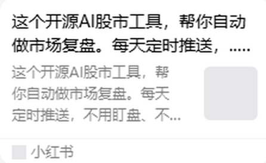
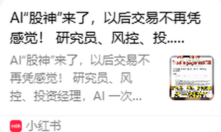
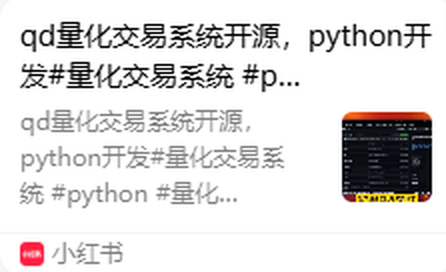
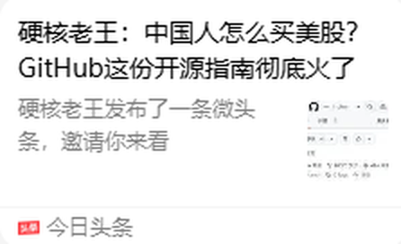

# 📈 量化与投资（8）

[⬅ 返回首页](../README.md)

## 目录

- [量化交易](#量化交易)（7）
- [美股与投资](#美股与投资)（1）

## 量化交易

- 🔗 **[近十年量化交易领域最重要的十本参考书是哪些？](https://www.zhihu.com/question/23857983/answer/1944419712495748317)**  
  `2026-08-27` · 知乎  
  知乎问答（卧龙投资笔记的回答），推荐量化交易参考书。  
  

- 🔗 **[量化交易是否快走到尽头了？](https://www.zhihu.com/question/271035214/answer/2027055311538729803)**  
  `2026-08-27` · 知乎  
  知乎问答（Insist 的回答），讨论量化交易的前景。  
  

- 🔗 **[有独立开发完成一个量化系统开发的人吗？](https://www.zhihu.com/question/35977425/answer/2870343463)**  
  `2026-08-27` · 知乎  
  知乎问答（陈跃辉的回答），讲独立开发量化系统的经验。  
  

- 🔍 **[开源 AI 股市工具，自动做市场复盘并定时推送](https://www.xiaohongshu.com/search_result?keyword=%E5%BC%80%E6%BA%90%20AI%20%E8%82%A1%E5%B8%82%E5%B7%A5%E5%85%B7%EF%BC%8C%E8%87%AA%E5%8A%A8%E5%81%9A%E5%B8%82%E5%9C%BA%E5%A4%8D%E7%9B%98%E5%B9%B6%E5%AE%9A%E6%97%B6%E6%8E%A8%E9%80%81)**  
  `2026-08-06` · 小红书  
  一个开源 AI 股市复盘工具，每天定时推送。  
  

- 🔍 **[AI 帮你省掉 90% 的量化开发时间：Quantskills](https://www.xiaohongshu.com/search_result?keyword=AI%20%E5%B8%AE%E4%BD%A0%E7%9C%81%E6%8E%89%2090%25%20%E7%9A%84%E9%87%8F%E5%8C%96%E5%BC%80%E5%8F%91%E6%97%B6%E9%97%B4%EF%BC%9AQuantskills)**  
  `2026-08-06` · 小红书  
  Quantskills 收集了大量可被 AI 调用的量化 skills 和 agent。  
  

- 🔍 **[AI“股神”来了：研究员、风控、投资经理多 Agent 协作](https://www.xiaohongshu.com/search_result?keyword=AI%E2%80%9C%E8%82%A1%E7%A5%9E%E2%80%9D%E6%9D%A5%E4%BA%86%EF%BC%9A%E7%A0%94%E7%A9%B6%E5%91%98%E3%80%81%E9%A3%8E%E6%8E%A7%E3%80%81%E6%8A%95%E8%B5%84%E7%BB%8F%E7%90%86%E5%A4%9A%20Agent%20%E5%8D%8F%E4%BD%9C)**  
  `2026-07-26` · 小红书  
  多 Agent 模拟研究员、风控和投资经理做交易决策的项目。  
  

- 🔍 **[qd 量化交易系统开源，Python 开发](https://www.xiaohongshu.com/search_result?keyword=qd%20%E9%87%8F%E5%8C%96%E4%BA%A4%E6%98%93%E7%B3%BB%E7%BB%9F%E5%BC%80%E6%BA%90%EF%BC%8CPython%20%E5%BC%80%E5%8F%91)**  
  `2026-07-25` · 小红书  
  开源的 Python 量化交易系统 qd。  
  

<a href="#目录">⬆ 回到本页目录</a> · <a href="../README.md">⬅ 首页</a>

## 美股与投资

- 🔍 **[硬核老王：中国人怎么买美股？GitHub 这份开源指南火了](https://so.toutiao.com/search?keyword=%E7%A1%AC%E6%A0%B8%E8%80%81%E7%8E%8B%EF%BC%9A%E4%B8%AD%E5%9B%BD%E4%BA%BA%E6%80%8E%E4%B9%88%E4%B9%B0%E7%BE%8E%E8%82%A1%EF%BC%9FGitHub%20%E8%BF%99%E4%BB%BD%E5%BC%80%E6%BA%90%E6%8C%87%E5%8D%97%E7%81%AB%E4%BA%86)**  
  `2026-07-10` · 今日头条  
  GitHub 上的中国人买美股开源指南。  
  

<a href="#目录">⬆ 回到本页目录</a> · <a href="../README.md">⬅ 首页</a>

